# Structure of online book reviews: gold-set findings (Phase A)

*Analysis of `data/review_sentence_annotations.tsv` — 1,152 human-annotated reviews, 11,634 sentences. Companion to [ANALYSIS_PLAN.md](../ANALYSIS_PLAN.md); code in [src/](../src/).*

This is the complete Phase A pass — occurrence, co-occurrence, contiguity, order, typology clustering, genre/platform stratification, book/author/reviewer similarity, temporality, and ratings — run on the trusted human-annotated (gold) set only. It does not yet touch the 670K-review model-predicted (silver) set — that's Phase C, gated on the correction pipeline (Phase B) described in the plan. Nothing here is affected by model error or the `WEAK_MODEL_LABELS`/`FICTION_GENRES` exclusions, since gold labels are human annotations, not predictions.

## 1. Occurrence: prevalence & multiplicity

*↔ [Phase C: §1. Occurrence](report_phase_c.md#occurrence-does-correction-help-and-does-it-replicate)*

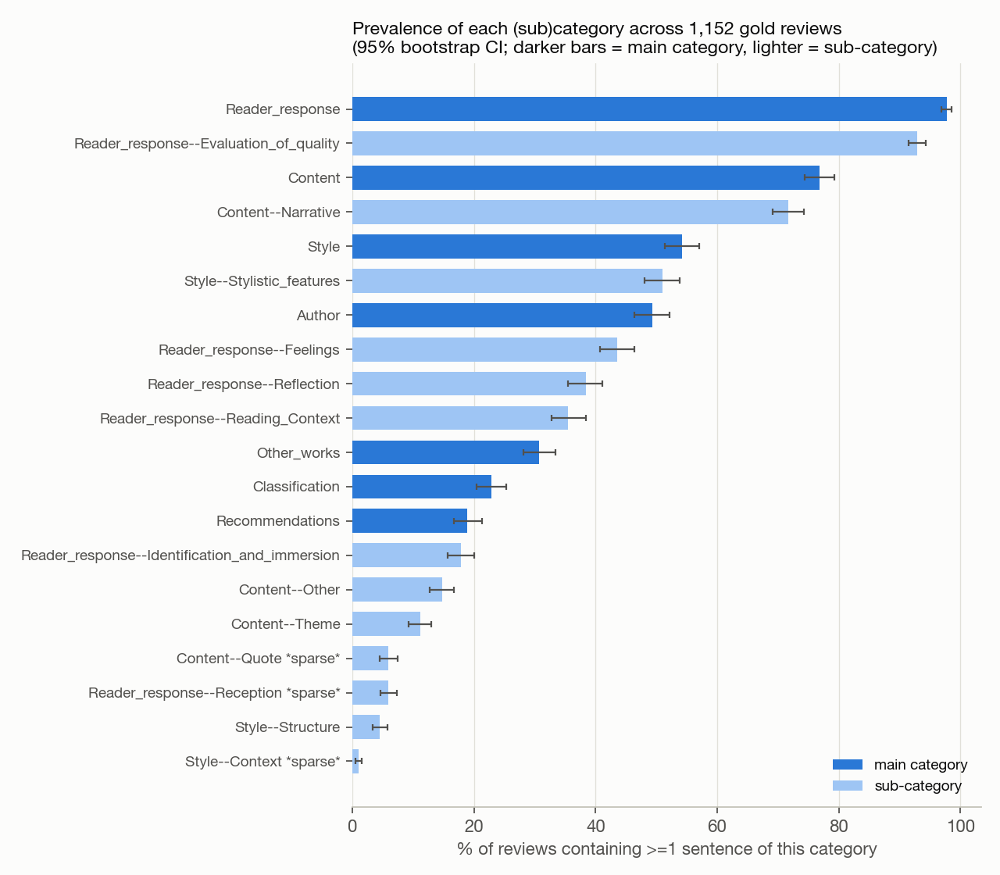

Nearly every review (97.7%) contains at least one Reader_response sentence, and most (76.8%) contain Content — these two are the backbone of the corpus. Everything else is optional and much more variable: Style appears in about half of reviews (54.3%), Author in about half (49.3%), and several sub-categories are rare enough (`Style--Context` 1.0%, `Style--Structure` 4.5%, `Content--Quote` 5.9%, `Reader_response--Reception` 5.9%) that they're flagged `sparse_gold_flag` and should be read as case studies, not as estimates with real statistical weight.

Multiplicity (how many sentences a review devotes to a category, once it's present at all) tells a different story than prevalence — and the mean alone can be misleading here, since multiplicity is itself right-skewed (a few reviews return to a topic many times, most don't). The median-alongside-mean columns below make that concrete: `Content--Quote` has low prevalence (5.9%) but the highest multiplicity of any label (mean 4.97 sentences, median 3) — when a review quotes the book, it tends to quote it several times, not once. By contrast, `Recommendations` and `Classification` are typically single-sentence asides (median 1) even when present, despite means of 1.11 and 1.30 that make them look marginally more expansive than they typically are. `Content` shows the largest absolute mean/median gap (7.00 vs. 4) of any common label — a minority of reviews with very extended synopses pull the mean well above what a typical review actually does; `Reader_response--Reflection` shows the largest *relative* gap among common labels (mean 2.26 vs. median 1 — more than double), a handful of unusually reflective reviews aside, most reviews that touch on reflection do it in exactly one sentence.

Full table: [results/01_occurrence/gold_occurrence.csv](../results/01_occurrence/gold_occurrence.csv).

| label | prevalence | 95% CI | mean sentences when present | median |
|---|---|---|---|---|
| Reader_response | 97.7% | [96.9%, 98.5%] | 5.15 | 4 |
| Reader_response--Evaluation_of_quality | 93.0% | [91.5%, 94.4%] | 2.97 | 2 |
| Content | 76.8% | [74.4%, 79.3%] | 7.00 | 4 |
| Content--Narrative | 71.7% | [69.2%, 74.3%] | 6.46 | 4 |
| Style | 54.3% | [51.4%, 57.0%] | 1.78 | 1 |
| Style--Stylistic_features | 51.0% | [48.0%, 53.8%] | 1.64 | 1 |
| Author | 49.3% | [46.4%, 52.2%] | 2.34 | 2 |
| Reader_response--Feelings | 43.6% | [40.7%, 46.4%] | 1.55 | 1 |
| Reader_response--Reflection | 38.4% | [35.4%, 41.2%] | 2.26 | 1 |
| Reader_response--Reading_Context | 35.4% | [32.8%, 38.4%] | 1.48 | 1 |
| Other_works | 30.7% | [28.1%, 33.4%] | 1.73 | 1 |
| Classification | 22.8% | [20.4%, 25.3%] | 1.30 | 1 |
| Recommendations | 18.9% | [16.7%, 21.3%] | 1.11 | 1 |
| Reader_response--Identification_and_immersion | 17.8% | [15.6%, 20.1%] | 1.56 | 1 |
| Content--Other | 14.8% | [12.7%, 16.8%] | 1.52 | 1 |
| Content--Theme | 11.1% | [9.3%, 13.0%] | 1.34 | 1 |
| Content--Quote *(sparse)* | 5.9% | [4.5%, 7.4%] | 4.97 | 3 |
| Reader_response--Reception *(sparse)* | 5.9% | [4.6%, 7.3%] | 1.22 | 1 |
| Style--Structure | 4.5% | [3.3%, 5.8%] | 1.12 | 1 |
| Style--Context *(sparse)* | 1.0% | [0.4%, 1.6%] | 1.00 | 1 |

## 2. Co-occurrence

*↔ [Phase C: §2. Co-occurrence](report_phase_c.md#co-occurrence)*

Two complementary views: **sentence-level** (do two categories get marked on the exact same sentence?) and **review-level** (do two categories tend to show up somewhere in the same review, beyond what review length alone would predict?). Both exclude the trivial parent/child pairs (a sub-category being active essentially forces its parent to be active too — that's definitional, not a finding).

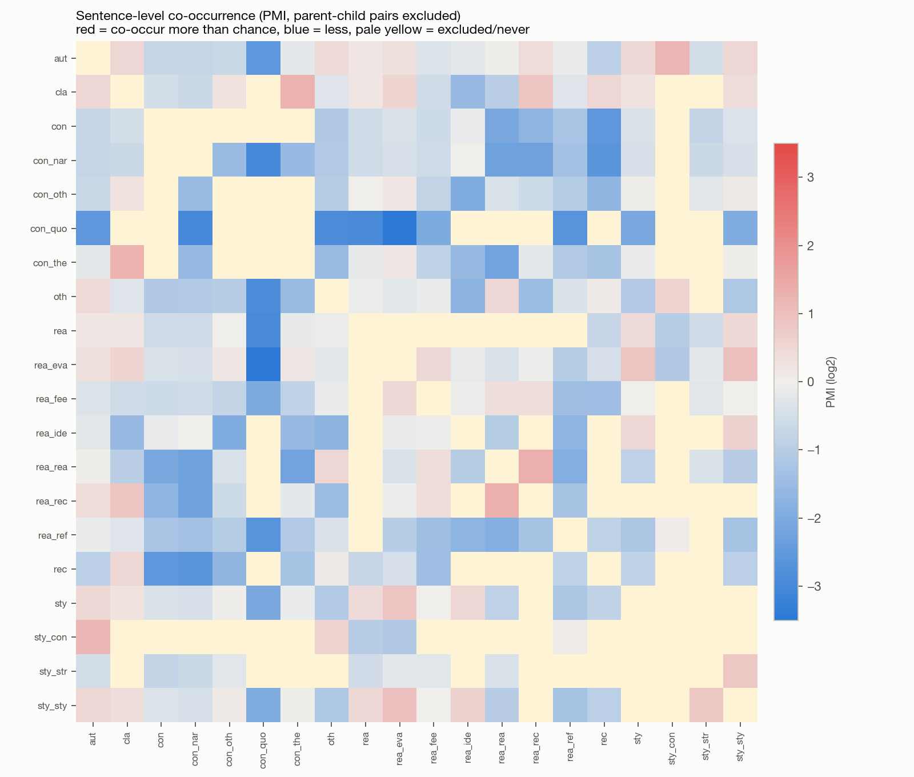

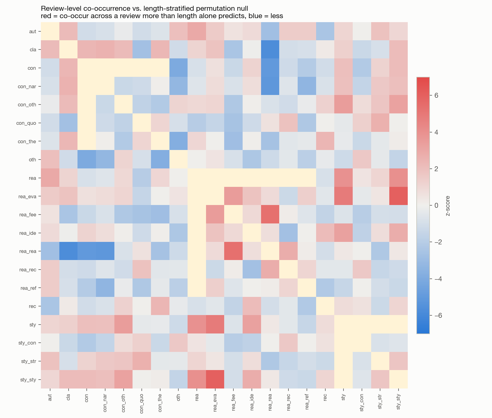

**Strongest positive associations** — `Style--Stylistic_features` and `Reader_response--Evaluation_of_quality` co-occur far more than chance both within single sentences (PMI 0.96, i.e. ~1.9× more often than independence predicts) and across whole reviews (z = 5.98): style commentary and quality judgment are frequently the same move ("the writing style makes this a strong book"). `Reader_response--Feelings` and `Reader_response--Reading_Context` pair up at the review level too (z = 5.32) — reviews that describe *when/how* they read a book also tend to describe how it made them *feel*.

**Strongest negative associations (avoidance)** — `Content` and `Reader_response--Reading_Context` avoid each other at the review level (z = −5.03), as do `Content--Narrative` and `Classification` (z = −5.71) and `Content` and `Other_works` (z = −4.02). At the sentence level, `Content--Quote` avoids nearly everything else (most negative PMI values in the matrix involve it) — quoting the book is a distinct, self-contained move that doesn't blend with commentary in the same sentence.

The pattern worth flagging for the typology question (§6 in the plan): synopsis-heavy content and reflective/contextual reader-response repeatedly repel each other, while style and evaluation repeatedly attract. That's an early hint that reviews cluster into something like "plot-focused" vs. "response-focused" types.

**Is the sentence-level PMI itself confounded by review length? Checked, and the pooled estimate is real but disproportionately a long-review estimate.** Review-level co-occurrence was already length-controlled (its permutation null is stratified by length bin), but the flat sentence-level PMI above pools every sentence regardless of which review it came from — and a longer review contributes more sentences to that pool, so the pooled estimate implicitly weights toward long-review behavior. Splitting sentence-level PMI into length quartiles confirms it: the full-corpus PMI correlates with each quartile's *own* PMI at only **r=0.72 for the shortest quartile, rising to r=0.97 for the longest** (70 well-powered pairs, n_both≥20) — the pooled number is a much better description of what happens in long reviews than short ones. The strongest pairs don't flip sign anywhere (11/70 well-powered pairs do, all among the weaker associations), but several show a real magnitude gradient rather than just noise: this section's own headline pair, `Style--Stylistic_features`/`Reader_response--Evaluation_of_quality`, strengthens steadily from PMI 0.43 in the shortest quartile to 1.17 in the longest — nearly tripling — so "style and evaluation repeatedly attract" is, more precisely, an attraction that gets *stronger* as a review has more room to develop it. Full tables: [results/02_cooccurrence/gold_cooccurrence_sentence_by_length.csv](../results/02_cooccurrence/gold_cooccurrence_sentence_by_length.csv), [results/02_cooccurrence/gold_cooccurrence_sentence_length_corr.csv](../results/02_cooccurrence/gold_cooccurrence_sentence_length_corr.csv).

Full tables: [results/02_cooccurrence/gold_cooccurrence_sentence.csv](../results/02_cooccurrence/gold_cooccurrence_sentence.csv), [results/02_cooccurrence/gold_cooccurrence_review.csv](../results/02_cooccurrence/gold_cooccurrence_review.csv).

## 3. Contiguity

*↔ [Phase C: §3. Contiguity](report_phase_c.md#contiguity)*

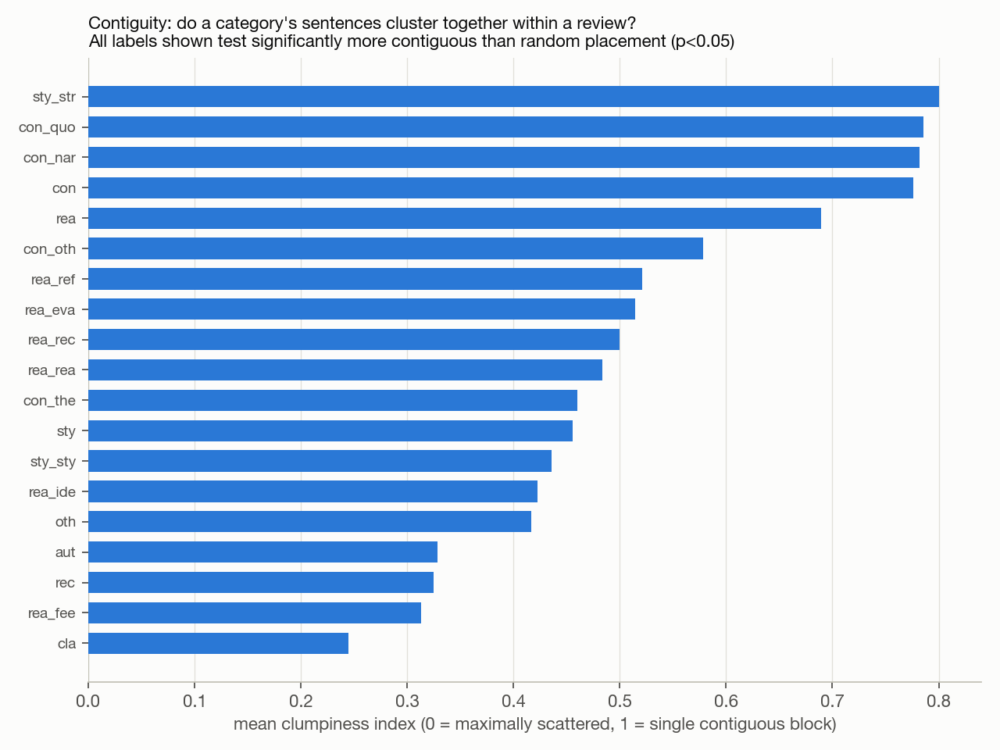

For every category, when it shows up more than once in a review, **it clusters into one block rather than being scattered through the review** — every single testable label comes out significantly more contiguous than random placement would produce (all p < 0.05, most p < 0.001). This isn't a marginal effect: `Content--Narrative`, `Content`, and `Content--Quote` all score above 0.78 on the 0–1 clumpiness index (1.0 = one unbroken block), meaning when a review discusses plot or quotes the book, it does so in one sustained passage rather than returning to it repeatedly. Even the lowest-scoring label, `Classification` (0.24), is still clearly more contiguous than chance (z = −2.26).

This is a real structural property of how these reviews are written: reviewers write in topic blocks, not free association. It also validates a modeling choice for later work — a review can reasonably be segmented into a small number of contiguous "zones" (synopsis zone, style zone, verdict zone) rather than needing to model every sentence independently.

Full table: [results/03_contiguity/gold_contiguity_label_summary.csv](../results/03_contiguity/gold_contiguity_label_summary.csv) (label-level); [results/03_contiguity/gold_contiguity_detail.csv](../results/03_contiguity/gold_contiguity_detail.csv) (every review×label pair, for anyone who wants to look at individual reviews).

### Is an individual review block-structured, or does it alternate?

New question (chat, 2026-08-31) — everything above is **per-label, pooled across reviews** ("does category X form one block, corpus-wide?"). That leaves the review-level question unanswered: does a *given* review keep each of its categories in one block, or does it alternate between them (A→B→A)? `src/19a_review_contiguity_precedence.py`.

One design constraint settled this before it was designed: the obvious approach — writing each review as a string of category symbols — **doesn't work on this data**, because 31.7% of sentences carry two or more main labels simultaneously (66 distinct label-sets occur), so there is no single "current category" per sentence. The measure therefore uses **per-label binary tracks**: each review scores the k-weighted mean of its own per-label clumpiness, over only those categories appearing on **≥2 sentences** — a category appearing once is trivially one run and carries no information about organization, and including such cases would inflate every score toward 1. That restriction, plus requiring ≥2 such categories (otherwise "alternates *between* categories" is undefined) and ≥3 sentences, leaves **696 of 1,152 reviews** eligible. The null permutes **sentence order within the review** — one joint shuffle across all labels at once, preserving every category's count *and* the co-occurrence structure between categories, which matters precisely because labels are far from independent here.

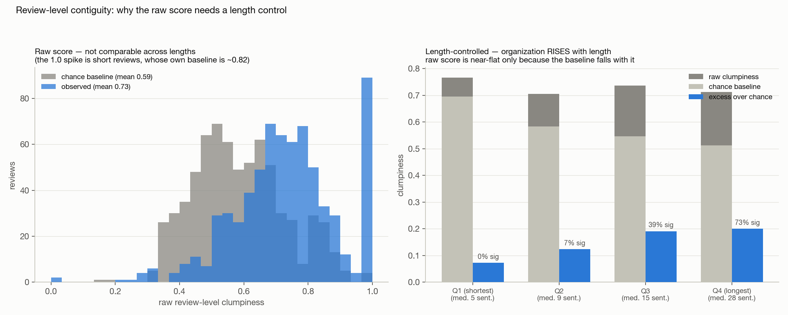

**Individual reviews are block-structured, and strikingly one-directionally so.** Mean review-level clumpiness is **0.73 against a null of 0.59**, with 196 of 696 reviews (28%) significantly more blocked than chance at q<0.05 — and **not a single review significantly more *alternating* than chance**. Reviewers who deviate from random ordering deviate only toward organization, never away from it. So §3's corpus-level finding isn't an aggregation artifact that could have been produced by many individually-messy reviews averaging out — the organization is present review by review. (Method check: this reproduces §3's published per-review×label clumpiness exactly, max absolute difference 5×10⁻⁵ across 2,406 review×label pairs, i.e. rounding only.)

**The raw score is not comparable across review lengths, and reading it as if it were gets the length story exactly backwards** (correction applied 2026-08-31, after an earlier draft of this section over-read the raw distribution). The left panel above has a pronounced spike at exactly 1.0, which looks like strong evidence of organization but isn't: those 89 reviews have a **median of 5 sentences and 2 eligible categories, and their own chance baseline is already 0.82** — with a category on just 2 sentences, clumpiness is binary (adjacent → 1.0) and in a 5-sentence review two sentences are adjacent most of the time by luck. Only 11 of those 89 are significant. The fix is to compare each review against *its own* baseline: **excess over chance = observed − null**.

| length quartile | median sentences | raw clumpiness | chance baseline | **excess over chance** | % significant |
|---|---|---|---|---|---|
| Q1 (shortest) | 5 | 0.766 | 0.695 | **0.072** | 0% |
| Q2 | 9 | 0.706 | 0.583 | **0.123** | 7% |
| Q3 | 15 | 0.737 | 0.546 | **0.191** | 39% |
| Q4 (longest) | 28 | 0.712 | 0.512 | **0.200** | 73% |

Raw clumpiness is near-flat across lengths (ρ=−0.11) — but only because **the chance baseline falls steeply** (ρ=−0.46) while the observed score doesn't. The length-controlled measure therefore *rises* substantially: **ρ=+0.33 (p=8×10⁻¹⁹), with longer reviews showing nearly three times the excess organization of short ones**. This is the same shape of problem §8 documents for temporal trends — a measure moving with length for mechanical reasons — and the same resolution: length here is not a nuisance to net out but a substantive dimension in its own right (§9), and the substantive finding is that **longer reviews are more organized, not merely longer**.

Two things the significance column does *not* show, worth separating: the 0%→73% gradient is partly this real effect and partly **statistical power** — a 5-sentence review's permutation null is coarse (few distinct orderings, most scoring near 1.0), so it cannot clear significance almost regardless of how organized it is. Read the excess column as the effect size and the significance column as detectability. (4 reviews, all n≤5, have a fully degenerate null — every permutation scores identically — and are flagged rather than silently scored.) Full tables: [results/19_review_contiguity_precedence/gold_review_contiguity.csv](../results/19_review_contiguity_precedence/gold_review_contiguity.csv), [results/22_review_contiguity_scaled/gold_review_contiguity_by_length.csv](../results/22_review_contiguity_scaled/gold_review_contiguity_by_length.csv).

### Two more views of the same review: boundaries and interleaving

The measure above averages each category's *own* block quality. Two complementary measures ask the question differently (`src/20a_contiguity_zones.py`); both use the same joint sentence-order permutation null and are reported as excess over that null, per the convention above.

**Configuration boundaries** count how often the *active label-set* changes from one sentence to the next, normalized against the fewest changes the review's own set of configurations would allow and the most (every sentence differing). This treats the review as a segmentation problem rather than a per-label one — and it's legitimate despite the multi-label complication, because it only ever compares adjacent sentences for equality, never treating the 66 observed label-sets as a modelling alphabet. **Mean 0.656 against a null of 0.491 (excess +0.166)** across 865 scorable reviews — the same conclusion as the per-label measure, reached independently. (96 reviews are unscorable because every sentence has a distinct configuration, which forces the boundary count and leaves the score undefined; flagged rather than imputed.)

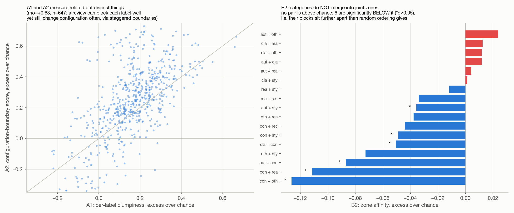

The two measures correlate at **ρ=+0.63 — related, but far from redundant**, which is itself the informative part (left panel). A review can block each individual category well while still changing configuration often, if the blocks' *boundaries* are staggered rather than aligned: `Content` running sentences 1–6 and `Reader_response` running 4–9 gives each label one clean block but three configuration changes. The gap between the two measures is exactly that staggering.

**Pairwise interleaving** asks, for each pair of categories both appearing on ≥2 sentences, whether they occupy distinct stretches or alternate. Walking only the sentences carrying exactly one of the two (sentences carrying *both* are skipped rather than assigned arbitrarily, which would manufacture or hide switches), 1 switch means cleanly separated, many means A→B→A. Reported as `separation` = 1 − interleaving. **Mean 0.812 against a null of 0.700 (excess +0.112)** — categories keep to their own stretches more than chance. By pair, the strongest separation among well-powered pairs is `Content`/`Reader_response` (+0.174, n=477), consistent with them anchoring opposite ends of the arc; the weakest are `Reader_response`/`Style` (+0.052) and `Classification`/`Reader_response` (+0.041, n.s.) — pairs that genuinely intermix. Full tables: [results/20_contiguity_zones/gold_review_boundary_interleaving.csv](../results/20_contiguity_zones/gold_review_boundary_interleaving.csv), [results/20_contiguity_zones/gold_pair_interleaving.csv](../results/20_contiguity_zones/gold_pair_interleaving.csv).

## 4. Order

*↔ [Phase C: §4. Order](report_phase_c.md#order)*

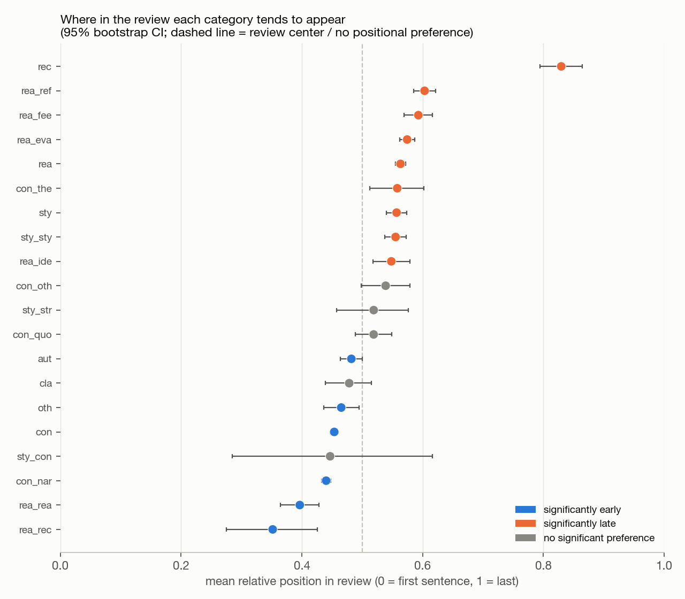

Reviews have a discernible **arc**. Early in the review (significantly before the review's midpoint): `Content--Narrative` (mean relative position 0.44), `Content` overall (0.45), `Other_works` (0.47). Late (significantly after the midpoint): `Style` (0.56), `Reader_response` overall (0.56), `Evaluation_of_quality` (0.57), `Feelings` (0.59), `Reflection` (0.60). And **`Recommendations` is the outlier of the whole dataset** — mean relative position 0.83, essentially the last thing a review does. This is exactly the "synopsis, then response, then verdict" structure a reader would expect from a book review, now measured rather than assumed.

**Three refinements on the mean-position measure** (chat, 2026-09-22), because a label's own multiplicity per review distorts it two different ways:

- *Significance.* The bootstrap CI originally resampled individual sentences, which treats multiple same-review sentences of one label as independent draws when they're correlated (`Content` averages 7.1 sentences/review). Switching to a cluster bootstrap — resampling `review_id`s instead of sentences — widens the CI for exactly the labels that recur most, and flips one flag: `Author`'s apparent early skew (mean 0.48) is *not* statistically distinguishable from center once that correlation is accounted for (CI now [0.463, 0.502], was [0.464, 0.500]) — it's dropped from the "significantly early" list above. `Content`, with 866 review-groups rather than a few reviews carrying most of the mass, is essentially unaffected by the correction.
- *Compression toward 0.5.* Independent of significance, a label used many times per review has its own scattered instances averaged toward the center of wherever they span, pulling the *pooled* mean toward 0.5 regardless of how early/late it actually skews — a label mentioned once per review carries no such internal averaging. Two statistics sidestep this: tail mass and onset (`results/04_order/gold_order_onset.csv`, exactly one first/last position per review regardless of recurrence). By tail mass, `Content` is genuinely front-loaded — 21.6% of its sentences fall in the review's first fifth vs. 13.2% in the last — with a first mention at 0.21 on average and a last at 0.76, confirming it runs through most of the review rather than clustering near one point. `Author`, despite its near-center mean, has *more* mass in the front fifth than the back (29.2% vs. 23.7%) — and both sit well above the 20% a uniform spread across five equal bands would predict, consistent with two distinct uses (an early biographical aside, a later "recommended if you like this author" note) rather than one genuine central tendency, with the early use somewhat more common than the late one.
- *Length.* Pooling all review lengths together can hide length-dependent structure. Recomputing positional density within length quartiles (`results/04_order/gold_order_position_by_length.csv`) surfaces one outright reversal: `Classification`'s mean position drifts from **0.32** in the shortest quartile (2–4 sentences) to **0.54** in the longest (15+) — early-skewing in short reviews, late-skewing in long ones, a sign flip the pooled estimate (0.48, "no preference") erases completely. `Reader_response` and `Style` shift substantially in magnitude (0.49→0.62 and 0.46→0.60) while keeping the same late direction throughout; `Content` and `Recommendations` are comparatively stable across quartiles, so the pooled estimate is more trustworthy for those two specifically.

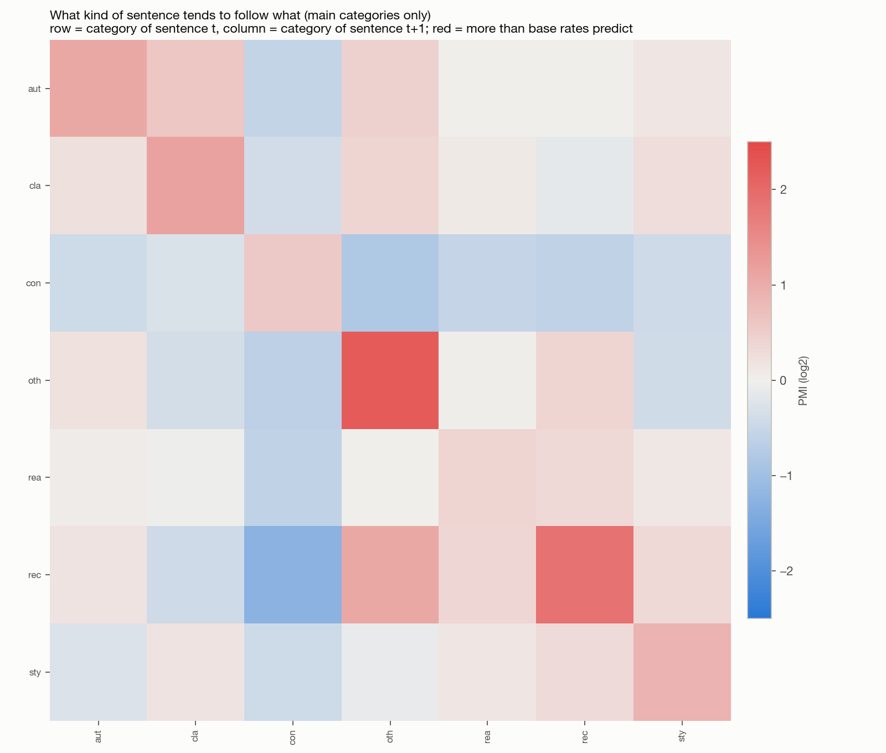

The transition structure confirms §3 from a different angle: every main category has a strongly positive self-transition PMI (`Other_works`→`Other_works` PMI 2.22, `Recommendations`→`Recommendations` 1.87, `Classification`→`Classification` 1.15, `Author`→`Author` 1.06) — categories persist from one sentence to the next far more than base rates would predict, which is just contiguity restated as a Markov property. The more interesting cross-category signal: `Author`→`Classification` (PMI 0.59) and `Recommendations`↔`Other_works` (PMI ~1.06/0.38 both directions) suggest that discussing the author's background often leads into genre/classification remarks, and that recommendation sentences often sit next to comparisons with other works ("if you liked X, try this").

Full tables: [results/04_order/gold_order_position.csv](../results/04_order/gold_order_position.csv), [results/04_order/gold_order_onset.csv](../results/04_order/gold_order_onset.csv), [results/04_order/gold_order_position_by_length.csv](../results/04_order/gold_order_position_by_length.csv), [results/04_order/gold_order_transitions.csv](../results/04_order/gold_order_transitions.csv), [results/04_order/gold_order_transition_matrix.csv](../results/04_order/gold_order_transition_matrix.csv) (wide, raw counts).

### Do categories have a *fixed* pairwise order?

New question (chat, 2026-08-31), and a sharper one than the arc above can answer. The mean positions reported above are **marginal** — averaged across all reviews — which cannot establish that two categories reliably order the same way *within* a review. Two categories can have near-identical marginal means while one consistently precedes the other whenever both appear (or while their relative order is pure coin-flip). The paired version: among reviews containing **both** A and B, how often does A's mean position precede B's? Because it compares A and B inside the same review, review-specific composition cancels out. Main labels only, BH-corrected across the 21 pairs. `src/19a_review_contiguity_precedence.py`.

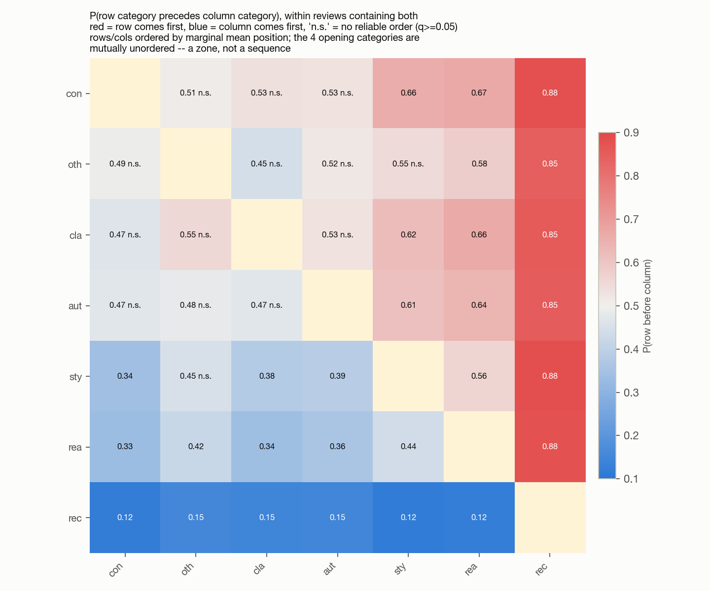

**14 of 21 pairs have a reliable order — and the 7 that don't are almost exactly one coherent group.** All six pairs among `Content`, `Other_works`, `Classification`, and `Author` are non-significant (P(before) between 0.47 and 0.55, every q>0.28); the only other non-significant pair is `Other_works`/`Style`. Meanwhile *every* cross-group pair is significantly ordered. That is the signature of a **zone rather than a sequence**: these four categories reliably come early, but carry no fixed order among themselves — a review can open with plot, with the author, with genre classification, or with a comparison to other books, and which one comes first is not conventionalized.

The resulting structure, derived from pairwise tests rather than read off marginal averages:

| zone | categories | internal order |
|---|---|---|
| 1. Opening | `Content`, `Other_works`, `Classification`, `Author` | none — all 6 internal pairs unordered |
| 2. Middle | `Style`, `Reader_response` | weak but reliable (`Style` before `Reader_response`, P=0.56, q=0.009) |
| 3. Closing | `Recommendations` | — |

`Recommendations` is the most rigidly-placed category in the corpus: it comes last against **every** other category, at P=0.85–0.88 in all six pairs (all q<10⁻⁶). This upgrades §11's "review arc" from an informal reading of marginal averages into a tested structure — and refines it, since the opening is genuinely a zone, not the ordered "synopsis → author → classification" progression the marginal means alone might suggest. Full table: [results/19_review_contiguity_precedence/gold_pairwise_precedence.csv](../results/19_review_contiguity_precedence/gold_pairwise_precedence.csv).

### Do paired categories actually merge into one stretch? No — and that qualifies the word "zone"

Precedence establishes that the four opening categories have no fixed order among themselves. It does *not* establish that they form one contiguous **block** — two categories can be positionally co-located while still occupying separate stretches. The direct test (`src/20a_contiguity_zones.py`, and distinct from §4's transition PMI, which is a local sentence-to-sentence measure): treat A∪B as a single pseudo-category and ask whether merging them *adds* contiguity relative to what A's and B's own individual block quality would give. Strongly positive would mean one shared zone — including the case where two individually-scattered categories together fill one stretch, since A→B→A→B is a zone even though neither label is blocked on its own.

Crucially this needs its own null, for the same reason the review-level measure did: **merging any two categories raises clumpiness mechanically** (bigger k, fewer possible runs), so a positive raw affinity means nothing by itself. Against the permutation null (right panel above):

**No pair merges into a joint zone above chance — and six pairs are significantly *below* chance**, meaning their blocks sit further apart than random ordering would place them: `Content`+`Other_works` (−0.126, q=9×10⁻¹¹), `Content`+`Reader_response` (−0.112, q=10⁻⁶²), `Author`+`Content` (−0.087, q=7×10⁻²⁰), `Classification`+`Content` (−0.051), `Content`+`Style` (−0.049), `Author`+`Style` (−0.035). The measure was built to find zones and found the opposite: **active separation**. That agrees with the interleaving measure computed independently in §3 (across the 17 shared pairs, separation excess and zone affinity correlate at ρ=−0.49, p=0.047 — more separated, less merged), which is reassuring since the two were designed to answer different questions.

**So "zone" in the precedence sense above means *positional co-location*, not *contiguity merging*** — and the distinction matters most exactly where it was introduced. Within the four-category opening group, the three pairs involving `Content` are all significantly anti-merged, while the three pairs *not* involving `Content` (`Author`+`Classification`, `Author`+`Other_works`, `Classification`+`Other_works`) are indifferent — neither merged nor separated beyond chance. **`Content` keeps its own stretch even among the categories it shares an opening position with.** The opening is better described as several distinct blocks that all sit early, in no fixed order, than as one undifferentiated opening passage. Full table: [results/20_contiguity_zones/gold_pair_zone_affinity.csv](../results/20_contiguity_zones/gold_pair_zone_affinity.csv).

### Deriving the zones formally

The groupings above were read off which pairs are and aren't significantly ordered. The formal version clusters the precedence structure directly (`src/21a_zone_discovery.py`), using distance `d(A,B) = 2 × |P(A before B) − 0.5|` — zero when two categories have no reliable order, one when one always precedes the other — with average-linkage hierarchical clustering. Precedence is the right input rather than zone affinity, for two reasons: the zone-affinity result above is a null, so clustering it would cluster noise; and precedence covers all 21 pairs where the contiguity measures cover only 17.

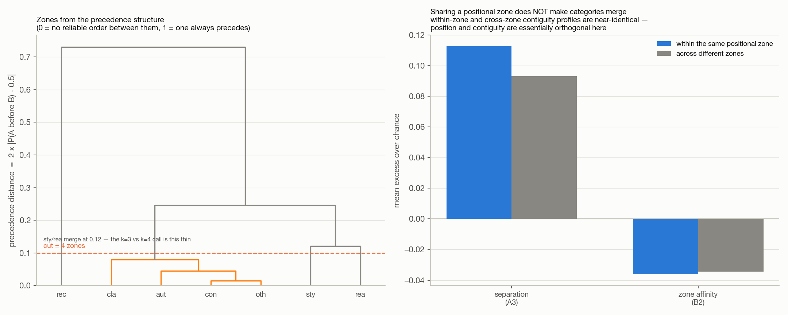

**Choosing the number of zones needed a criterion other than the obvious one.** Silhouette picks k=2 — a degenerate split isolating `Recommendations` from everything else, which leaves 8 significantly-ordered pairs sitting inside one "zone." Silhouette measures cluster separation, not whether a partition respects the ordering structure, and here those come apart. The criterion actually matching the construct: a good zone partition should have **few within-zone pairs that *are* significantly ordered** (those zones should split) and **few between-zone pairs that are *not*** (those should merge).

| k | silhouette | within-zone but ordered | between-zone but unordered | total errors |
|---|---|---|---|---|
| 2 | 0.669 | 8 | 0 | 8 |
| 3 | 0.567 | 1 | 1 | 2 |
| **4** | 0.393 | **0** | **1** | **1** |
| 5 | 0.211 | 0 | 4 | 4 |

**k=4 wins, giving: {`Content`, `Other_works`, `Classification`, `Author`} → {`Style`} → {`Reader_response`} → {`Recommendations`}** — with zero within-zone ordered pairs. The single remaining error is `Other_works`/`Style`, which sits across a zone boundary without a reliable order; `Other_works` is a genuine boundary case.

**The k=3 alternative deserves stating, because the margin is one error.** At k=3, `Style` and `Reader_response` group together (the arc's familiar three-part shape). They split at k=4 only because `Style` precedes `Reader_response` at P=0.56 — statistically significant on n=548 reviews but a *trivially small* ordering, and the dendrogram shows them merging at distance 0.12, far below any other join. By this report's own repeated convention of preferring effect size to significance, k=3 is the more defensible reading of the same data; k=4 is what the mechanical criterion selects. Both are reported rather than one being quietly chosen.

*(Resolved by Phase C: at silver scale k=3 wins outright with **zero** consistency errors — `Style` before `Reader_response` stays too small an ordering to separate them even at n=227,570, and `Other_works`/`Style`, the boundary anomaly above, resolves cleanly. The effect-size reading was the right one.)*

**Finally, the zones are positional through and through.** Comparing pairs *within* a zone against pairs *across* zones on the contiguity measures (right panel): separation excess is +0.113 within vs. +0.093 across, and zone affinity is −0.036 within vs. −0.034 across. **Near-identical — sharing a positional zone makes categories no more merged than being in different zones.**

*(Superseded in part by Phase C, §4 of [report_phase_c.md](report_phase_c.md): at 400× the sample the two do separate — within-zone separation +0.051 vs. +0.106 across, affinity −0.019 vs. −0.037 — so the stronger claim these numbers originally supported, that position and contiguity are essentially **orthogonal**, was over-read from gold's smaller sample. What holds at both scales is the qualitative point: within-zone affinity stays negative, so categories sharing a positional zone still do not merge into a shared stretch. Phase C also settles the k=3 vs k=4 question below, in favour of k=3.)* Only zone 1 has multiple members, so it is the only zone this comparison can be computed for; and `Recommendations` — the most rigidly ordered category of all — is invisible to the contiguity side entirely, since it is usually one sentence long. Full tables: [results/21_zone_discovery/gold_zone_membership.csv](../results/21_zone_discovery/gold_zone_membership.csv), [results/21_zone_discovery/gold_zone_profile.csv](../results/21_zone_discovery/gold_zone_profile.csv).

## 5. Review typology

*↔ [Phase C: §5. Review typology](report_phase_c.md#review-typology)*

Two independent clusterings of the 1,152 reviews, cross-checked against each other:

- **Compositional** — KMeans on each review's standardized main-category sentence proportions (Author, Classification, Content, Other_works, Reader_response, Recommendations, Style) plus its proportion of unlabeled sentences. Answers "what does this review spend its sentences on."
- **Sequence-based** — KMeans on each main category's *onset* (first-occurrence) position *within* reviews that contain it (categories absent from a review are imputed with the corpus-wide onset marginal from §4, not an arbitrary constant). Answers "where in the review do things happen," independent of how much of each thing there is.

*Onset rather than mean position (chat, 2026-09-22)*: a category recurring many times in one review gets its mean position smoothed toward that review's local center almost by construction, which after standardization injects noise weighted equally with genuine signal — worst for the categories most reviews discuss most (`Content`, `Reader_response`). Prototyped before adopting: onset gives a markedly cleaner sequence clustering (silhouette nearly doubles at k=2) and a *lower* correlation with review length than the mean-position version did, so it replaced it everywhere position feeds a clustering or similarity test in this report (§4's own corpus-level position statistics are unaffected — this is specifically about *using* position as a clustering feature). Length-stratified imputation (matching the marginal to a review's own length quartile) was tested alongside and rejected: it leaks length into the feature space through the imputed value itself and made the confound worse, not better.

### How many clusters

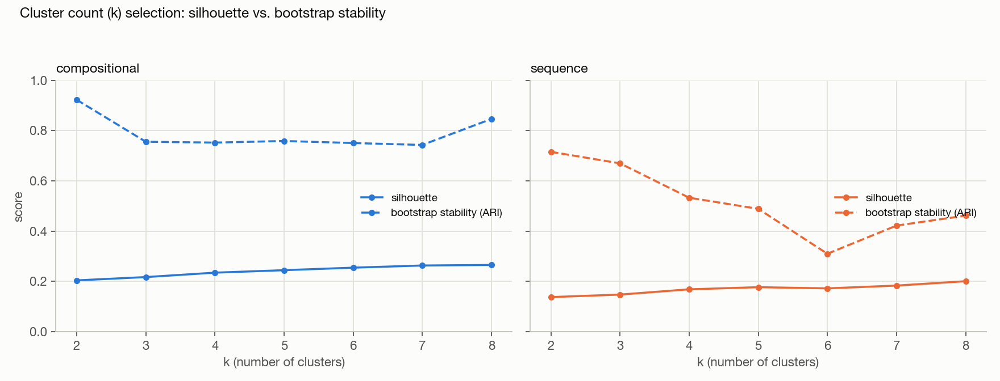

Neither clustering has a sharp "elbow" — silhouette rises gently and roughly monotonically with k for both, which is the expected signature of continuous, overlapping variation rather than a small number of hard-edged types. The most *stable* result (bootstrap resampling, agreement measured by adjusted Rand index) is actually the coarsest split, k=2, for both clusterings (compositional ARI 0.92; sequence ARI 0.86); stability dips through the middle range and recovers somewhat toward k=8. Read literally, "pick the k with the best silhouette among stable options" selects k=8 for the compositional clustering and k=3 for the sequence-based one (silhouette 0.266, stability 0.74) — those are the results characterized below — but the coarse k=2 reading is real too and worth stating first because it's the most robust:

**At k=2, reviews split into a "narrative-forward" type (46.4%, mean 15.8 / median 12.5 sentences, `Content` 0.65 / `Reader_response` 0.39) and a "response-forward" type (53.6%, mean 5.2 / median 4.0 sentences, `Content` 0.21 / `Reader_response` 0.89).** This is exactly the axis that co-occurrence (§2) and order (§4) already pointed to, now confirmed as the single strongest way the corpus actually splits.

### The finer typology (k=8)

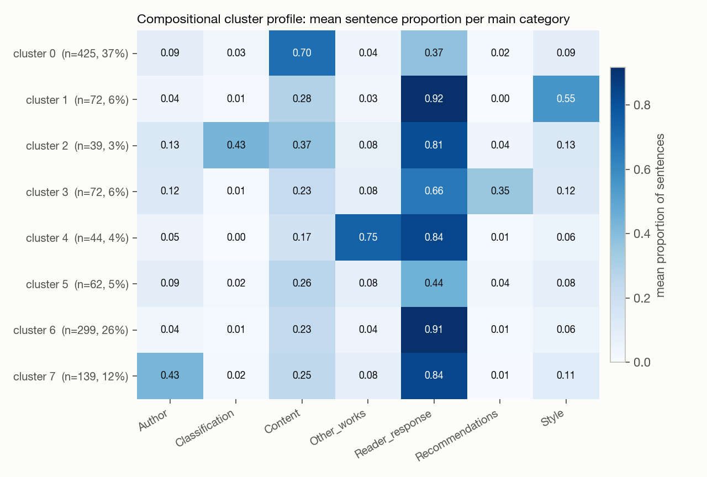

At k=8 that coarse axis resolves into eight more specific tendencies (full profile: [results/05_typology/gold_typology_cluster_profile.csv](../results/05_typology/gold_typology_cluster_profile.csv); representative opening sentences for each: [results/05_typology/gold_typology_representative_reviews.csv](../results/05_typology/gold_typology_representative_reviews.csv)):

| cluster | n (%) | mean sentences | median sentences | mean rating | reading |
|---|---|---|---|---|---|
| 0 | 425 (36.9%) | 17.2 | 14.0 | 3.61 | **Narrative-forward** — `Content` 0.70, the longest reviews in the corpus, the "default" long-form review |
| 6 | 299 (26.0%) | 6.6 | 5.0 | 3.32 | **Response-forward** — `Reader_response` 0.91, `Content` only 0.23, short |
| 7 | 139 (12.1%) | 6.2 | 4.0 | 3.31 | **Author-focused** — `Author` 0.43 (by far the highest of any cluster), still response-heavy |
| 1 | 72 (6.2%) | 3.4 | 3.0 | 3.16 | **Style-and-response, minimal plot** — `Style` 0.55, `Reader_response` 0.92, `Content` only 0.28, the shortest reviews (median 3 sentences) |
| 3 | 72 (6.2%) | 3.9 | 4.0 | **4.45** | **Recommendation-forward** — `Recommendations` 0.35 (vs. 0.02–0.08 everywhere else), skews `Children_fiction`, by far the highest average rating |
| 5 | 62 (5.4%) | 11.4 | 6.5 | 3.50 | **Mixed/moderate** — no category dominates; a genuine "blend" type rather than a distinct profile |
| 4 | 44 (3.8%) | 3.0 | 2.0 | 3.88 | **Comparison-heavy** — `Other_works` 0.75 (vs. 0.04–0.13 elsewhere), skews `Young_adult` (series/read-alike comparisons) |
| 2 | 39 (3.4%) | 3.6 | 3.0 | 3.34 | **Classification-heavy** — `Classification` 0.43 (vs. 0.01–0.13 elsewhere), skews `Historical_fiction` |

Length is the one dimension where mean and median diverge enough within a cluster to matter: cluster 5 ("mixed/moderate") has the largest gap of any cluster, mean 11.4 vs. median 6.5 — a genuinely skewed mix rather than a coherent moderate-length group, consistent with its own "no category dominates" description; a handful of long outliers are pulling its mean well above what a typical member actually looks like. Cluster 0 (narrative-forward) shows the largest *absolute* gap (17.2 vs. 14.0) simply because it's the longest cluster overall, but the *relative* gap there (1.2×) is smaller than cluster 5's (1.75×).

Two honest caveats on this finer reading. First, cluster separation is real but soft: a 2D PCA projection of the same review vectors (below) shows cluster 0 pulling apart reasonably cleanly, but clusters 1, 2, 3, 4, 6, and 7 overlapping substantially in the middle of the space — these are tendencies on a continuum, not discrete boxes reviews fall into. Second, genre association is weak for most clusters (top genre share only 15–32% almost everywhere) — the exceptions worth taking seriously are cluster 3 (`Recommendations`-heavy, `Children_fiction`-skewed, notably higher rating) and cluster 4 (`Other_works`-heavy, `Young_adult`-skewed), both small but coherent enough to be plausible genre-linked review conventions rather than noise. §6 below formally tests genre and platform association with cluster membership — both come back significant, though platform's is the stronger of the two.

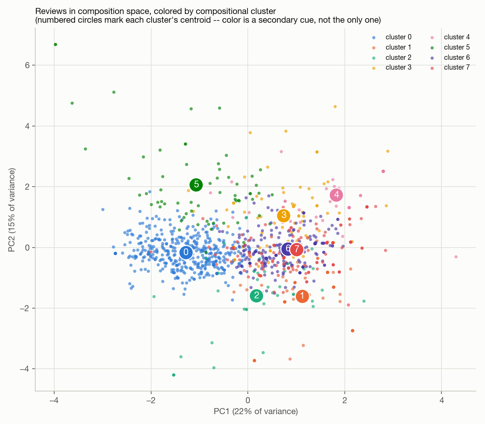

### What do the sequence clusters actually contain?

The compositional clusters above answer "what does the review spend its sentences on." The sequence clusters answer a different question — "in what order" — and so far this report has only shown that the two axes are largely independent (below), not what the sequence clusters themselves look like. Since they're fit on each main category's own *onset* (first-occurrence) position (0 = opens the review, 1 = closes it), the clearest way to read them is as **the review's characteristic opening/closing move**, not its topic mix:

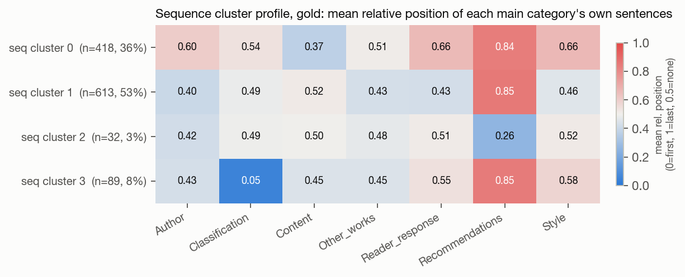

| cluster | n (%) | reading |
|---|---|---|
| 0 | 884 (76.7%) | **Default — `Reader_response` opens early** — `Reader_response`'s first mention lands at 0.04, essentially always one of the review's opening moves when present; `Recommendations` still closes late (0.85); everything else (`Author`, `Classification`, `Content`, `Other_works`, `Style`) sits in a loose 0.26–0.44 band with no sharp preference. The majority pattern. |
| 2 | 230 (20.0%) | **The classic arc** — `Content` opens very early (0.03), `Reader_response` (0.60) and `Style` (0.61) come late, `Recommendations` closes (0.85). This is the "synopsis → response → verdict" pattern described in the synthesis (§11 below), now isolated as its own cluster. Strongly overlaps compositional cluster 0 (narrative-forward) — 84% of its members also land there compositionally, the strongest cross-clustering link in the whole table below. |
| 1 | 38 (3.3%) | **Recommendation-first** — `Recommendations`' first mention lands at 0.23, far earlier than the other two clusters' ~0.85, a genuine reversal. Rare, skews `Children_fiction`, and **the highest-rated cluster of the three** (mean rating 4.54) — leading with the recommendation looks like its own small, distinct, enthusiastic-review convention rather than noise. |

One change from the previous (mean-position) version of this clustering worth flagging honestly: that version's k=4 solution isolated a fourth archetype, "opens on classification" (`Classification` pinned near 0.05, 8% of reviews). At k=3 under onset, no cluster shows that pattern — `Classification`'s onset sits in a similar 0.38–0.48 band across all three clusters above, so that convention either isn't as distinct a signal in the onset-based feature space or needs a finer k than the stability criterion currently selects to separate back out. The two archetypes that *do* survive intact — the classic arc and recommendation-first — are exactly the two most extreme, single-category-driven ones, consistent with the sequence clustering finding "does this review do one specific structural move at all" more reliably than gradual shape differences. Full table: [results/11_sequence_cluster_profile/gold_typology_sequence_cluster_profile.csv](../results/11_sequence_cluster_profile/gold_typology_sequence_cluster_profile.csv).

### Does composition predict sequence?

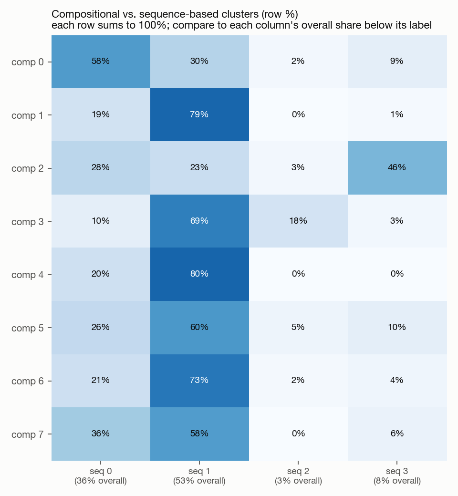

Only weakly (adjusted Rand index between the two clusterings: 0.014 — close to the 0 you'd get from unrelated clusterings, and even closer to 0 than the previous mean-position version's 0.063). Most of that is because one sequence cluster (0, the majority "`Reader_response`-opens-early" default) absorbs 77% of all reviews regardless of composition, so most compositional clusters just track that overall base rate. But two exceptions stand out, the same two that showed up structurally above: compositional cluster 3 (`Recommendations`-heavy) is 25% sequence-cluster-1 (recommendation-first) against a 3.3% corpus base rate — a 7.6× enrichment, the recommendation-first convention showing up from both directions — and compositional cluster 0 (narrative-forward) is 46% sequence-cluster-2 (the classic arc) against a 20.0% base rate, a 2.3× enrichment. So the general answer is **what a review discusses and where it discusses things are mostly independent axes of variation**, with the same two specific exceptions as before (recommendation-heavy and narrative-forward reviews do seem to have a distinctive internal order, not just a distinctive topic mix).

Full tables: [results/05_typology/gold_typology_k_selection.csv](../results/05_typology/gold_typology_k_selection.csv), [results/05_typology/gold_typology_clusters.csv](../results/05_typology/gold_typology_clusters.csv) (per-review cluster assignments), [results/05_typology/gold_typology_crosstab.csv](../results/05_typology/gold_typology_crosstab.csv).

## 6. Genre and platform effects

*↔ [Phase C: §6. Genre and platform](report_phase_c.md#genre-and-platform)*

Scope note first: a full re-run of §2–5 crossed by genre (10) *and* platform (4) — 40 strata, several under 100 reviews, `Romance`×`platform_3` has zero reviews — would mostly measure noise at gold-set scale. What follows is what gold *can* support: category prevalence and typology-cluster membership stratified by genre and by platform separately (not crossed), plus the confound checks the plan calls for. The finer co-occurrence/contiguity/order breakdowns by genre/platform are deferred to Phase C, where the silver set's cell sizes actually support them.

### Descriptives and confounds

| genre | n | mean sentences | median sentences | mean rating |
|---|---|---|---|---|
| Suspense | 140 | 11.7 | 8.0 | 3.12 |
| Young_adult | 85 | 12.9 | 8.0 | 4.12 |
| Fantasy_fiction | 87 | 11.9 | 7.0 | 4.16 |
| Other fiction | 112 | 10.2 | 6.5 | 3.71 |
| Romance | 68 | 10.1 | 5.0 | 4.18 |
| Literary_thriller | 150 | 10.0 | 6.0 | 3.03 |
| Literary_fiction | 267 | 9.0 | 5.0 | **2.65** |
| Children_fiction | 89 | 9.7 | 5.0 | 4.40 |
| Historical_fiction | 79 | 8.3 | 5.0 | 4.08 |
| Regional_fiction | 75 | 8.2 | 6.0 | 4.23 |

| platform | n | mean sentences | median sentences | mean rating | dates | notes |
|---|---|---|---|---|---|---|
| platform_1 | 89 | 10.9 | 11.0 | — | — | no rating or date on **any** of its 89 reviews |
| platform_2 | 419 | 16.1 | 13.0 | 3.47 | 2003–2022 | longest reviews by far |
| platform_3 | 162 | 6.5 | 4.0 | 2.93 | 2011–2020 | |
| platform_5 | 482 | 5.9 | 4.0 | 3.74 | 1999–2017 | shortest reviews, largest N |

Both length and rating differ significantly by genre and by platform (Kruskal-Wallis, all p<0.01; platform↔length p=8×10⁻⁶⁸, by far the strongest of the four). Two things worth flagging before trusting any prevalence comparison below: **platform_1 has no rating or date metadata at all** — consistent with §0's finding that it also lacks reviewer identity, this platform is simply metadata-poor across the board, not just on the reviewer dimension. And **platform explains review length far more strongly than genre does** — platform_2 reviews run almost 3× longer than platform_5's on average, a gap the median confirms rather than an artifact of a few outliers (13 vs. 4). Every genre's median sits comfortably below its mean (typically by 30–40%, `Suspense`/`Young_adult` most so) — length is right-skewed within every genre and platform, not just in the corpus overall, so the mean columns here should be read as pulled upward by a long tail of unusually extensive reviews, not as what a typical review in that group looks like. This matters directly for the prevalence comparisons that follow, since prevalence (does a category appear at all) is not fully independent of length even though every other measure in this project uses length-normalized proportions.

### Category prevalence by genre

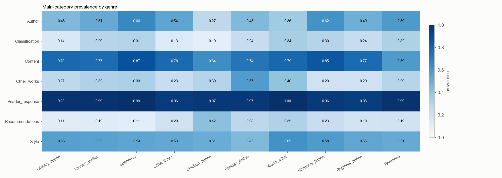

Genre effects are real but modest (Cramér's V 0.13–0.24 for the strongest associations, after Benjamini-Hochberg correction across the 17 tested labels). The clearest patterns: `Recommendations` is most genre-differentiated (V=0.238) — highest in `Children_fiction` (42%) and lowest in `Literary_fiction`/`Suspense` (11%), matching §5's finding that the recommendation-forward typology cluster skews children's fiction. `Author` (V=0.209) is highest in `Historical_fiction` (62%) and lowest in `Young_adult` (27%) — reviewers discuss the author's background more for historical fiction, less for YA. `Other_works` (V=0.200) peaks in `Fantasy_fiction` (57%, series/read-alike comparisons) and is lowest in `Historical_fiction`/`Regional_fiction` (20%). Full table with all 17 tested labels, chi-square statistics, and BH-adjusted q-values: [results/06_genre_platform/gold_genre_prevalence.csv](../results/06_genre_platform/gold_genre_prevalence.csv).

### Category prevalence by platform

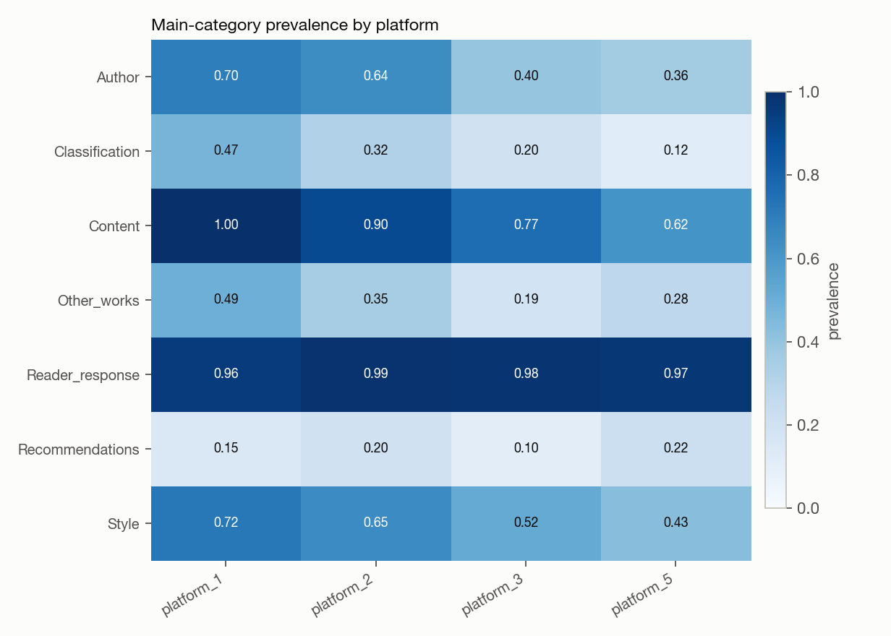

Platform associations are considerably stronger than genre's (`Content--Narrative` V=0.367, `Content` V=0.332 — roughly 50% larger than genre's strongest effect), which given the length confound above is exactly what you'd expect whether or not there's any real "platform style" underneath it. To check, `Content--Narrative` prevalence was recomputed within length terciles rather than pooled:

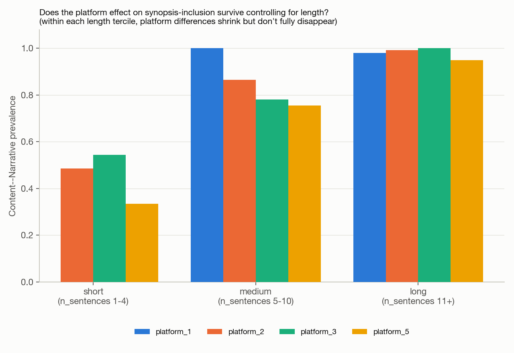

The platform gap **shrinks substantially but doesn't fully close**. Among short reviews (1–4 sentences), platform_5 includes narrative content only 33% of the time vs. platform_2/3's 49–54% — still a real gap after removing most of the length effect. Among long reviews (11+ sentences), all platforms converge above 95% (a ceiling effect — sufficiently long reviews almost always include some synopsis regardless of platform). Read together: **most of the raw platform effect on synopsis-inclusion is a length artifact, but a smaller genuine platform difference remains** — platform_5's short reviews skew more purely reactive (response-only, no synopsis) than platform_2/3's short reviews do. Full table: [results/06_genre_platform/gold_platform_prevalence.csv](../results/06_genre_platform/gold_platform_prevalence.csv); length-stratified detail: [results/06_genre_platform/gold_platform_length_stratified_check.csv](../results/06_genre_platform/gold_platform_length_stratified_check.csv).

### Ratings: Literary_fiction rates lower, on every platform

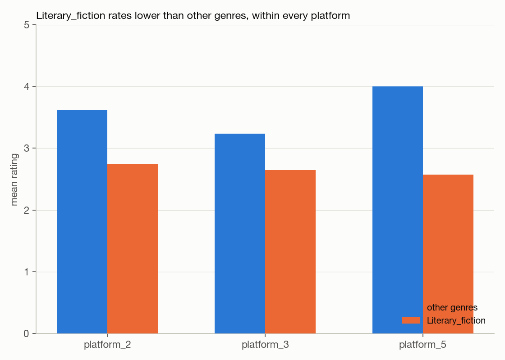

The single largest confound-checked finding in this section: `Literary_fiction` reviews average a full rating point or more below other genres, and this holds **within every platform separately** (platform_2: 2.75 vs. 3.61; platform_3: 2.64 vs. 3.23; platform_5: 2.57 vs. 4.00) — so it isn't an artifact of `Literary_fiction` being concentrated on a stricter-rating platform, it's a consistent, robust pattern. This foreshadows the ratings analysis (ANALYSIS_PLAN.md §11) and is worth carrying forward as a real effect to explain, not a confound to control away. Full table: [results/06_genre_platform/gold_litfic_rating_by_platform.csv](../results/06_genre_platform/gold_litfic_rating_by_platform.csv).

### Typology clusters by genre and platform

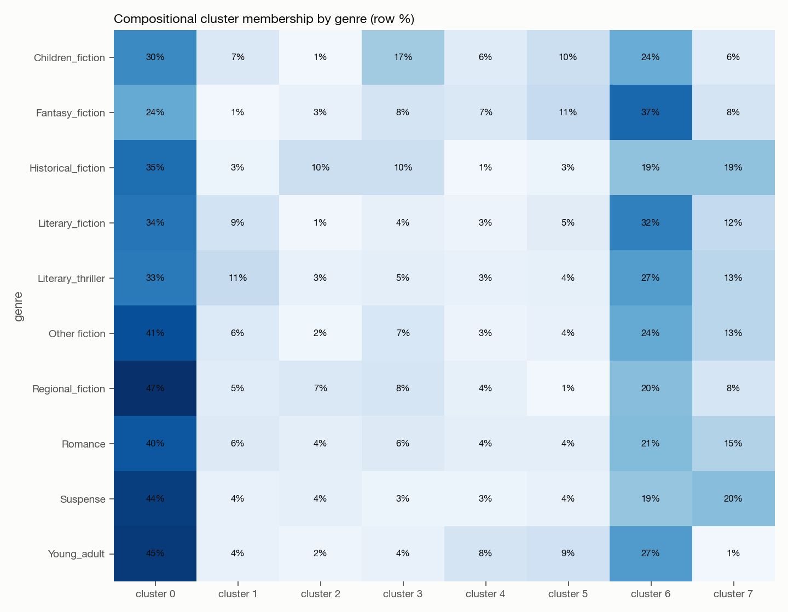

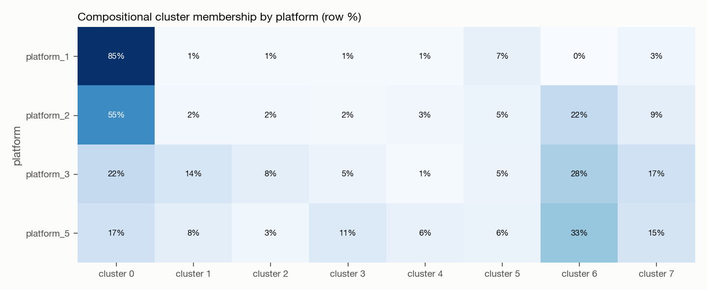

Both associations are statistically significant (genre: χ²=141.2, p=6×10⁻⁸, Cramér's V=0.13; platform: χ²=305.7, p=2×10⁻⁵², V=0.30 — platform's association with cluster membership is more than double genre's). The genre heatmap adds detail to §5's cluster read: `Children_fiction` is enriched in cluster 3 (recommendation-forward, 17% vs. 6% corpus-wide) and `Fantasy_fiction` is the most response-forward genre (37% cluster 6, the corpus high). The platform heatmap is dominated by one thing: **platform_1 is 85% cluster 0** (narrative-forward) — but per the metadata caveat above, platform_1 is a single reviewer, so this is that person's individual style, not a platform effect, and shouldn't be read as "platform_1 as a venue favors narrative reviews." Excluding platform_1, platform_2 still leans narrative-forward (55% cluster 0, consistent with its much longer reviews) while platform_3 and platform_5 lean more response-forward (28% and 33% cluster 6 respectively). Full tables: [results/06_genre_platform/gold_typology_by_genre.csv](../results/06_genre_platform/gold_typology_by_genre.csv), [results/06_genre_platform/gold_typology_by_platform.csv](../results/06_genre_platform/gold_typology_by_platform.csv).

## 7. Book, author, and reviewer similarity

*↔ [Phase C: §7. Book, author, and reviewer similarity](report_phase_c.md#book-author-and-reviewer-similarity)*

Are reviews of the same book more similar to each other than random review pairs? Reviews of different books by the same author? Reviews by the same reviewer? Each measured as cosine similarity between reviews' 20-dimension category-proportion vectors, tested against a permutation null (shuffle the group labels, recompute, repeat 999 times) — implementation in [src/common/similarity.py](../src/common/similarity.py), used by both this section and the variance-partitioning comparison below. `platform_1` is kept in for the book/author tests (its work_id/author_id are still meaningful) and excluded only from the reviewer test (its `user_id` isn't — see §0).

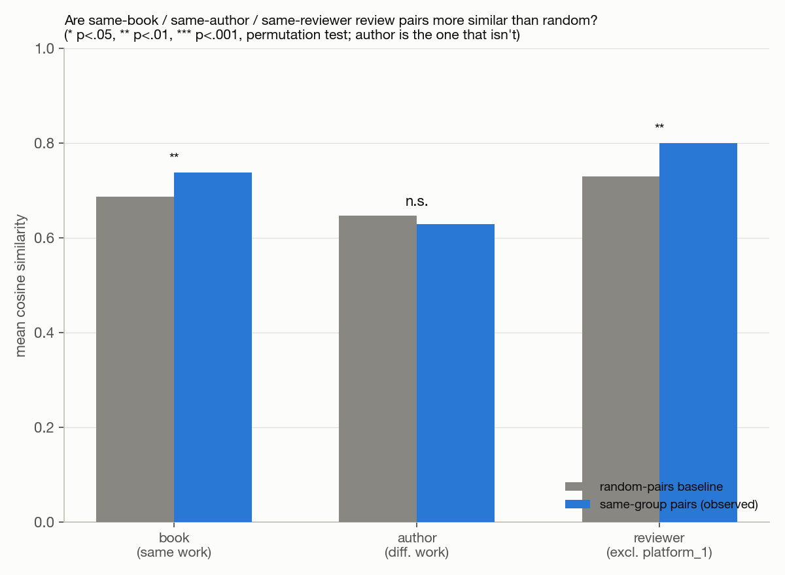

**Book: yes.** 85 works with ≥2 reviews (200 reviews, 181 pairs) — same-book review pairs average 0.737 cosine similarity vs. 0.686 for random pairs (z=2.98, p=0.004). Reviews of the same book really do resemble each other more than chance, though the effect is modest and per-work reliability varies enormously: the most internally-consistent books hit 0.92–0.95 mean similarity (2–3 reviews each, agreeing closely), while the most internally-diverse (among books with ≥3 reviews) — `impfic-work-42523` (`Literary_fiction`, 3 reviews, mean 0.60) and `impfic-work-23098` (`Historical_fiction`, 6 reviews, mean 0.64) — include individual review pairs as low as 0.22–0.40 similarity within the same book. Full tables: [results/07_book_author_similarity/gold_book_similarity_test.csv](../results/07_book_author_similarity/gold_book_similarity_test.csv), [results/07_book_author_similarity/gold_book_similarity_per_work.csv](../results/07_book_author_similarity/gold_book_similarity_per_work.csv) (ranked, all 85 works).

**Author (different books): no.** 122 authors reviewed across ≥2 distinct works (492 reviews, 6,933 eligible different-book pairs) — same-author pairs average 0.629 similarity, *below* the 0.647 random-pairs baseline (z=−1.39, p=0.918). Once you actually hold "different book" constant, there's no evidence that an author's books get reviewed similarly to each other. This is the one place the pairwise test and the variance-partitioning test below disagree — see the explanation there. Full tables: [results/07_book_author_similarity/gold_author_similarity_test.csv](../results/07_book_author_similarity/gold_author_similarity_test.csv), [results/07_book_author_similarity/gold_author_similarity_per_author.csv](../results/07_book_author_similarity/gold_author_similarity_per_author.csv).

**Reviewer: yes, the strongest of the three.** 50 reviewers with ≥2 reviews, excluding `platform_1` (117 reviews, 101 pairs) — same-reviewer pairs average 0.798 similarity vs. 0.727 baseline (z=3.34, p=0.001), the largest gap of any of the three tests. *(Updated 2026-10-22: reviewers are now keyed on platform + `user_id`, since ids are generated per platform; one gold id spanned two platforms. See Phase C §0.)* People who review more than once tend to write the same *kind* of review each time. Full tables: [results/07_book_author_similarity/gold_reviewer_similarity_test.csv](../results/07_book_author_similarity/gold_reviewer_similarity_test.csv), [results/07_book_author_similarity/gold_reviewer_similarity_per_reviewer.csv](../results/07_book_author_similarity/gold_reviewer_similarity_per_reviewer.csv).

### Which explains more: reviewer, book, or author?

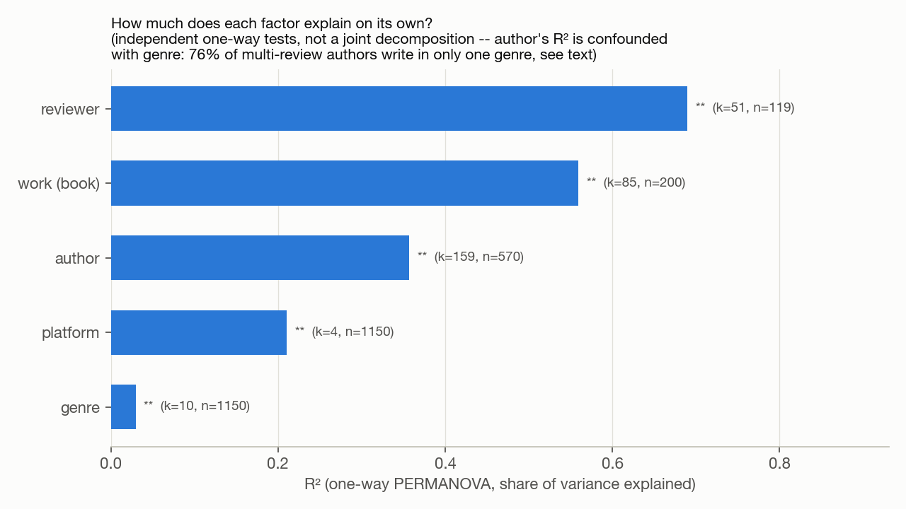

A comparative one-way PERMANOVA (R² = share of variance in the distance matrix explained by that grouping, each factor tested independently on its own natural subset — a simplification of a full joint model, flagged below): **reviewer (R²=0.69) > book (R²=0.56) > author (R²=0.36) > platform (R²=0.21) > genre (R²=0.03)**, all significant at p≤0.003. *(The joint version, with reviewer and book in one model at silver scale, is Phase C §15: reviewer still dominates for length and the `Content`/`Reader_response` balance, while book and author matter as much or more for `Other_works` and rating.)* Read together with the pairwise tests above, this directly answers your original question: **similarity is more about who writes the review than which book or author it's about** — reviewer identity explains more of a review's composition than book identity does, and book explains more than author does.

The author row needs an explicit caveat: its R²=0.36 looks substantial, but it directly contradicts the pairwise different-book test (§7 above, not significant). The reason is that the PERMANOVA doesn't hold genre constant, and **76% of multi-review authors write in only one genre** in this corpus (121 of 159) — so "author" here is largely standing in for "genre, sliced more finely," not a distinct authorial-voice effect. The more surgical pairwise test, which explicitly restricts to different-book pairs and so isolates authorship from genre, is the one to trust: it found no consistency. Full table: [results/07_book_author_similarity/gold_variance_partitioning.csv](../results/07_book_author_similarity/gold_variance_partitioning.csv).

## 8. Temporality

*↔ [Phase C: §8. Temporality](report_phase_c.md#temporality)*

1,063 of 1,152 gold reviews have a date, spanning 1999–2022 — but **`platform_1` has zero dated reviews** (0/89), so it drops out of this entire section by construction, on top of its already-established reviewer-identity gap. More importantly, **platform and date are badly confounded for the remaining three platforms**: `platform_5` supplies 73–100% of reviews before 2012 and vanishes entirely after 2016; `platform_2` is effectively the only source left by 2021–2022; `platform_3` only starts in 2011. Any raw "trend over time" risks just re-describing "platform composition changed," not a real shift in how people review. So every result below is reported two ways — **raw** (year alone) and **platform-adjusted** (year + platform together in the same model) — and only the adjusted version is trustworthy as a genuine temporal claim.

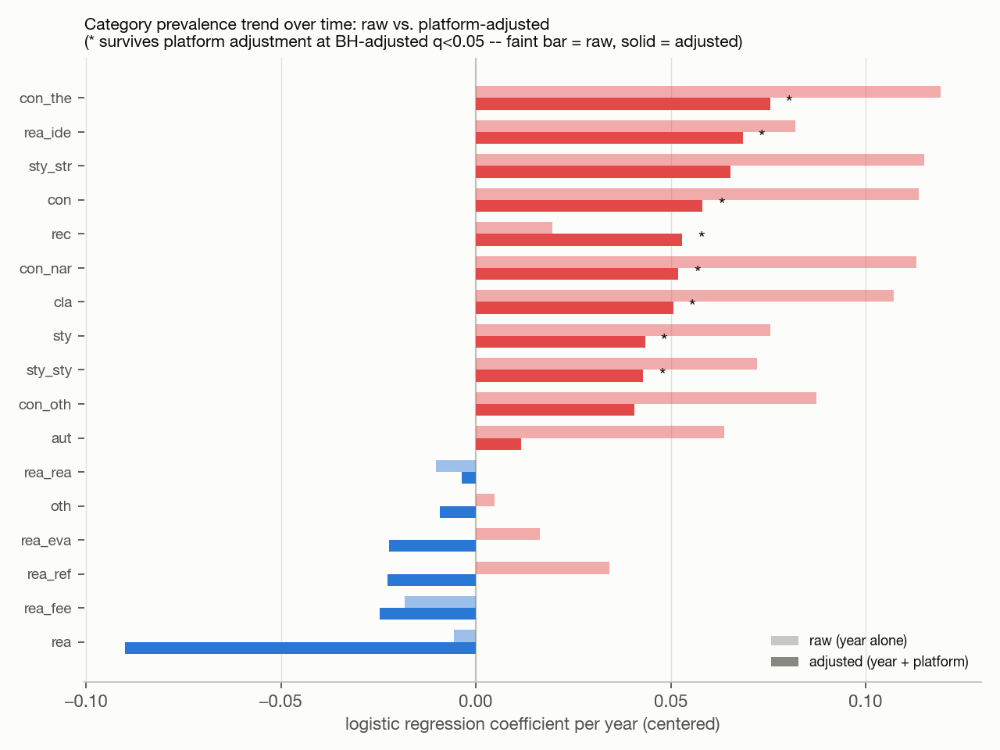

Eight categories show a trend that survives platform adjustment (BH-adjusted q<0.05, logistic regression on year, review-level "≥1 sentence" presence): `Content--Theme`, `Reader_response--Identification_and_immersion`, `Content`, `Recommendations`, `Content--Narrative`, `Classification`, `Style`, and `Style--Stylistic_features` — **all trending upward**. `Author`'s raw trend was strongly significant (p<0.001) but **vanishes** after platform adjustment (p=0.48) — a useful negative control, confirming that apparent rise was platform composition, not time.

**But review-level presence has its own confound the platform adjustment doesn't touch: review length grew substantially over the period (below), and a category whose true per-sentence rate never changed can still show a rising "≥1 sentence in the review" trend purely because longer reviews have more chances to contain at least one instance.** So every trend above is re-fit at the *sentence* level too — "does an individual sentence's probability of carrying this label change over time" — which has no such mechanism to confound it:

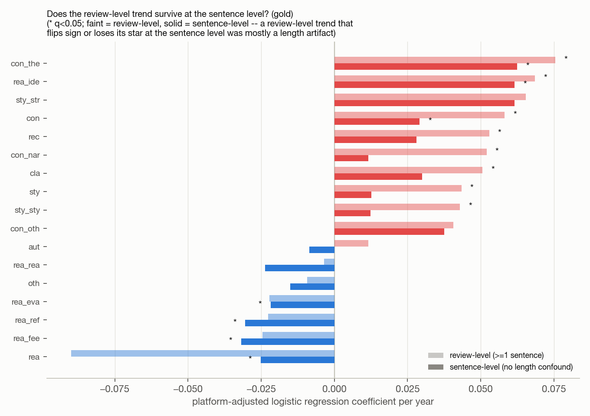

Only **3 of the 8** review-level "risers" hold up at the sentence level (q<0.05, same direction): `Content--Theme`, `Reader_response--Identification_and_immersion`, and `Content`. The other 5 — `Recommendations`, `Content--Narrative`, `Classification`, `Style`, `Style--Stylistic_features` — have a much smaller, non-significant sentence-level coefficient, consistent with their apparent review-level rise being substantially or entirely a length artifact rather than a real shift in how much individual sentences discuss them. The sentence-level test also surfaces the reverse pattern for four categories that weren't flagged at all above, because they're already so prevalent per review that there's little room for the review-level "≥1" measure to move (a ceiling effect): `Reader_response` overall, `Reader_response--Feelings`, `Reader_response--Reflection`, and `Reader_response--Evaluation_of_quality` all show a real, significant *decline* at the sentence level (q<0.01 each) that the review-level model missed entirely.

**A note on what "length artifact" means here, since it's easy to over-read** (raised in chat, 2026-08-19): length itself isn't noise — how much a reviewer chooses to say is plausibly meaningful, not a nuisance variable to explain away. What's specifically an artifact is the review-level "≥1 sentence" *measurement*: a longer review is mechanically more likely to trip that binary trigger even at an unchanged underlying rate, which is a fact about the measure, not about reviewing. The sentence-level fix above removes that specific inflation, but it isn't a length-neutral measure of "emphasis" either — it's a corpus-wide rate pooled across all sentences, so longer reviews (which contribute more sentences) get proportionally more weight in it. Neither version directly answers "does a review's length change what *share* of itself it devotes to a category" — §9 below treats that question, and two further ones (do long reviews cluster differently, are their sentences written differently), as first-class dimensions in their own right rather than covariates to net out.

This directly resolves what looked like a contradiction on first read — `Identification_and_immersion` trending *up* while its own parent `Reader_response` trends *down*: it isn't a contradiction, and now it's checkable rather than just plausible. `Reader_response`'s sentence-level rate is genuinely declining (confirmed above); `Identification_and_immersion`'s own sentence-level rate is one of the 3 real risers, holding up even after the length confound is removed — reader-response commentary is getting rarer overall, and a growing share of what's left is specifically about immersion. Phase C's report §8 has the full sentence-level breakdown across the much larger silver set, where the same pattern replicates. Full table (now with both review- and sentence-level columns): [results/08_temporal/gold_temporal_category_trends.csv](../results/08_temporal/gold_temporal_category_trends.csv).

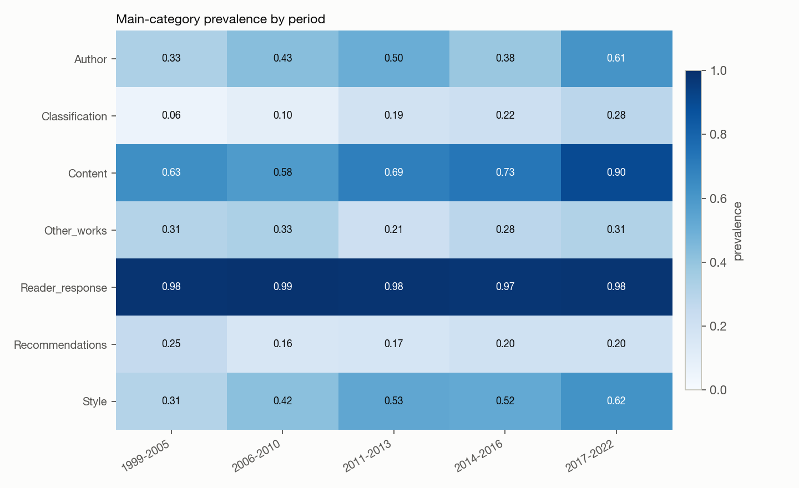

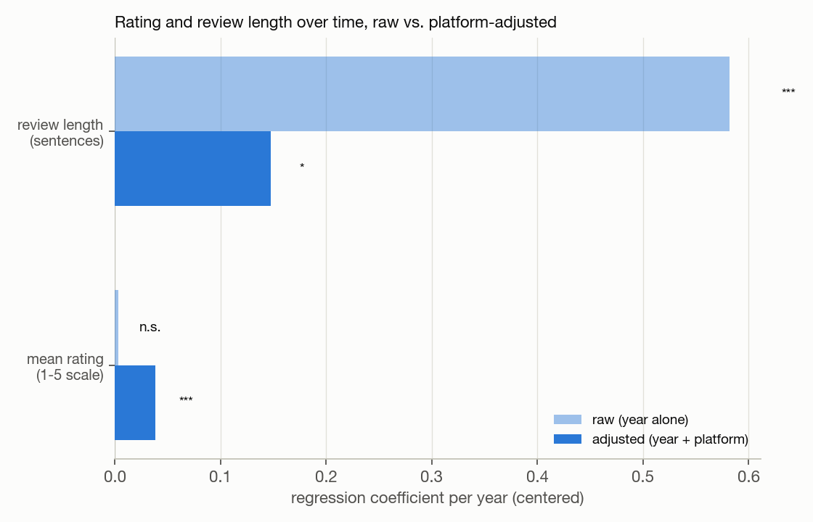

**Review length has genuinely grown over time**: both the raw trend (Spearman ρ=0.28, p=5×10⁻²¹) and the platform-adjusted one (p=0.044) are significant, though the adjusted coefficient is much smaller than the raw one (0.15 vs. 0.58 sentences/year) — most, but not all, of the raw length increase is platform composition, with a real residual growth trend underneath. **Rating shows the opposite pattern**: no raw trend at all (ρ=−0.01, p=0.66) but a clear positive trend once platform is controlled for (p=0.00026) — platform composition was *masking* a real rating increase over time, not creating a fake one. This is exactly the failure mode the platform-adjustment step exists to catch, in both directions. Full table: [results/08_temporal/gold_temporal_rating_length.csv](../results/08_temporal/gold_temporal_rating_length.csv).

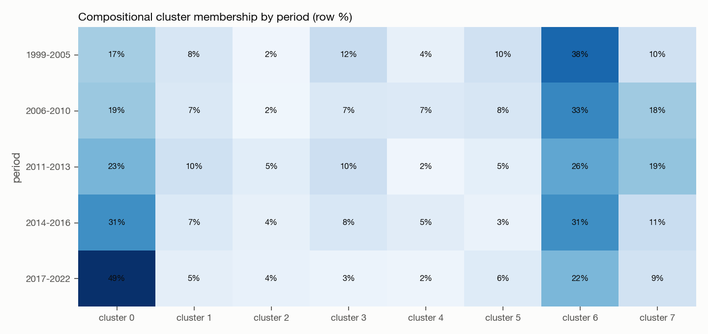

The clearest single temporal finding: **the corpus visibly shifts from response-forward to narrative-forward reviews over the period** (χ²=102.6, p=1.9×10⁻¹⁰, Cramér's V=0.155). Cluster 6 (response-forward, §5) accounts for 38% of reviews in 1999–2005, falling steadily to 22% by 2017–2022; cluster 0 (narrative-forward) rises from 17% to 49% over the same span — the mirror image, and directly consistent with `Content`'s upward trend above, confirmed at both the review and sentence level. (`Content--Narrative` specifically is more borderline once length is controlled for — its sentence-level trend is the same direction but only just misses q<0.05, so treat the cluster-level shift as most clearly a story about `Content` overall, not that specific sub-category.) Whether this reflects reviewing conventions actually changing over time or is itself residual platform character not fully captured by the year+platform adjustment isn't fully resolved by this analysis — worth flagging as an open question rather than a settled one. Full table: [results/08_temporal/gold_typology_by_period.csv](../results/08_temporal/gold_typology_by_period.csv).

## 9. Review length as a substantive dimension

*↔ [Phase C: §9. Review length as a substantive dimension](report_phase_c.md#review-length-as-a-substantive-dimension)*

New question (chat, 2026-08-19), directly prompted by §8's temporal length-artifact finding above: that section fixed a real measurement problem (review-level "≥1 sentence" mechanically inflating with more sentences) but "length artifact" doesn't mean length itself is noise — how much a reviewer chose to say is plausibly meaningful. Length has so far only ever appeared as a nuisance covariate to net out (§6's length-stratified platform check, §8's sentence-level reweighting). Three questions instead treat it as a variable worth understanding on its own terms: do long and short reviews allocate their sentences differently, do they cluster into different archetypes, and are their sentences written differently (denser, more or less specific)?

### Do long and short reviews talk about different things?

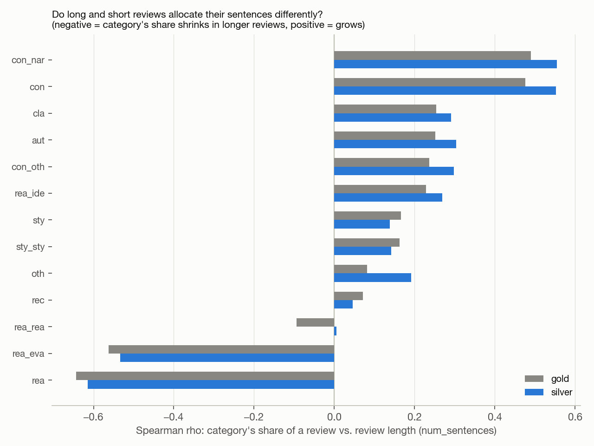

Yes, and the pattern is coherent. Each category's **share** of a review — `prop__label`, the length-neutral proportion already used as the typology clustering's own input — correlates with `num_sentences` directly (Spearman, cross-sectional, not a year trend). **`Reader_response` shrinks sharply as reviews get longer** (ρ=−0.64, p≈0; its `Evaluation_of_quality` sub-category alone: ρ=−0.56) — consistent with a roughly fixed-size "verdict" component that a longer review simply dilutes, rather than reader-response commentary itself becoming less common. **`Content` and `Content--Narrative` grow just as sharply** (ρ=0.48 and 0.49) — the extra room in a longer review goes disproportionately into synopsis/narrative material, not a proportional expansion of everything at once. A handful of categories (`Recommendations`, `Other_works`, `Style`, `Style--Stylistic_features`) show a *positive* rank correlation but a *negative* linear (OLS) slope — the honest reading is a non-monotonic, hump-shaped relationship (share rises off a near-zero baseline in short reviews, then gets diluted again in very long ones), not a straightforward trend; Spearman is the more trustworthy summary of direction for these, OLS the (partial) average linear slope. Full table: [results/09_length_dimension/gold_length_share_correlation.csv](../results/09_length_dimension/gold_length_share_correlation.csv).

This also completes the presence/rate/share triangle §8 left open: the year-trend regression, re-run a third way with `prop__label` (not presence, not pooled sentence rate) as the outcome, agrees on direction with both the review-level and sentence-level trends for **16 of 17** tested labels — only `Author` disagrees, and it wasn't a significant review-level riser to begin with. That three-way agreement is a second, independent confirmation that §8's sentence-level fix was catching something real, not introducing a different artifact of its own. Full tables: [results/09_length_dimension/gold_length_proportion_year_trends.csv](../results/09_length_dimension/gold_length_proportion_year_trends.csv), [results/09_length_dimension/gold_length_temporal_three_way_comparison.csv](../results/09_length_dimension/gold_length_temporal_three_way_comparison.csv).

### Do long reviews cluster differently?

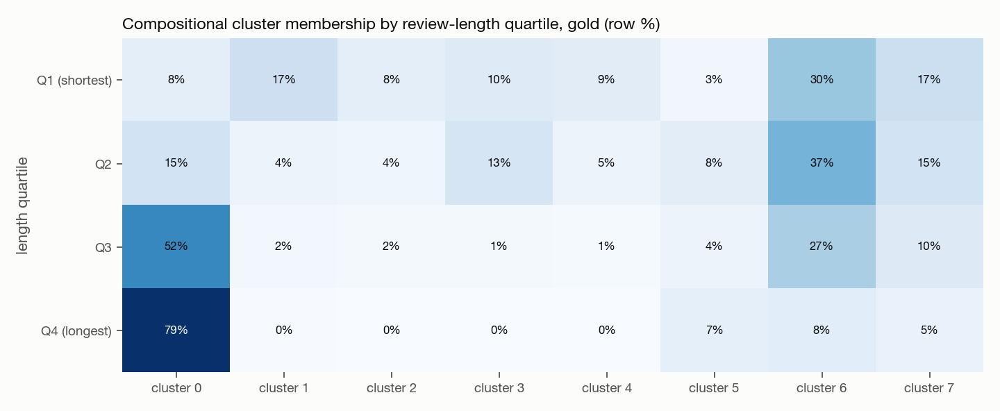

Length quartile associates with compositional cluster membership more strongly than genre or platform do (χ²=535.8, p=5×10⁻¹⁰⁰, Cramér's V=0.394 — versus §6's V=0.174/0.383 for genre/platform). Most of that is one cluster: **cluster 0, the narrative-forward "classic arc" (§5, 37% of the corpus), captures 79% of the longest quartile of reviews and only 8% of the shortest** — directly consistent with the share finding above (`Content`/`Content--Narrative` expanding to fill extra room). The honest caveat this raises, exactly as anticipated when this question was scoped: **cluster 0 may be partly rediscovering verbosity rather than a purely qualitative distinction** — "writes a long narrative-forward review" and "writes a long review" are hard to fully separate here. Sequence-cluster membership associates too, but more weakly (χ²=134.0, V=0.241) — how a review is ordered is less tied to its length than what it's about is. Re-clustering within just the long-review subset to check whether finer structure is being washed out by pooling with short reviews is a natural follow-up, not attempted this pass. Full tables: [results/09_length_dimension/gold_length_quartile_by_composition_cluster.csv](../results/09_length_dimension/gold_length_quartile_by_composition_cluster.csv), [results/09_length_dimension/gold_length_quartile_by_sequence_cluster.csv](../results/09_length_dimension/gold_length_quartile_by_sequence_cluster.csv).

### Are longer reviews' sentences written differently?

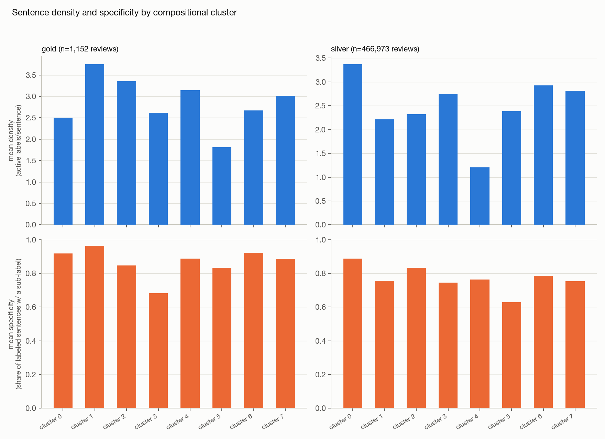

Two new measures, neither computed anywhere else in this project: **density** (mean number of simultaneously active labels per sentence, main+sub together) and **specificity** (the fraction of *labeled* sentences that carry at least one sub-category, versus main-category-only). Both **decrease** as reviews get longer (density ρ=−0.38, p=9×10⁻⁴²; specificity ρ=−0.30, p=7×10⁻²⁶) — longer reviews don't just add more sentences, their average sentence carries less simultaneous label load and is somewhat less likely to get specific. Neither shows a real trend over time independent of length (year correlations are small and only borderline significant, ρ≈−0.06 to −0.07). By cluster, cluster 1 (§5, small, `Reader_response`-heavy) is both the densest (3.75 labels/sentence) and most specific (96%); cluster 5 is the sparsest (1.82); cluster 3 the least specific (68%). Full tables: [results/09_length_dimension/gold_density_specificity_correlations.csv](../results/09_length_dimension/gold_density_specificity_correlations.csv), [results/09_length_dimension/gold_density_specificity_by_composition_cluster.csv](../results/09_length_dimension/gold_density_specificity_by_composition_cluster.csv).

**Is density's drop just sentences getting shorter? No — gold-only check, since silver's predictions carry no sentence text or offsets to measure this at all.** The tempting explanation for density falling with length is that longer reviews use shorter, more clipped sentences that mechanically have less room to touch multiple categories at once. The data says the opposite: mean sentence length (characters) correlates only weakly, and *positively*, with review length (ρ=+0.19, p=7×10⁻¹¹) — longer reviews' sentences run slightly *longer* on average, not shorter. And sentence length correlates positively with that sentence's own density (ρ=+0.32, p≈0) — longer sentences do carry more simultaneous labels, exactly as more words would predict. Put together, sentence length doesn't explain density's decline with review length; if anything it points the other way, since longer reviews' slightly longer sentences would predict *higher* density, not lower. The drop looks like a genuine compositional/structural pattern — longer reviews spread their category coverage across more, more single-purpose sentences rather than packing each sentence with more simultaneous topics — not an artifact of sentence length. Full tables: [results/09_length_dimension/gold_sentence_length_correlations.csv](../results/09_length_dimension/gold_sentence_length_correlations.csv), [results/09_length_dimension/gold_sentence_length_by_review.csv](../results/09_length_dimension/gold_sentence_length_by_review.csv).

## 10. Ratings

*↔ [Phase C: §10. Ratings](report_phase_c.md#ratings-the-headline-finding)*

`0.0`/blank ratings are confirmed placeholders (§0) and excluded — 1,060/1,152 reviews (92%) have a real 1–5 rating, mean 3.51. A weak but real length confound exists (longer reviews rate very slightly lower — Spearman ρ=−0.07, p=0.02–0.03), small enough not to be a major concern given every category feature used here is already length-normalized, but worth keeping in mind for the correlations below.

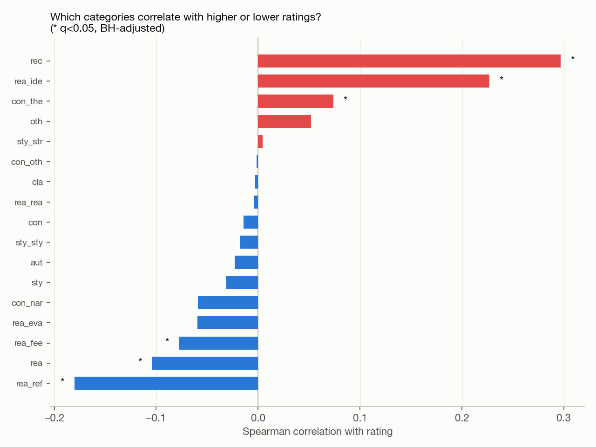

Two clusters of association stand out (Spearman correlation between a category's proportion and rating, BH-adjusted): **`Recommendations` (ρ=0.30) and `Reader_response--Identification_and_immersion` (ρ=0.23) correlate positively** — reviews that recommend the book, or describe getting pulled into it, skew toward higher ratings, unsurprisingly. **`Reader_response--Reflection` (ρ=−0.18), `Reader_response` overall (ρ=−0.10), and `Reader_response--Feelings` (ρ=−0.08) correlate negatively** — more reflective, feelings-heavy engagement leans toward *lower* ratings, which is less obvious: it suggests reflection/feelings-heavy language in this corpus skews toward processing a mixed or negative reaction, not just enthusiastic response. Full table: [results/10_ratings/gold_rating_correlations.csv](../results/10_ratings/gold_rating_correlations.csv).

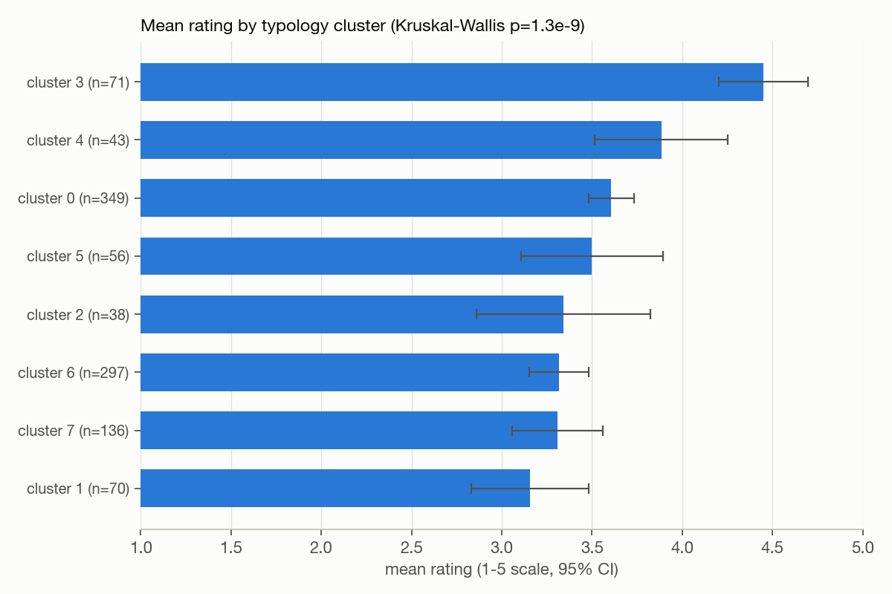

Rating differs significantly by §5's typology cluster (Kruskal-Wallis p=1.3×10⁻⁹): cluster 3 (recommendation-forward, `Children_fiction`-skewed) tops out at 4.45 — already flagged in §5 as the highest-rated cluster — while cluster 1 (style-and-response, minimal plot, the shortest reviews in the corpus) is lowest at 3.16. Full table: [results/10_ratings/gold_rating_by_cluster.csv](../results/10_ratings/gold_rating_by_cluster.csv).

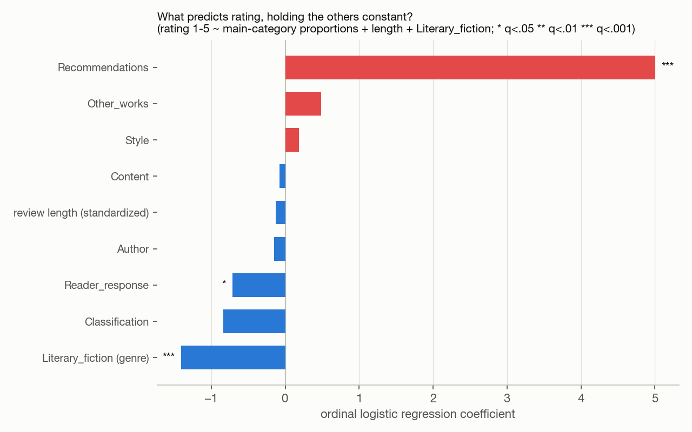

An ordinal logistic regression of rating (1–5) on the seven main-category proportions, review length, and `Literary_fiction` genre together (pseudo-R²=0.063 — modest overall) makes the strongest single point in this section: **`Literary_fiction` has the largest coefficient of any predictor, by a wide margin (coef=−1.41, p=1.3×10⁻²³), and it stays essentially unchanged when controlling for everything the review discusses.** §6 found `Literary_fiction` rates about a point lower on every platform; this confirms that gap is **not explained by what those reviews talk about** — it's an independent genre effect, not a byproduct of `Literary_fiction` reviews happening to be more `Style`-heavy or `Content`-heavy. `Recommendations` remains strongly positive even in the full model (coef=5.00, p=3.7×10⁻¹⁰) — the single most reliable positive predictor of rating in the whole analysis — and `Reader_response` remains negative (coef=−0.72, p=0.01), consistent with the raw correlation above. Full table: [results/10_ratings/gold_rating_ordinal_model.csv](../results/10_ratings/gold_rating_ordinal_model.csv).

## 11. Synthesis: an emerging review "arc"

*↔ [Phase C: §16. Synthesis](report_phase_c.md#synthesis)*

Putting §2–5 together (§8's temporal and §10's rating findings are folded in at the end):

1. Reviews open with **synopsis** (`Content`, `Content--Narrative`) — common, early, and written in one sustained block.
2. They move into **evaluation and response** (`Style`, `Evaluation_of_quality`, `Feelings`, `Reflection`) — late-leaning, and `Style`↔`Evaluation_of_quality` travel together strongly enough (both within a sentence and across the review) to look like a single compound move: "the writing was good/bad, and that's why I feel X about the book."
3. They close, when they close at all (only 18.9% of reviews do), with an explicit **recommendation** — far more end-loaded than any other category in the dataset.
4. `Content--Quote` behaves as its own distinct, self-contained move — rare, but when used, sustained (mean 4.97 sentences) and avoiding co-occurrence with most other categories at the sentence level.
5. §5's clustering confirms this wasn't just a co-occurrence/order artifact: the single most robust way the corpus splits (k=2, bootstrap ARI 0.92) is exactly this narrative-forward vs. response-forward axis, and it further resolves into distinguishable sub-types — author-focused, recommendation-forward, comparison-heavy, classification-heavy — that align loosely but plausibly with genre conventions (children's/YA reviews lean recommendation- and comparison-heavy; historical fiction leans classification-heavy).

§5 confirms this reading directly rather than just anticipating it: the clustering wasn't tuned to find this axis, and it's the most stable split in the data regardless.

**One refinement to step 1, added later** (§4's pairwise-precedence subsection, 2026-08-31): "reviews open with synopsis" is right on average but slightly overstates the convention. Pairwise tests within reviews show `Content`, `Other_works`, `Classification`, and `Author` form an **opening zone with no reliable internal order** — all six pairs among them are non-significant, while every pair crossing out of that group is significantly ordered. So the arc is better stated as *opening zone → `Style`/`Reader_response` → `Recommendations`*, where what a review opens *with* among those four is not conventionalized, even though the fact that it opens with one of them is.

That "zone" is **positional, not a merged passage**: the union-clumpiness test in §4 finds no category pair merging into a shared contiguous block above chance, and `Content` in particular keeps a stretch distinctly separate from the other three opening categories. The arc is a sequence of separate blocks, loosely ordered at the front and rigidly at the back — not a smooth progression through undifferentiated regions.

6. §8 adds a temporal dimension to the same axis: the corpus visibly drifts from response-forward (38% in 1999–2005) toward narrative-forward (49% by 2017–2022) over the period, mirrored by `Content`'s upward trend, confirmed at both the review and sentence level (length-controlled) — whatever this arc represents, it's not a static convention; its balance has shifted over two decades.
7. §10 adds who explicitly "closes well": `Recommendations`-heavy reviews (step 3, above) aren't just a distinct structural move, they're the strongest positive predictor of rating in the whole dataset (ordinal regression coef=5.00), while `Reflection`/`Feelings`-heavy engagement (step 2) leans toward *lower* ratings — the arc's later stages aren't neutral description, they're where most of the measurable sentiment lives. And genre (specifically `Literary_fiction` rating a full point lower, independent of composition) sits outside this arc entirely — a separate axis this analysis hasn't fully explained.

## 12. Scope and caveats

*↔ [Phase C: §17. Scope and caveats](report_phase_c.md#scope-and-caveats)*

- **Gold set only (1,152 reviews).** These are real findings, not provisional ones — but they're small-N relative to the 670K-review silver set, and several sub-category findings above (`Content--Quote`, `Style--Structure`, `Style--Context`) rest on a few dozen reviews or fewer. Treat those as suggestive rather than conclusive until Phase C replicates them at scale.
- **`num_sentences` correction.** The file's own `num_sentences` metadata field disagreed with the actual number of annotated sentence rows for 206/1,152 reviews (off by 1–14 sentences, both directions) — every position- and length-dependent computation here (proportions, relative position, contiguity's n) uses the actual annotated sentence count, not the metadata field. See `src/common/data_prep.py`.
- **No silver-set numbers here.** `WEAK_MODEL_LABELS` and `FICTION_GENRES` exclusions (ANALYSIS_PLAN.md §0b) don't apply to this report — they're a model-reliability and domain-shift concern specific to predicted labels, and every category here is a human annotation.
- **Multiple comparisons.** The co-occurrence and order tests involve many pairwise comparisons (177 label pairs at the sentence and review level, 20 positional tests, 49 transition pairs); p-values are reported per-test, not corrected for the family-wise rate. The magnitudes (PMI, z-scores, clumpiness index) are more informative than the raw p-values for judging which findings are substantial versus merely detectable.
- **§3's review-level contiguity measure covers 696 of 1,152 reviews (60%), not all of them.** Reviews are excluded when they have fewer than two categories appearing on ≥2 sentences, or fewer than 3 sentences — necessarily, since "does this review alternate between categories" is undefined otherwise, but it means the eligible population skews longer and more multi-category than the corpus as a whole (median 8 sentences vs. 6 overall). The finding "reviews are block-structured" is therefore established for reviews substantial enough to *have* structure, and says nothing about the short reviews it excludes. It also uses main labels only — sub-labels are nested in their parent's sentences, so including both would double-count the same blocks.
- **§3's raw clumpiness figures are reported for continuity with §3's own label-level index, but should not be compared across reviews of different lengths** — the chance baseline moves with length (ρ=−0.46), so the raw score is only interpretable against each review's own null. Every cross-review or cross-group comparison in this report uses the excess-over-chance version instead. The same caution applies to any future measure built on the same count-based index (`ANALYSIS_PLAN.md` item 13's A2/A3/B2 all share it): check the baseline's length-dependence before comparing raw values across groups.
- **§4's zone structure now has a formal derivation, but the k=3 vs k=4 choice is a judgment call on a one-error margin.** The clustering is over 7 categories and 21 pairs — a small problem where the partition can hinge on a single weak ordering, as it does here (`Style` before `Reader_response` at P=0.56). Both readings are reported in the text; neither should be treated as settled. Note also that the standard model-selection tool for this (silhouette) actively misleads here, picking a degenerate k=2 — a reminder that these zones are chosen by a criterion built for this construct, not by an off-the-shelf default. Precedence also uses each category's *mean* position within a review, which compresses a wide-spanning category to a single point — two heavily interleaved categories can produce a confident-looking precedence value.
- **§3's and §4's newer measures (boundaries, interleaving, zone affinity) are each reported against their own permutation null, and only the excess is comparable across reviews or pairs** — every one is a count-based index whose chance baseline moves with review length and category counts. The raw columns are retained in the result files for transparency but should not be compared across groups. Two consequences worth naming: 96 reviews are unscorable for the boundary measure (every sentence a distinct configuration forces the boundary count), and the pairwise measures cover only 17 of the 21 category pairs. The four missing pairs are exactly `Recommendations` paired with `Author`, `Classification`, `Other_works` and `Style` — `Recommendations` appears in only 18.9% of reviews and is typically a *single* sentence (median 1, §1), so it rarely clears the ≥2-sentence bar that contiguity requires at all. That is a structural limit of applying block-based measures to a category that is usually one sentence long, not a null result about those pairs; note it means the most rigidly-ordered category in §4's precedence analysis is the one least visible to §3's and §4's contiguity measures.
- **The zone-affinity result is a negative finding, and negative findings from a single operationalization deserve the usual caution.** "No pair merges into a joint zone" is established for *this* definition of merging (union clumpiness vs. individual clumpiness, both against a sentence-order permutation null). A different definition — say, minimum gap between blocks, or a measure tolerant of one category nesting inside another — could plausibly find structure this one misses. The corroboration from §3's independently-designed interleaving measure (ρ=−0.49) makes the finding more robust than a single measure alone, but does not make it definition-independent.
- **Typology is soft, not hard.** Silhouette scores throughout §5 are modest in absolute terms (0.20–0.27 for the compositional clustering, weaker still for the sequence-based one) — these are real, statistically-validated tendencies, but reviews sit on a continuum rather than falling cleanly into 8 (or even 2) discrete boxes. The k=8 breakdown is a genuine refinement of the k=2 axis, not an alternative to it.
- **§6's genre/platform tests are per-label, not corrected across the full genre+platform+cluster family.** BH correction was applied within the genre-prevalence family and separately within the platform-prevalence family (17 tests each), but not jointly across every test run in §6 — treat the borderline associations (q-value close to 0.05) with more caution than the clear ones (`Content--Narrative`/`Content` by platform, `Recommendations`/`Author` by genre, all q<10⁻⁶).
- **§6 stops at prevalence and typology cluster membership.** Genre/platform stratification of co-occurrence, contiguity, and order (the finer structure from §2–4) is deferred to Phase C, where the silver set's larger per-stratum N actually supports it — at gold scale, most genre×platform cells are too small (several genres have under 100 reviews split across 4 platforms).
- **§7's variance-partitioning is five independent one-way tests, not a joint model.** R² values aren't additive and aren't adjusted for the confounds between factors (author↔genre being the clear example, caveated in the text) — a proper joint/nested PERMANOVA (work nested in author, reviewer nested in platform) is a possible future refinement, not attempted here.
- **§7's book and author samples are still fairly thin** (85 works, 122 multi-work authors) even though the tests came back with clean p-values — per-work/per-author rankings (which specific books are most consistent/divergent) are more exploratory than the aggregate significance tests are.
- **§8's length confound is now fixed, not just flagged** (2026-08-19) — every category trend is fit at both the review level (original) and the sentence level (immune to length by construction), reported side by side. Only 3 of the original 8 review-level "risers" hold up at the sentence level; the rest were substantially or entirely an artifact of the review-level *measure*, not necessarily of the reviews themselves — see §8's note on what that does and doesn't mean, and §9 for length treated as a substantive dimension rather than a covariate. What's still not controlled for, in either version: genre composition, reviewer turnover, and other slower shifts could still be latent confounds behind a surviving trend — §8 has ruled out platform and length-as-measurement-inflation specifically, not every possible confound.
- **§9's length-quartile-by-cluster test isn't corrected for the two families run (composition, sequence)**, and its main finding (cluster 0 capturing 79% of the longest quartile) is stated as an association, not a causal claim about which drives which — a review being long and a review being narrative-forward are entangled by construction (narrative summary takes more sentences to write), not independently varying properties this test can cleanly separate.
- **§9's density and specificity measures use each source's own label set** — gold's 20 labels vs. silver's 16 (`WEAK_MODEL_LABELS` excluded) — so absolute values aren't directly comparable gold-to-silver, only within-source correlations and rankings are (already the case for every other composition measure in this project).
- **§10's ordinal model is a single, non-hierarchical fit.** Ratings from the same reviewer, work, or platform aren't independent observations (§7 already showed reviewer identity alone explains R²=0.69 of composition) — a mixed-effects ordinal model with reviewer/work random effects would be the more rigorous version, not attempted here. The pseudo-R²=0.063 should be read as "how much of rating variance the *average* review's composition explains," not as a ceiling on how predictable rating is in principle.
- Phase A is now complete for the gold set — all of ANALYSIS_PLAN.md §2–11 have a first pass. Phase B (the model-error correction pipeline) and Phase C (rerunning this same battery on the 670K-review silver set) remain.
