# Structure of online book reviews: silver-set findings (Phase C)

*Analysis of `data/predctions-robbert-sentences-all.tsv.gz` + `metadata/review_metadata.tsv.gz`, filtered to `FICTION_GENRES` and excluding `WEAK_MODEL_LABELS` — 466,973 reviews, 5.2M sentences, ~400x the gold set. Companion to [ANALYSIS_PLAN.md](../ANALYSIS_PLAN.md) and the Phase A report ([report.md](report.md) / [report.html](report.html)); code in [src/](../src/) (the `*c_*.py` scripts, plus `src/common/silver_data_prep.py` and `src/correction/`).*

This is a **replication check**, not a fresh analysis: every section here re-runs a Phase A method at silver scale and asks whether gold's finding holds up. Most sections use **raw** (uncorrected) model predictions — §1 (occurrence) applies the validated Rogan-Gladen correction at full corpus scale, and §13 checks four more (co-occurrence, contiguity, order, typology) against instance-level correction on a subsample; everything else is raw, and stays scoped as future work (§16). That's a deliberate reporting choice, not an oversight: raw predictions are already known to be reasonably well-calibrated in aggregate (§1), and the real value of this pass is checking which Phase A findings are robust at scale versus which were small-sample artifacts — a question raw data answers as well as corrected data does, for anything not requiring the last decimal of precision.

**Read this alongside two outcomes that matter more than any individual number below**: most Phase A findings replicate closely, which is real validation. One does not — gold's headline rating finding — and catching that is the entire point of doing Phase C. See §10.

## 0. What changed going from gold to silver

*New in Phase C — no Phase A counterpart.*

| | gold (Phase A) | silver (Phase C) |
|---|---|---|
| Reviews | 1,152 | 466,973 |
| Sentences | 11,634 | 5,201,162 |
| Labels | human-annotated | model-predicted (RobBERT/MaChAmp), `WEAK_MODEL_LABELS` excluded (16 of 20 remain) |
| Genres | 10 fiction genres | same 10 (`Non-fiction`/missing genre excluded, §0b) |
| Platforms | 4 | 8 |
| Date range | 1999–2022 | 1999–2022 (4 reviews dated 1970 excluded as placeholders) |
| Correction | n/a (ground truth) | §1 only: Rogan-Gladen, sentence-level. Everything else raw. |

A small data-quality note surfaced while building the silver tables: 3 `review_id`s in the raw metadata are attached to two conflicting rows (different `work_id`/genre) — deduplicated (keep-first), affects 6 of 670,924 rows, immaterial to anything below.

## 1. Occurrence: does correction help, and does it replicate?

*↔ [Phase A: §1. Occurrence](report.md#occurrence-prevalence-multiplicity)*

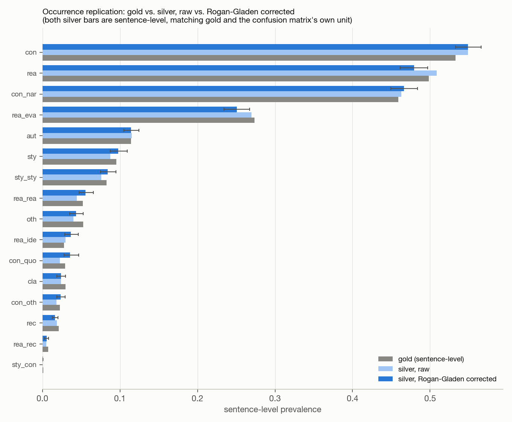

The first attempt at this got the unit of analysis wrong — applying the confusion matrix's *sentence-level* correction to Phase A's *review-level* "≥1 sentence with this label" statistic, which runs much higher (one review has ~10 sentences, only needs one hit) and isn't the quantity the confusion matrix measures. That produced nonsense (a couple of labels "corrected" to exactly 100%), caught by comparing against gold before trusting it. Fixed by reporting sentence-level prevalence throughout (the validated quantity) and keeping review-level "≥1" as a separate, explicitly raw-only, uncorrected statistic ([results/01_occurrence/silver_occurrence_review_level.csv](../results/01_occurrence/silver_occurrence_review_level.csv)).

Sentence-level, both raw and corrected track gold closely: mean |gap from gold| is **0.0059 raw, 0.0070 corrected** — correction moves the estimate closer to gold for 8/16 labels and gold's true value falls inside the corrected 95% CI for 9/16. Worth being honest about what this does and doesn't show: **correction did not uniformly outperform the raw estimate here**, unlike Phase B's synthetic validation where it always helped (mean |bias| dropped from 0.0070 naive to 0.0001 corrected in that controlled test). Real predictions don't guarantee the held-out 2,323-sentence test set's error rate transfers uniformly to a 5.2M-sentence corpus spanning 8 platforms and 23 years the way a controlled simulation, by construction, does. The correction still adds something raw point estimates don't — a valid confidence interval — just not a guaranteed bias reduction on every label. Full table: [results/01_occurrence/silver_occurrence_sentence_level.csv](../results/01_occurrence/silver_occurrence_sentence_level.csv), [results/01_occurrence/silver_vs_gold_occurrence.csv](../results/01_occurrence/silver_vs_gold_occurrence.csv).

## 2. Co-occurrence

*↔ [Phase A: §2. Co-occurrence](report.md#co-occurrence)*

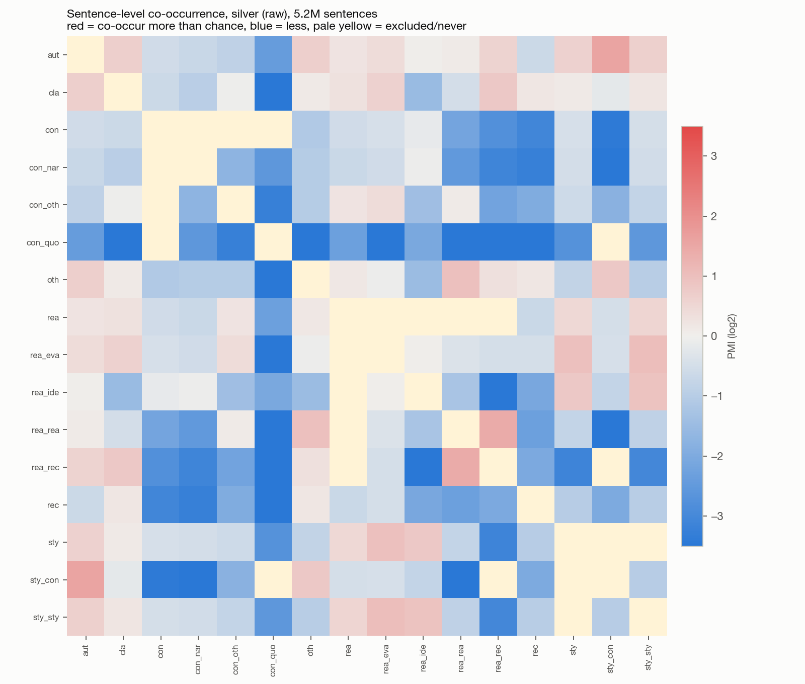

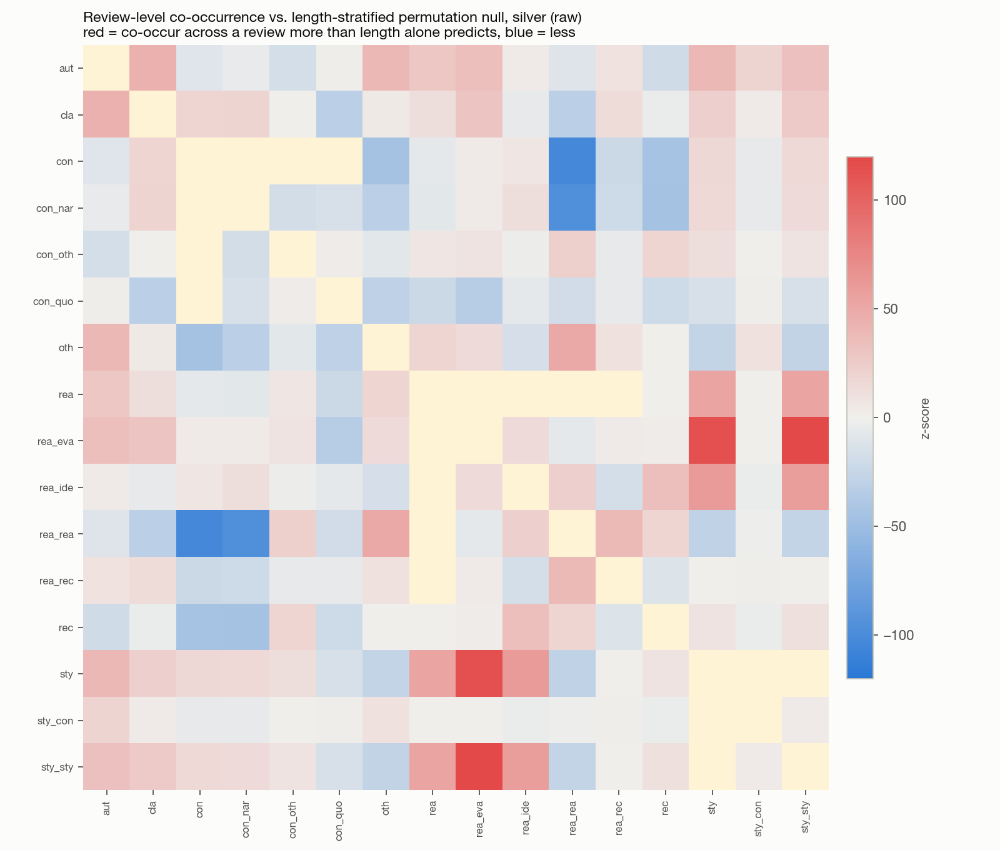

Replicates closely. The strongest sentence-level positive association in gold — `Style--Stylistic_features` ↔ `Reader_response--Evaluation_of_quality` (PMI 0.96) — is still strongly positive in silver (PMI 1.02), and the strongest review-level associations match too: `Evaluation_of_quality`↔`Style--Stylistic_features` is the single largest z-score in both (gold z=5.98; silver z=119.9 — z-scores scale with n, not a like-for-like magnitude comparison, but the *ranking* agrees). On the negative side, `Content`/`Content--Narrative` avoiding `Reader_response--Reading_Context` is the strongest repulsion in both datasets (gold z=−5.4/−4.9; silver z=−103/−96, again top-ranked in both). z-scores in the hundreds are expected and not specially meaningful at this n — with 467K reviews, detecting *some* deviation from the permutation null is almost guaranteed; the sign and relative ranking are what's informative, not the magnitude. Full tables: [results/02_cooccurrence/silver_cooccurrence_sentence.csv](../results/02_cooccurrence/silver_cooccurrence_sentence.csv), [results/02_cooccurrence/silver_cooccurrence_review.csv](../results/02_cooccurrence/silver_cooccurrence_review.csv).

**The length-confound check on sentence-level PMI (§2 of the Phase A report) replicates, and sharpens.** Correlation of full-corpus PMI with each length quartile's own PMI: **r=0.91 (shortest) rising to r=0.99 (longest)** — an even tighter gradient than gold's 0.72→0.97, confirming at 400x scale that the pooled sentence-level estimate is disproportionately a long-review estimate. 17 of 103 well-powered pairs (n_both≥20) flip sign somewhere across quartiles, all among the weaker associations, same as gold. And the flagship pair replicates almost exactly: `Style--Stylistic_features`/`Reader_response--Evaluation_of_quality` strengthens from PMI 0.45 in the shortest quartile to 1.19 in the longest (gold: 0.43→1.17) — independently re-derived at scale, not a small-sample coincidence. Full tables: [results/02_cooccurrence/silver_cooccurrence_sentence_by_length.csv](../results/02_cooccurrence/silver_cooccurrence_sentence_by_length.csv), [results/02_cooccurrence/silver_cooccurrence_sentence_length_corr.csv](../results/02_cooccurrence/silver_cooccurrence_sentence_length_corr.csv).

## 3. Contiguity

*↔ [Phase A: §3. Contiguity](report.md#contiguity)*

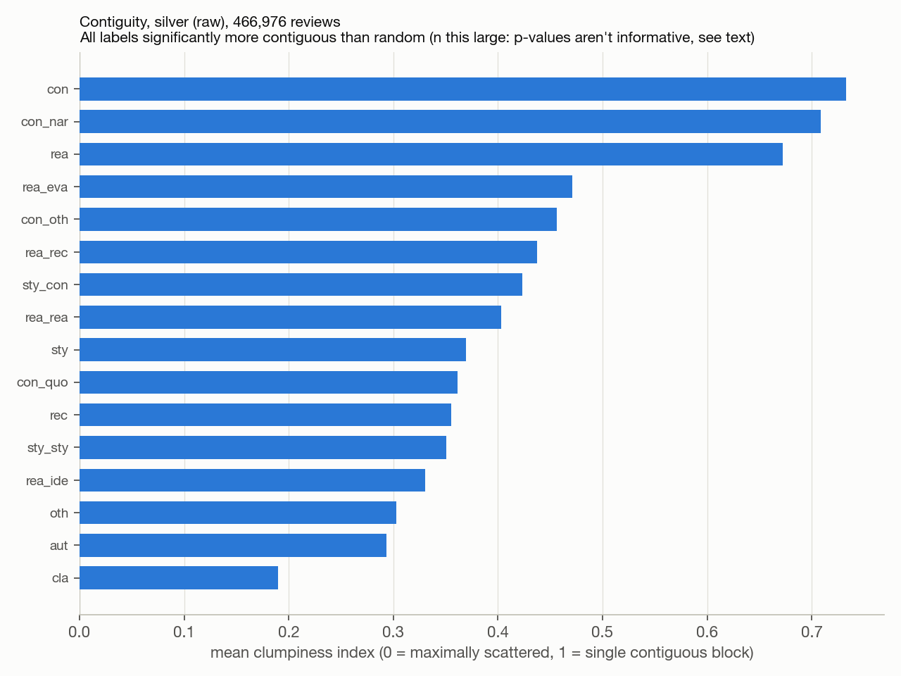

Replicates closely, same ranking as gold: `Content`, `Content--Narrative`, and `Reader_response` cluster into contiguous blocks most strongly (clumpiness 0.67–0.73, vs. gold's 0.78–0.78), `Classification` least (0.19, vs. gold's 0.24). Every label is significantly more contiguous than random placement — as with co-occurrence, the p-values (effectively 0 across the board given n) aren't the informative number here; the clumpiness index (an effect size) is. Same underlying finding as Phase A: reviewers write in topic blocks, not free association, and this holds at 400x scale. Full table: [results/03_contiguity/silver_contiguity_label_summary.csv](../results/03_contiguity/silver_contiguity_label_summary.csv).

### Review-level organization at scale

The measures above are per-label, pooled across reviews. Phase A's §3 added two *review-level* measures — is a given review block-structured, or does it alternate between categories — and this is their silver counterpart (`src/22_review_contiguity_scaled.py`). **291,818 of 466,973 reviews (62.5%)** are eligible for the per-label measure (≥2 categories on ≥2 sentences each, ≥3 sentences), close to gold's 60.4%, so the eligible population is comparably representative in both.

**A methodological note that made this feasible at all.** Gold's implementation permutes sentence order 1,000 times per review — untenable across 467K reviews. It turns out not to be necessary: both scores are *linear* in an underlying count, so the null expectation is available in closed form. For per-label clumpiness, `E[runs] = k(n−k+1)/n` for k sentences placed among n; for the configuration-boundary score, `E[boundaries] = (n−1)(1 − Σᵢcᵢ(cᵢ−1)/(n(n−1)))` for a review with configuration counts cᵢ. **Validated against gold's simulated nulls before use: mean absolute difference 0.003 (clumpiness) and 0.006 (boundaries), correlations 0.9995 and 0.9990** — the residual is Monte Carlo noise in the 1,000-permutation simulation, not error in the closed form. Silver then runs in about ten seconds. The trade-off is deliberate and worth stating: closed form gives the null *mean* but not its variance, so silver reports effect sizes without per-review significance tests. Phase A's §3 established that at review level the significance flag mostly tracks statistical power anyway (short reviews cannot clear it regardless of how organized they are), while excess-over-chance is the effect size.

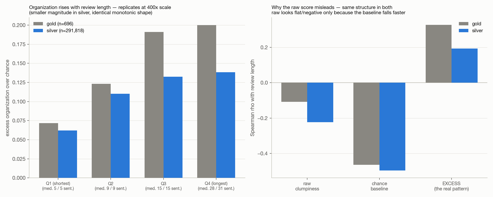

**Both review-level findings replicate.** Reviews are more organized than chance — mean clumpiness **0.700 vs. a null of 0.592 (excess +0.108**, against gold's +0.144) — and the independently-constructed configuration-boundary measure agrees (**0.590 vs. 0.468, excess +0.122**, gold +0.165). The two measures correlate at **ρ=+0.68 (gold: +0.63)**: related but far from redundant in silver too, so the "same conclusion from two different constructions" argument survives at scale.

**The length finding replicates in structure, more modestly in size.** Raw clumpiness *falls* with length (ρ=−0.22) while the chance baseline falls faster (ρ=−0.50), so **excess organization rises (ρ=+0.19**, against gold's +0.33), monotonically across quartiles: 0.062 → 0.110 → 0.133 → 0.138. The correction Phase A applied — that reading the raw score gets the length story backwards — is confirmed rather than being an artifact of gold's smaller sample. That the silver effect is roughly half gold's magnitude is worth flagging honestly: the direction and monotonic shape are what replicate cleanly; the exact size does not. Full tables: [results/22_review_contiguity_scaled/silver_review_contiguity_scaled.csv](../results/22_review_contiguity_scaled/silver_review_contiguity_scaled.csv), [results/22_review_contiguity_scaled/silver_review_contiguity_scaled_by_length.csv](../results/22_review_contiguity_scaled/silver_review_contiguity_scaled_by_length.csv).

**Not repeated on silver: the pairwise and zone analyses** (Phase A's §3 interleaving and §4 precedence / zone affinity / zone discovery). Deferred by decision rather than blocked — those need the per-review permutation machinery vectorized, unlike the review-level measures whose nulls turned out to be closed-form. Note for anyone picking this up: all 7 main labels *are* available in silver (the four `WEAK_MODEL_LABELS` are all sub-labels), so the silver zone analysis would have the same 21 pairs as gold, not a reduced set.

## 4. Order

*↔ [Phase A: §4. Order](report.md#order)*

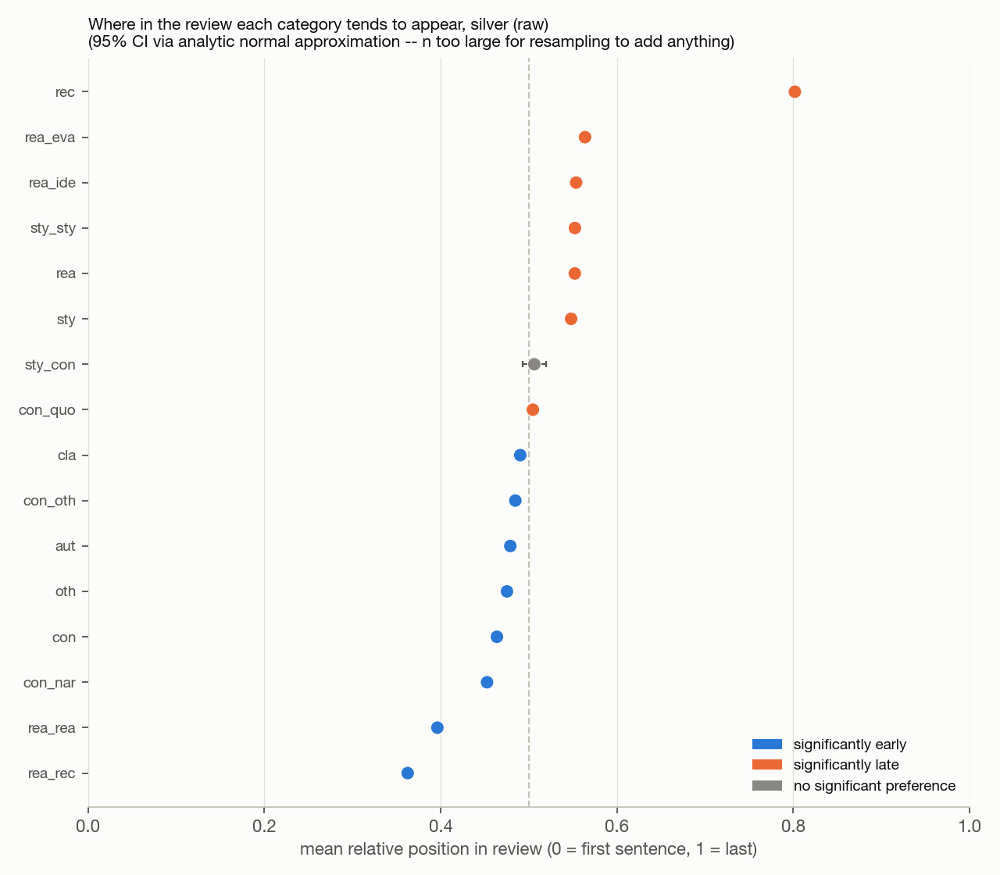

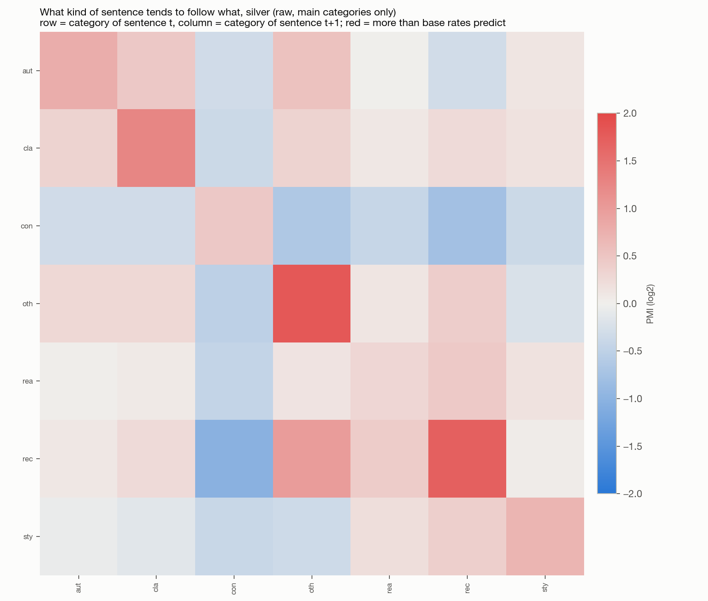

The review "arc" replicates in detail. Early: `Content--Narrative` (0.453), `Content` (0.464), `Other_works` (0.475), `Author` (0.479) — same ordering as gold. Late: `Style` (0.548), `Reader_response` (0.552), `Evaluation_of_quality` (0.564) — same ordering again. `Recommendations` is still the standout outlier, essentially closing the review (0.802, vs. gold's 0.830). The transition structure replicates too: every main category shows a strongly positive self-transition PMI (`Other_works`→`Other_works` highest at 1.81, vs. gold's 2.22), the Markov-property restatement of §3's contiguity finding.

**The same three multiplicity/length refinements from Phase A (chat, 2026-09-22)**, ported to `src/04c_order.py`, scaled analytically rather than by resampling since some labels here have millions of positions: the naive normal-approximation SE (std/sqrt(n)) this file already used in place of gold's bootstrap is replaced by a closed-form cluster-robust ("sandwich") SE on the ratio-of-sums mean — the same estimator behind `vce(cluster)` for a clustered mean, and the analytic limit of gold's cluster bootstrap. Onset stats (one value per review) keep the plain normal approximation, since no within-review clustering applies to them.

- **A genuinely interesting gold/silver contrast on `Author`.** Gold's cluster-robust correction knocked `Author`'s early skew below significance (§4 above) — with only 557 review-groups, the between-review noise swamped a real but small effect. Silver has 236,803 review-groups carrying the same-sized effect (mean 0.479 vs. gold's 0.482), and the cluster-robust CI there is tight enough ([0.478, 0.480]) to call it significant. Same underlying effect size, opposite significance call — a clean illustration of why the silver track's extra power matters for exactly the marginal cases gold can't resolve on its own, not just for rare-label prevalence.
- **Tail mass and onset replicate gold's shape.** `Content` is front-loaded (20.8% of sentences in the first fifth vs. 14.1% in the last; first mention 0.196, last 0.768) — same pattern, same rough magnitude as gold. `Author` again has more front- than back-mass (29.6% vs. 24.0%), matching gold's split once its own front/back figures are read correctly — both sit well above the 20% a uniform spread would predict, the same early-bio/late-recommendation mix gold's onset table suggested, tilted toward the earlier use in both tracks. Full table: [results/04_order/silver_order_onset.csv](../results/04_order/silver_order_onset.csv).
- **The `Classification` length reversal replicates, at far higher power.** Mean position goes **0.345 → 0.408 → 0.485 → 0.531** from the shortest review-length quartile (2–4 sentences) to the longest (16+) — the same early-to-late sign flip gold showed (0.32→0.54), now backed by 90,093 review-groups instead of 260. `Reader_response` and `Style` again drift substantially (0.475→0.593 and 0.454→0.590) while `Content` and `Recommendations` stay comparatively stable across quartiles. Full table: [results/04_order/silver_order_position_by_length.csv](../results/04_order/silver_order_position_by_length.csv).

Full tables: [results/04_order/silver_order_position.csv](../results/04_order/silver_order_position.csv), [results/04_order/silver_order_transitions.csv](../results/04_order/silver_order_transitions.csv).

### Zones at scale — and a case where significance had to be abandoned outright

Phase A derived a **zone** structure from within-review pairwise precedence (its §4): among reviews containing both A and B, does A reliably precede B? Categories with no reliable order sit in the same positional zone. Running that at silver scale required vectorizing the pairwise machinery (`src/23_zone_analysis_scaled.py`), and — as with §3's review-level measures — the permutation turned out to be unnecessary, since interleaving and union-clumpiness are also linear in an underlying count. Interleaving's null is the two-sample runs problem, `E[switches] = 2·nₐ·n_b/(nₐ+n_b)`. **Validated against gold's simulated versions before use: observed values match exactly, nulls to within 0.0005 on average.** Silver then runs in about seven seconds, and unlike gold — where four `Recommendations` pairs were unestimable — **all 21 pairs are available here**.

**The zone criterion could not survive contact with silver's sample size, and this is the clearest instance in this report of significance being useless.** Phase A classified a pair as "reliably ordered" using q<0.05. At silver's n, **20 of 21 pairs clear that bar** — including `Content`/`Other_works` at P=0.5056, which is significant purely because n=105,267. Applying the gold criterion would place nearly every category in its own zone and dissolve the structure entirely. What rescues it is noticing that gold's significance test was *already* acting as an effect-size threshold without anyone choosing one: gold's significant pairs bottom out at |P−0.5| = 0.0602 and its non-significant pairs top out at 0.0542. Making that explicit — **"reliably ordered" means |P−0.5| ≥ 0.055** — reproduces gold's classification exactly while remaining meaningful at scale, and is applied to both sources so the criterion means the same thing in each.

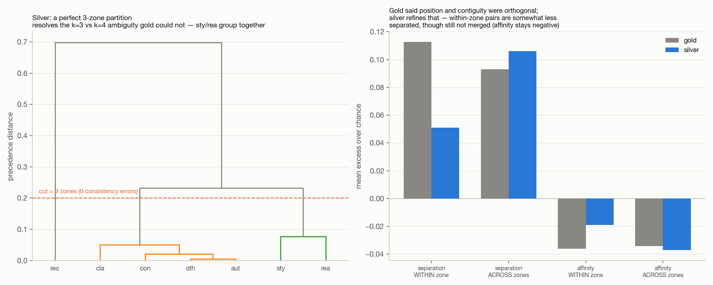

**Silver returns a perfect three-zone partition — zero consistency errors — and settles a question gold left open.**

| zone | categories | mean position |
|---|---|---|
| 1. Opening | `Content`, `Other_works`, `Author`, `Classification` | 0.464 – 0.490 |
| 2. Middle | `Style`, `Reader_response` | 0.548, 0.552 |
| 3. Closing | `Recommendations` | 0.802 |

Zone 1's membership is identical to gold's. The open question was whether `Style` and `Reader_response` form one zone (k=3) or two (k=4): gold's mechanical criterion picked k=4 by a single error, while the effect-size reasoning favoured k=3, and Phase A reported both rather than choosing. **Silver settles it as k=3, with zero errors** — `Style` before `Reader_response` remains too small an ordering (|P−0.5| = 0.038) to separate them even at n=227,570, while `Other_works`/`Style`, gold's one boundary anomaly, resolves cleanly to ordered. The reading Phase A flagged as more defensible is the one that holds at scale.

**One Phase A conclusion needs softening, though.** Gold found within-zone and cross-zone contiguity profiles nearly identical and concluded that position and contiguity are "essentially orthogonal." Silver's larger sample separates them: within-zone separation excess is **+0.051 vs. +0.106 across zones**, and zone affinity **−0.019 within vs. −0.037 across**. So categories sharing a positional zone *are* somewhat less separated and less anti-merged than cross-zone pairs — the orthogonality claim was too strong. What survives is the qualitative core, and it survives intact: **within-zone affinity is still negative**, so categories sharing a zone still do not merge into a shared stretch. Positional zones remain positional. Full tables: [results/21_zone_discovery/silver_zone_membership.csv](../results/21_zone_discovery/silver_zone_membership.csv), [results/21_zone_discovery/silver_zone_profile.csv](../results/21_zone_discovery/silver_zone_profile.csv), [results/23_zone_analysis_scaled/silver_pairwise_precedence.csv](../results/23_zone_analysis_scaled/silver_pairwise_precedence.csv), [results/23_zone_analysis_scaled/silver_pair_interleaving.csv](../results/23_zone_analysis_scaled/silver_pair_interleaving.csv), [results/23_zone_analysis_scaled/silver_pair_zone_affinity.csv](../results/23_zone_analysis_scaled/silver_pair_zone_affinity.csv).

**Two further scale effects worth recording.** All 21 pairs now show significantly positive interleaving separation (gold: 17 of 17 estimable), so "categories keep to their own stretches" is unqualified at scale. And on zone affinity, gold found *no* pair merging above chance; silver finds **4 of 21** doing so — `Author`+`Classification`, `Classification`+`Other_works`, `Classification`+`Reader_response`, `Author`+`Other_works`, three of which are the non-`Content` opening pairs that gold could only call indifferent. Their effect sizes are tiny (+0.007 to +0.015) against separations reaching −0.103, so the honest reading is that gold's "no merging" was a power limitation on those specific pairs, and what replaces it is "negligible merging" rather than a real zone.

## 5. Review typology

*↔ [Phase A: §5. Review typology](report.md#review-typology)*

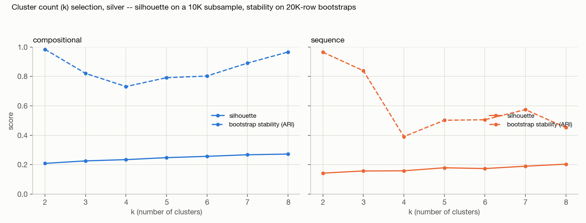

k=8 chosen independently by the same silhouette+stability procedure as gold (silhouette 0.27, stability 0.97 at k=8 — both close to gold's 0.27/0.97). This alone is a good sign: the same model-selection process, applied to a completely different, 400x-larger sample, landed on the same k.

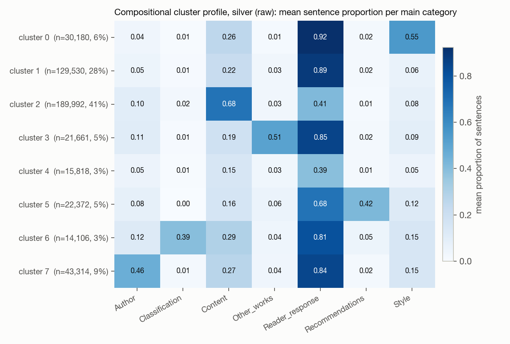

The cluster *profiles* match gold almost feature-for-feature, not just the count:

| silver cluster | n (%) | reading | matches gold cluster |
|---|---|---|---|
| 2 | 189,992 (41%) | narrative-forward (`Content` 0.68) | 0 (narrative-forward, 37%) |
| 1 | 129,530 (28%) | response-forward (`Reader_response` 0.89, low `Content`) | 6 (response-forward, 26%) |
| 7 | 43,314 (9%) | author-focused (`Author` 0.46) | 7 (author-focused, 12%) |
| 0 | 30,180 (6%) | style-and-response, minimal plot (`Style` 0.55) | 1 (same profile, 6%) |
| 5 | 22,372 (5%) | recommendation-forward (`Recommendations` 0.42), **highest rating** | 3 (same profile, highest rating, 6%) |
| 3 | 21,661 (5%) | comparison-heavy (`Other_works` 0.51) | 4 (same profile, 4%) |
| 4 | 15,818 (3%) | mixed/moderate | 5 (mixed/moderate, 5%) |
| 6 | 14,106 (3%) | classification-heavy (`Classification` 0.39) | 2 (same profile, 3%) |

Every one of gold's 8 archetypes reappears, at similar relative sizes, with the same rating pattern (recommendation-forward highest in both: gold 4.45, silver 4.53). This is the strongest single piece of evidence in this report that Phase A's typology isn't a small-sample artifact.

### What do the sequence clusters actually contain?

Positional feature is onset (first-occurrence), not mean position, as of 2026-09-22 — see gold's §5 for why (prototyped before adopting: cleaner signal, lower length confound, length-stratified imputation tested and rejected). Under the previous (mean-position) construction silver chose a *finer* k than gold (7 vs. 4); under onset it inverts — **silver now chooses k=2 (gold: k=3)**, the coarsest option on the table (silhouette 0.257, stability 0.98, the most stable k tested here by a wide margin):

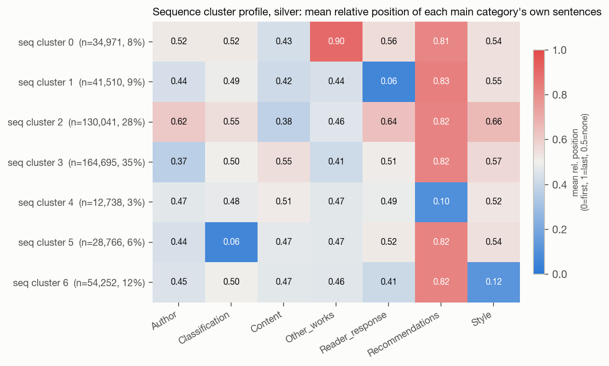

| silver cluster | n (%) | reading | gold equivalent |
|---|---|---|---|
| 1 | 383,577 (82.1%) | Default — `Reader_response` opens early (0.03), everything else in a loose 0.28–0.42 band, `Recommendations` still closes (0.79) | 0 (same profile, 76.7%) |
| 0 | 83,396 (17.9%) | The classic arc — `Content` opens very early (0.04), `Reader_response` (0.55) and `Style` (0.58) come late, `Recommendations` closes (0.79) | 2 (same profile, 20.0%) |

The two clusters that survive at silver's chosen k are the same two dominant archetypes gold found, at closely matching relative sizes (82.1% vs. gold's 76.7% for the default cluster; 17.9% vs. 20.0% for the classic arc) and near-identical onset values for every category — a clean replication of the corpus's two dominant structural conventions, independently re-derived at 400x scale. What does *not* replicate: gold's third, small (3.3%) recommendation-first cluster has no silver counterpart at k=2 — silver's own model-selection process, run independently with the same protocol, simply didn't pick a k fine enough to separate it out (or it doesn't exist as a distinct enough archetype at this scale; the two aren't distinguishable from k selection alone). This is the opposite lesson from most of this report's "does gold's finding hold up at scale" questions: here scale bought *less* apparent structure, not more, and the honest read is that k=2's stability (0.98) so thoroughly dominates every finer option that the finer structure — real or not — isn't what the data most confidently supports at silver's size. Full table: [results/11_sequence_cluster_profile/silver_typology_sequence_cluster_profile.csv](../results/11_sequence_cluster_profile/silver_typology_sequence_cluster_profile.csv).

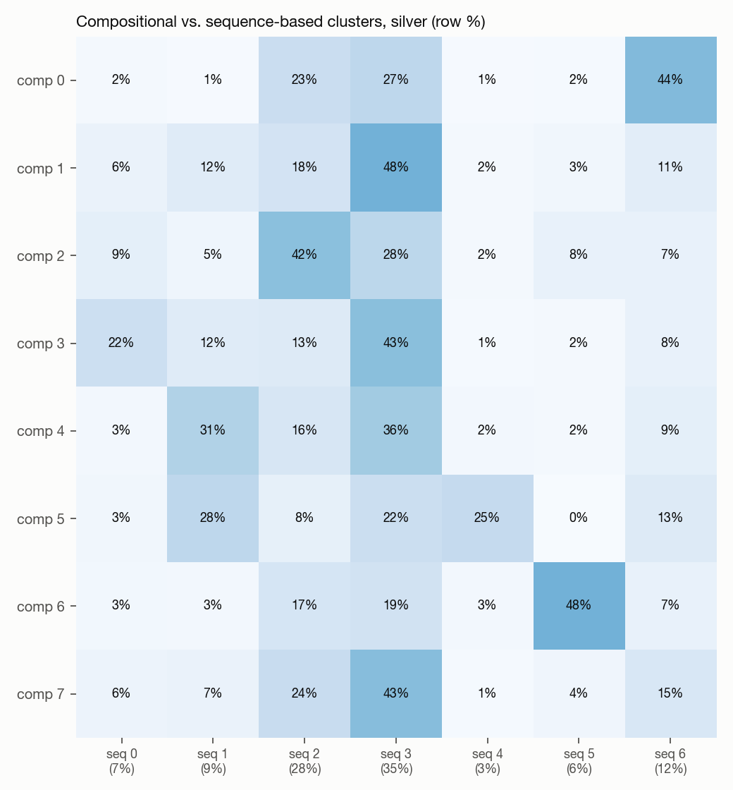

The composition/sequence independence finding replicates, and sharpens: silver's cross-tab ARI is **−0.018** (gold: 0.014, itself down from the mean-position version's 0.063 in both tracks) — what a review discusses and where it discusses things remain independent axes at scale too, if anything more cleanly so under onset. The one structural link that *does* survive from gold — narrative-forward reviews (compositional cluster 2, 41% of the corpus) disproportionately landing in the classic-arc sequence cluster — replicates almost exactly: 37.3% of that compositional cluster lands in the classic-arc sequence cluster against an 17.9% base rate, a **2.1× enrichment** (gold: 2.3×). Gold's other link — recommendation-heavy composition enriching for the recommendation-first sequence cluster — can't be checked here, since silver's chosen k has no recommendation-first cluster to enrich into. Full tables: [results/05_typology/silver_typology_k_selection.csv](../results/05_typology/silver_typology_k_selection.csv), [results/05_typology/silver_typology_cluster_profile.csv](../results/05_typology/silver_typology_cluster_profile.csv), [results/05_typology/silver_typology_crosstab.csv](../results/05_typology/silver_typology_crosstab.csv).

## 6. Genre and platform

*↔ [Phase A: §6. Genre and platform effects](report.md#genre-and-platform-effects)*

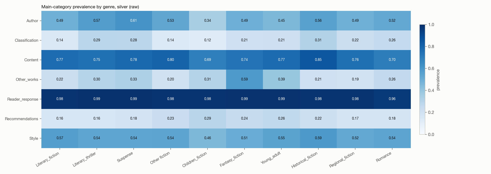

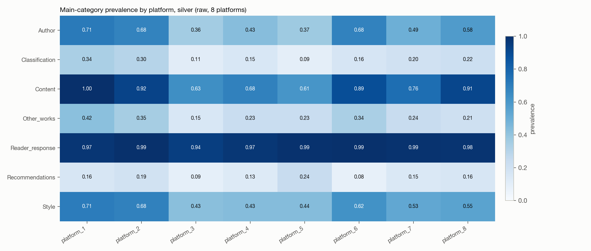

With 8 real platforms (vs. gold's 4, one of which was a single reviewer) and every genre×platform cell populated in the hundreds or thousands, this section can go further than gold's could. Platform remains the stronger association (`Content--Narrative` by platform: Cramér's V=0.383) than genre (`Other_works` by genre: V=0.174) — same ordering as gold. `Recommendations` is still notably genre-skewed, consistent with gold's `Children_fiction`/`Young_adult` reading.

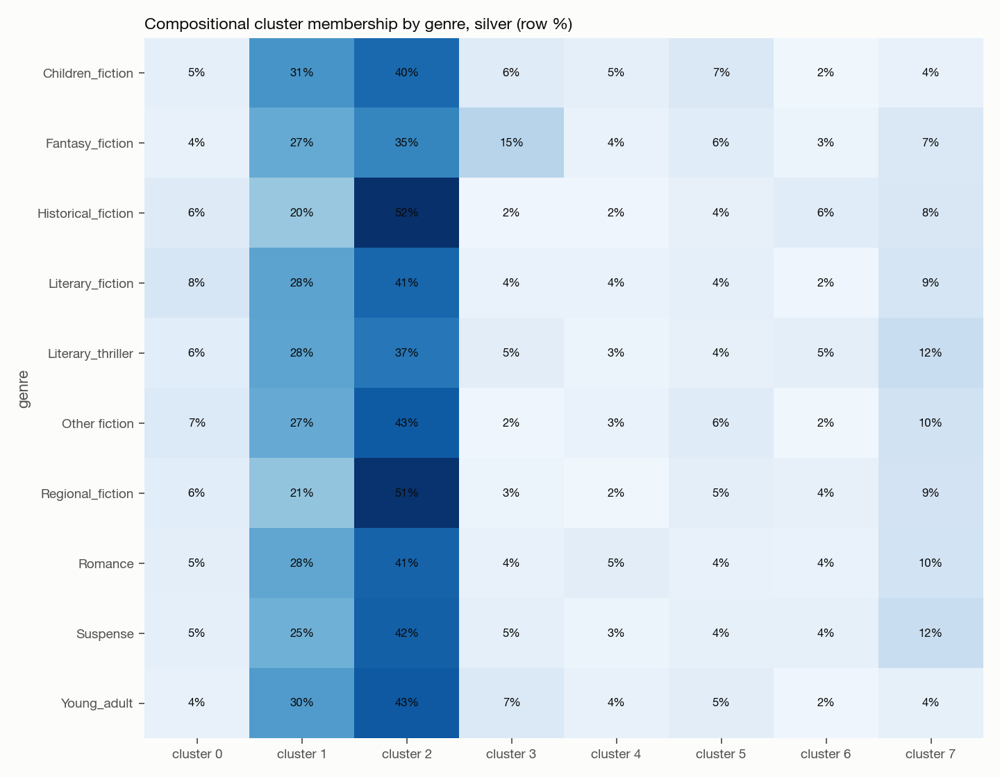

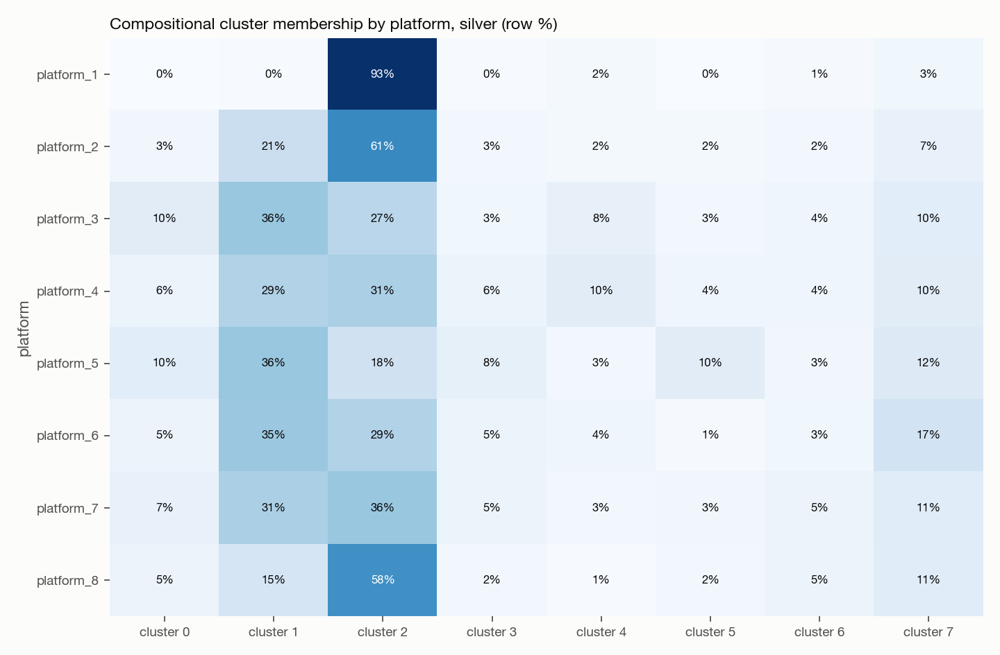

Typology cluster membership associates with both genre (χ²=14,477, Cramér's V=0.067) and platform (χ²=110,067, V=0.183) — again platform explaining more than genre, matching gold's pattern (and §7 of the Phase A report's variance-partitioning finding that platform explains more composition variance than genre does). Full tables: [results/06_genre_platform/silver_genre_prevalence.csv](../results/06_genre_platform/silver_genre_prevalence.csv), [results/06_genre_platform/silver_platform_prevalence.csv](../results/06_genre_platform/silver_platform_prevalence.csv), [results/06_genre_platform/silver_typology_by_genre.csv](../results/06_genre_platform/silver_typology_by_genre.csv), [results/06_genre_platform/silver_typology_by_platform.csv](../results/06_genre_platform/silver_typology_by_platform.csv).

### Do contiguity and order vary by genre or platform?

New question (chat, 2026-08-31). §6 above and §7 of the Phase A report show genre and platform shape *what* a review discusses. Whether they shape *how it is organised* — §3's contiguity, §4's ordering — had not been asked. `src/25_contiguity_by_genre_platform.py`, on the 291,818 contiguity-eligible reviews.

An uncontrolled comparison would mostly re-measure length, since §6 established platform explains review length strongly (platform_2 reviews run ~3× platform_5's) and §3 showed contiguity excess still rises with length. So the model is `excess ~ length + genre + platform`, and the reported quantity is **partial η²** per factor rather than a list of coefficients — with n≈292,000 every p-value here is effectively zero, so effect size is the only informative output.

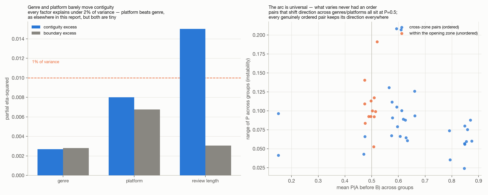

**Genre and platform barely move contiguity at all.** Partial η² for contiguity excess: **genre 0.003, platform 0.008, length 0.015** — every factor under 2% of variance, and genre under a third of a percent. Platform beats genre, the same ordering §6 and §7 find for composition, but here both are near-negligible. Boundary excess behaves the same (genre 0.003, platform 0.007, length 0.003). Length-adjusted group means bear this out: contiguity excess spans only 0.083–0.126 across ten genres and 0.081–0.120 across seven platforms. **Boundary excess is the one measure with a visible platform spread** — 0.084 (platform_6) to 0.186 (platform_8), a factor of 2.2 that survives length adjustment — so *where* a review is published affects how often it switches between category configurations more than it affects whether each category stays in one block.

The contrast with §11's reviewer analysis is the substantive point: contiguity's ICC across reviewers is **0.10 after the same controls**, an order of magnitude above genre's and platform's η². **Organization is a personal property far more than a venue or genre property** — the opposite balance from composition, where §6 finds platform mattering substantially.

**And the review arc is universal.** Rather than deriving ten incomparable zone structures, the test computes within-review precedence P(A before B) per genre and per platform for all 21 pairs and asks how much the structure moves. **14 of 21 pairs keep the same direction in every genre, and 14 of 21 in every platform** — but the seven that flip are not evidence of genre-specific arcs. They sit at P≈0.5 (mean distance from 0.5 of **0.014**, versus **0.213** for the stable pairs), and **all 12 of the within-opening-zone pairs are unstable while 28 of 30 other pairs are stable**. In other words, the only orderings that vary across genres and platforms are precisely the ones §4's zone analysis found had no reliable order to begin with — flipping around a coin toss, not disagreeing about a convention.

`Recommendations` last is the strongest case: it holds in **all ten genres and all seven platforms**, every estimable pair, with a mean spread of only 0.05–0.08. The three-zone arc derived on the pooled corpus is not an artifact of aggregating heterogeneous genres — it is the same arc everywhere, and this is independent confirmation of the opening zone's unorderedness from a direction §4 could not provide. Full tables: [results/25_contiguity_by_genre_platform/silver_contiguity_anova.csv](../results/25_contiguity_by_genre_platform/silver_contiguity_anova.csv), [results/25_contiguity_by_genre_platform/silver_contiguity_by_genre_platform.csv](../results/25_contiguity_by_genre_platform/silver_contiguity_by_genre_platform.csv), [results/25_contiguity_by_genre_platform/silver_precedence_by_group.csv](../results/25_contiguity_by_genre_platform/silver_precedence_by_group.csv).

## 7. Book, author, and reviewer similarity

*↔ [Phase A: §7. Book, author, and reviewer similarity](report.md#book-author-and-reviewer-similarity)*

The one Phase A section (§7 of the gold report) with no silver counterpart until now. Same question — are same-book, same-author-different-book, and same-reviewer review pairs more similar than random pairs, measured as cosine similarity between reviews' category-proportion vectors? — but the gold method (a dense pairwise distance matrix + label-permutation test) doesn't transfer: at gold scale the "multi-review" subsets were a small, convenient slice of the corpus (85 works, 122 authors, 51 reviewers). At silver scale they're most of it — 37,086 works (453,254 reviews, 98% of the corpus after the group-size filter), 14,096 authors with ≥2 reviews (461,351 reviews, 99%), 30,101 reviewers excl. `platform_1` (336,109 reviews, 72%) — and some individual groups are enormous (the single most prolific author has 54,889 reviews). A dense N×N distance matrix over that is many GB before computing anything.

**Sizing this first (per the plan's standing rule: check feasibility before committing to full implementation) ruled out the naive approach and led to a scalable redesign** in [src/common/similarity.py](../src/common/similarity.py): within-group similarity computed as one small block-diagonal matrix per group (capped at 100 members — exact under the cap, an unbiased random-subsample estimate over it, so the 54,889-review author can't blow up the compute), a cluster bootstrap (resampling groups, not individual pairs, since within-group pairs aren't independent of each other) for the confidence interval, and a random-pairs baseline from a sampled million pairs rather than an exhaustive enumeration (infeasible — ~10¹¹ pairs in the full corpus). **Validated against the original dense method on gold's own book and author subsets before trusting it here:** exact agreement on the point estimates and matching substantive conclusions (book significant both ways, author-different-book not significant both ways), with the z-scores differing modestly since the variance estimators differ (cluster bootstrap + baseline SE vs. label permutation) — a difference in precision, not in what's being measured.

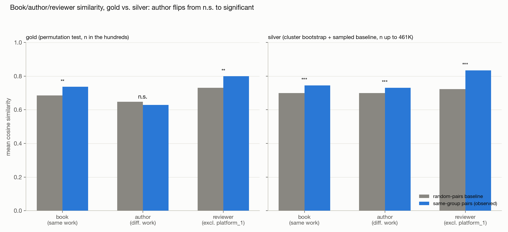

**Book: yes, replicates.** 37,086 works with ≥2 reviews, 453,254 reviews, 7,291,244 eligible pairs — same-book pairs average 0.746 cosine similarity (95% CI 0.744–0.747) vs. 0.699 for random pairs (z=53.2, p≈0). Same direction as gold's 0.737 vs. 0.686 (z=2.98), now with the statistical power to be unambiguous rather than merely suggestive. Full tables: [results/07_book_author_similarity/silver_book_similarity_test.csv](../results/07_book_author_similarity/silver_book_similarity_test.csv), [results/07_book_author_similarity/silver_book_similarity_per_work.csv](../results/07_book_author_similarity/silver_book_similarity_per_work.csv).

**Author (different books): yes at silver scale — this reverses gold's null finding.** 14,096 authors have ≥2 reviews, but only 6,099 of them retain at least one eligible different-book pair after excluding same-work pairs (many multi-review authors turn out to have all their reviews on a single book) — 4,176,319 eligible pairs, 461,351 reviews in the underlying pool. Same-author-different-book pairs average 0.732 similarity (CI 0.729–0.735) vs. 0.700 baseline (z=21.8, p=1.0×10⁻¹⁰⁵). Gold found the opposite: same-author pairs *below* baseline (0.629 vs. 0.647, z=−1.39, n.s.), and explicitly concluded "no evidence that an author's books get reviewed similarly." **The most defensible reading is that gold's null was a power problem, not a real absence of effect** — 122 authors and 6,933 eligible pairs is thin for detecting an effect this size (silver's equivalent per-pair signal, projected down to gold's sample size, would not reliably clear significance either). This is the mirror image of the Literary_fiction rating finding in §10 below: there, a prominent gold finding didn't survive scale; here, a prominent gold *null* didn't survive scale. Both are exactly the kind of correction Phase C exists to catch, in opposite directions — scale can both debunk a spurious finding and rescue a real one that gold was underpowered to see. Full tables: [results/07_book_author_similarity/silver_author_similarity_test.csv](../results/07_book_author_similarity/silver_author_similarity_test.csv), [results/07_book_author_similarity/silver_author_similarity_per_author.csv](../results/07_book_author_similarity/silver_author_similarity_per_author.csv).

**Reviewer: yes, the strongest of the three — matches gold's ranking.** 30,101 reviewers with ≥2 reviews excl. `platform_1`, 336,109 reviews, 5,810,165 eligible pairs — same-reviewer pairs average 0.835 similarity (CI 0.831–0.839) vs. 0.723 baseline (z=55.2, p≈0), the largest gap of the three tests, same as gold (0.800 vs. 0.730, z=3.10, also the largest gap there). People who review more than once keep writing the same *kind* of review — the most robust of the three findings across both datasets. Full tables: [results/07_book_author_similarity/silver_reviewer_similarity_test.csv](../results/07_book_author_similarity/silver_reviewer_similarity_test.csv), [results/07_book_author_similarity/silver_reviewer_similarity_per_reviewer.csv](../results/07_book_author_similarity/silver_reviewer_similarity_per_reviewer.csv).

**Not redone here: the comparative PERMANOVA / variance-partitioning** (gold §7's "which explains more: reviewer, book, or author?", which found reviewer > book > author > platform > genre). `oneway_permanova` has the same dense-matrix problem as the original pairwise test and would need its own scalable redesign (sum-of-squares via sampling rather than a full distance matrix) — scoped out as follow-up work rather than shipped as a rushed implementation of a statistic this central to the report's interpretation. Gold's caveat about the author PERMANOVA row being confounded with genre (76% of multi-review authors write in only one genre) is worth flagging as relevant background for that follow-up, since it's the same author-consistency question now resolved differently at silver scale.

## 8. Temporality

*↔ [Phase A: §8. Temporality](report.md#temporality)*

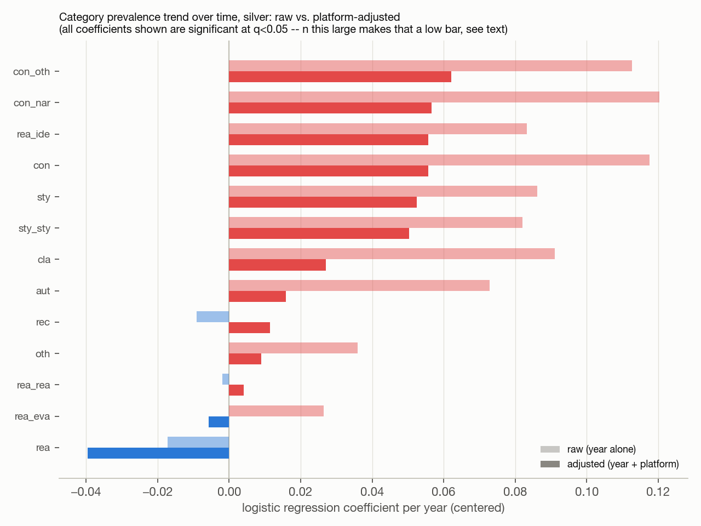

Same platform-confound problem as gold (`platform_1` still has zero dated reviews here too — 18,123/18,123 missing), same fix (every trend reported raw and platform-adjusted). All 13 tested labels show a "significant" review-level adjusted trend — at n≈440K, that's close to guaranteed and not the interesting number; direction and relative size are. `Content`, `Content--Narrative`, `Style`, `Style--Stylistic_features`, `Classification` all trend upward (matches gold's rising set). One difference worth noting: gold found no directional trend for `Reader_response` overall; silver finds a small but significant *decline* (adjusted coef −0.040) — consistent with, not contradicting, the typology shift below (response-forward reviews receding as narrative-forward ones grow).

**Fixed rather than left as a caveat (ANALYSIS_PLAN.md TODO, 2026-08-19): review length grew substantially over 1999–2022 (below), and the review-level "≥1 sentence" outcome above picks that up mechanically — a category whose true per-sentence rate never changed can still show a rising review-level trend purely because longer reviews have more chances to contain at least one instance.** Every trend is now also fit at the sentence level, which has no such mechanism to confound it:

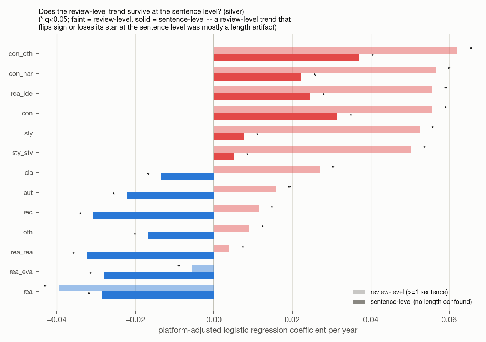

The result is more dramatic than gold's version of this check: **5 of the review-level "risers" don't just fail to survive at the sentence level — they flip sign, both significantly.** `Classification`, `Author`, `Recommendations`, `Other_works`, and `Reader_response--Reading_Context` all show a positive, "significant" review-level trend and a negative, significant sentence-level trend. At silver's scale this isn't ambiguous: these categories' true per-sentence rates are *declining*, and the review-level measure only looked like it was rising because reviews got long enough to keep finding at least one instance anyway. Only 8 of the 13 tested labels show the same sign at both levels: `Content`, `Content--Narrative`, `Content--Other`, `Style`, `Style--Stylistic_features`, `Reader_response--Identification_and_immersion` (all real risers) and `Reader_response`, `Reader_response--Evaluation_of_quality` (real decliners, the latter newly confirmed — its review-level trend was barely significant in the wrong-looking direction).

This resolves the `Reader_response` vs. `Identification_and_immersion` question directly rather than by inference: `Reader_response`'s sentence-level decline is real and large (adjusted coef −0.029, matching the raw sentence-level rate collapsing from 76% of sentences in 1999 to 46% in 2022); `Identification_and_immersion`'s sentence-level rise is also real (adjusted coef +0.025) — it is a genuine riser, not a length artifact, even though its raw sentence-level rate is close to flat in absolute terms (3.5%→3.5%) — the regression's coefficient reflects direction and consistency across the whole period, not just the endpoints, and both checks agree it's positive. Reader-response commentary overall is getting rarer; what's left is shifting toward being specifically about immersion rather than a generic reaction. (A minor, ruled-out third factor: silver's main/sub predictions come from independent classifiers that can disagree — `Identification_and_immersion=1` while `Reader_response=0` for 0.8% of that sub's sentences, too small to drive a trend divergence this size.)

**Worth being precise about what "length artifact" means, so it doesn't read as "not real"** (raised in chat, 2026-08-19): length itself isn't noise — it plausibly reflects genuine differences in what a reviewer has to say, not a nuisance to explain away. The artifact is specifically in the review-level "≥1 sentence" *measure*, which mechanically inflates with more sentences regardless of content. The sentence-level fix removes that inflation but replaces it with a different simplification: a corpus-wide rate where longer reviews (more sentences) get more weight, not a length-neutral measure of how much of *a given review* a category occupies. §9 below treats that question, and two further ones (do long reviews cluster differently, are their sentences written differently), as first-class dimensions in their own right rather than covariates to net out.

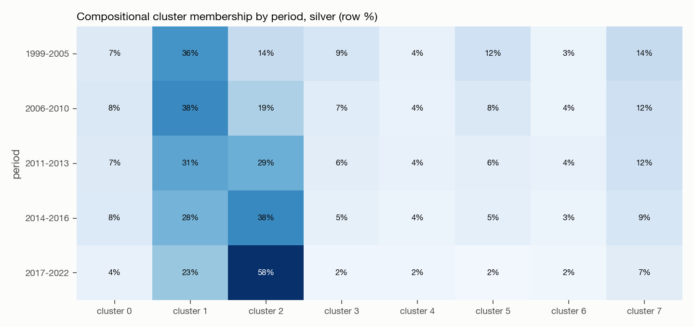

The "response-forward gives way to narrative-forward" shift replicates and is **more pronounced** with the full date range: silver's narrative-forward cluster grows from 16% (1999–2005) to 58% (2017–2022) of the corpus, vs. gold's 17%→49%. Review length also keeps growing (raw ρ=0.36, adjusted coef +0.37 sentences/year, both significant) — same direction as gold. Full tables: [results/08_temporal/silver_temporal_category_trends.csv](../results/08_temporal/silver_temporal_category_trends.csv), [results/08_temporal/silver_period_prevalence.csv](../results/08_temporal/silver_period_prevalence.csv), [results/08_temporal/silver_typology_by_period.csv](../results/08_temporal/silver_typology_by_period.csv).

## 9. Review length as a substantive dimension

*↔ [Phase A: §9. Review length as a substantive dimension](report.md#review-length-as-a-substantive-dimension)*

Silver counterpart to the question §8 raised: "length artifact" only means the review-level "≥1 sentence" *measure* is inflated by length, not that length itself is meaningless. Same three sub-analyses as gold's §9 (composition-vs-length, cluster-vs-length, density/specificity), at 400x the scale.

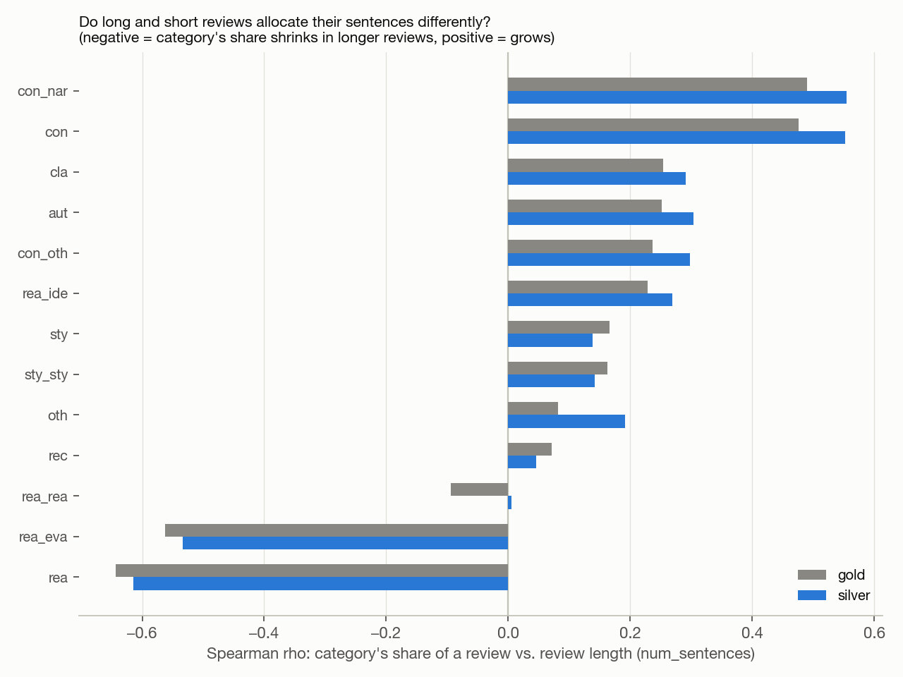

**Do long and short reviews talk about different things? Replicates closely.** `Reader_response`'s share of a review shrinks sharply with length (ρ=−0.61 silver vs. −0.64 gold; `Evaluation_of_quality` alone: −0.53 vs. −0.56); `Content`/`Content--Narrative`'s share grows just as sharply (ρ=0.55 vs. 0.48/0.49 gold). The sign-discordant (positive Spearman, negative OLS slope) pattern gold showed for a handful of categories is **more widespread at silver scale** — 7 of 13 tested labels (`Recommendations`, `Other_works`, `Style`, `Style--Stylistic_features`, `Classification`, `Reader_response--Identification_and_immersion`, `Reader_response--Reading_Context`) show it, versus gold's 4 — consistent with the same non-monotonic, hump-shaped relationship (share rises off a near-zero baseline in short reviews, dilutes again in very long ones), now resolved more precisely with more data rather than looking like noise. Full table: [results/09_length_dimension/silver_length_share_correlation.csv](../results/09_length_dimension/silver_length_share_correlation.csv).

The third-way proportion year-trend is where silver adds something gold's small sentence counts couldn't show cleanly: re-run with `prop__label` as the outcome, its sign agrees with the *sentence-level* trend (not the review-level one) for **all 5** of §8's sign-flipping categories (`Classification`, `Author`, `Recommendations`, `Other_works`, `Reader_response--Reading_Context`) — a **third independent method landing on the same side as the sentence-level fix**, not just two methods agreeing with each other by construction. Overall 8 of 13 labels agree in direction across all three measures (review-level, sentence-level, share); the 5 disagreements are exactly §8's flagged sign-flips, not new discrepancies. Full tables: [results/09_length_dimension/silver_length_proportion_year_trends.csv](../results/09_length_dimension/silver_length_proportion_year_trends.csv), [results/09_length_dimension/silver_length_temporal_three_way_comparison.csv](../results/09_length_dimension/silver_length_temporal_three_way_comparison.csv).

**Do long reviews cluster differently? Replicates, and the effect is if anything sharper.**

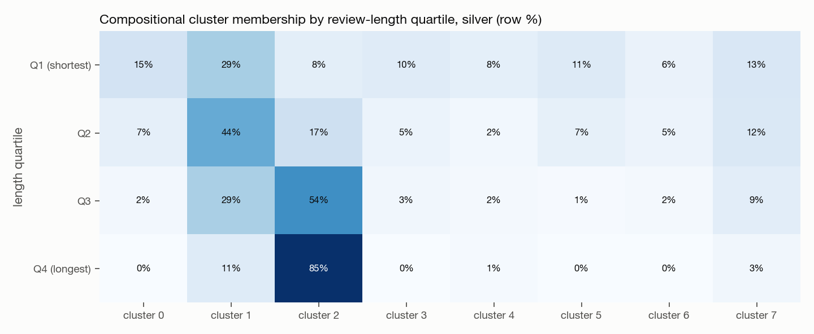

Length quartile associates with compositional cluster membership more strongly than genre or platform (χ²=215,683, p≈0, Cramér's V=0.392 — essentially identical to gold's V=0.394) and more weakly with sequence cluster (χ²=34,058, V=0.270, vs. gold's 0.241). Same concentration in one cluster: **cluster 2, the narrative-forward archetype (§5, 41% of the corpus), captures 85% of the longest quartile of reviews and only 8% of the shortest** (gold: cluster 0, 79%/8%). The same honest caveat applies at scale: this cluster may be partly rediscovering verbosity rather than a purely qualitative distinction, and that's not resolved by having more data — it would need the within-long-subset re-clustering follow-up flagged in gold's §9, not attempted here either. Full tables: [results/09_length_dimension/silver_length_quartile_by_composition_cluster.csv](../results/09_length_dimension/silver_length_quartile_by_composition_cluster.csv), [results/09_length_dimension/silver_length_quartile_by_sequence_cluster.csv](../results/09_length_dimension/silver_length_quartile_by_sequence_cluster.csv).

**Are longer reviews' sentences written differently? Same direction, smaller magnitude.**

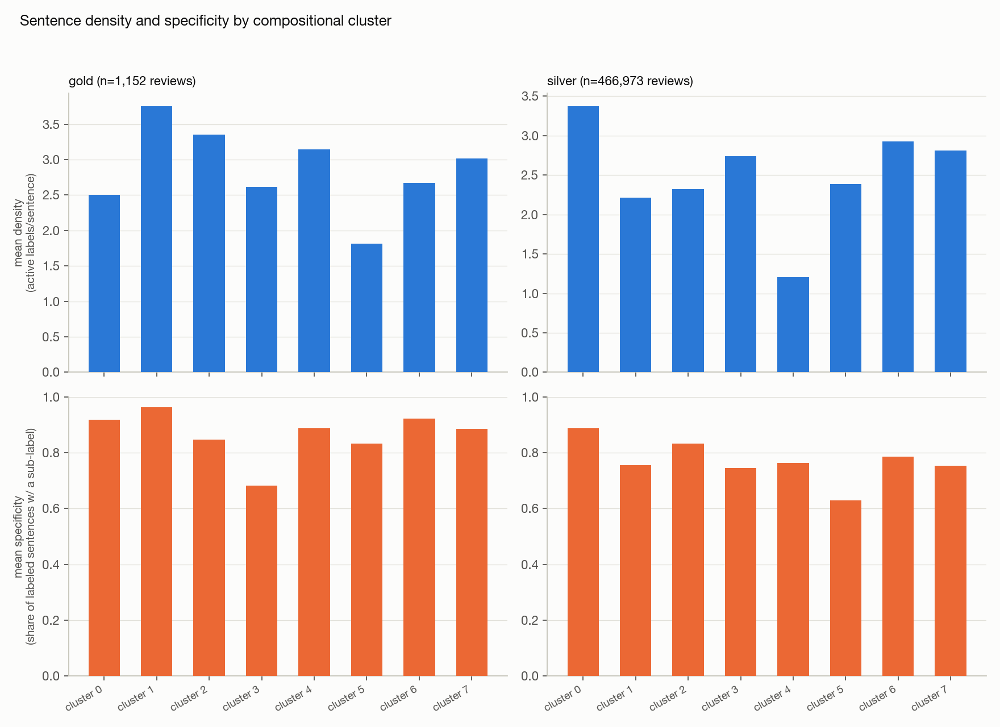

Density and specificity both decrease with length (density ρ=−0.17, specificity ρ=−0.18 — real but noticeably weaker than gold's −0.38/−0.30, likely diluted by the much wider length range at silver scale, up to 567 sentences vs. gold's max of 78). Neither trends meaningfully over time once length is accounted for (density year ρ=−0.02; specificity year ρ=0.004, technically significant at this n but negligible in size). By cluster, cluster 0 (small, `Reader_response`-heavy, similar profile to gold's densest cluster) is both the densest (3.37) and most specific (89%); cluster 4 is the sparsest (1.20); cluster 5 the least specific (63%). Full tables: [results/09_length_dimension/silver_density_specificity_correlations.csv](../results/09_length_dimension/silver_density_specificity_correlations.csv), [results/09_length_dimension/silver_density_specificity_by_composition_cluster.csv](../results/09_length_dimension/silver_density_specificity_by_composition_cluster.csv).

## 10. Ratings — the headline finding

*↔ [Phase A: §10. Ratings](report.md#ratings)*

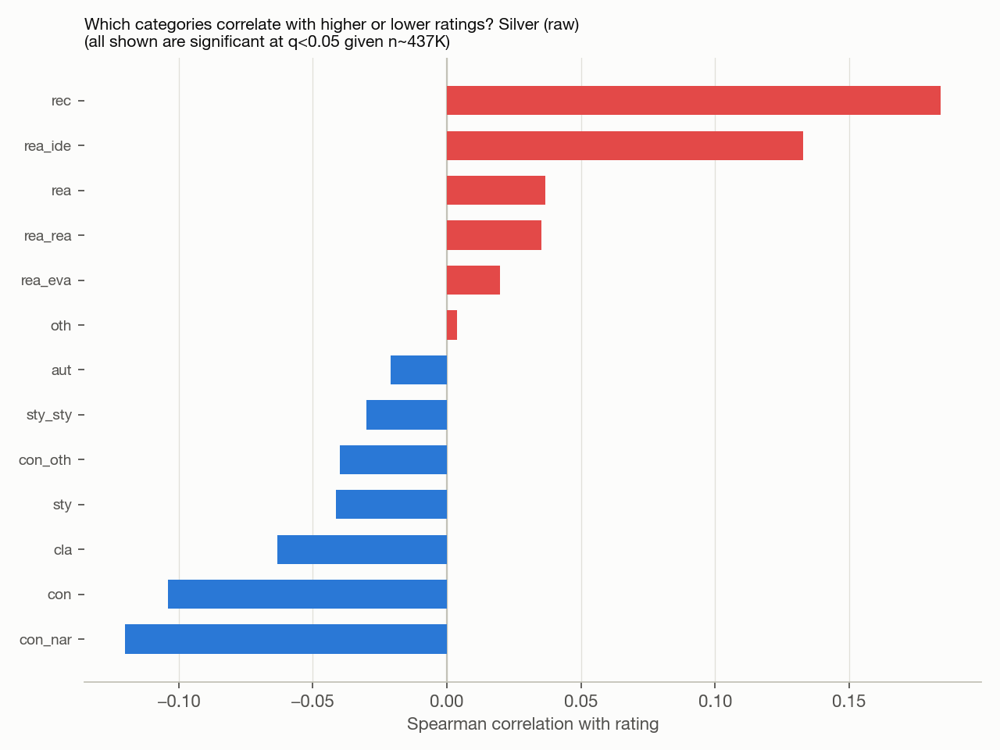

`Recommendations` (ρ=0.184) and `Reader_response--Identification_and_immersion` (ρ=0.133) remain the strongest positive correlates of rating, matching gold's direction and ranking. `Content--Narrative` and `Content` are more negatively correlated in silver (ρ=−0.120, −0.104) than gold flagged prominently, though gold's own `Content--Narrative` correlation was already negative (ρ=−0.059) — same direction, roughly double the magnitude at scale.

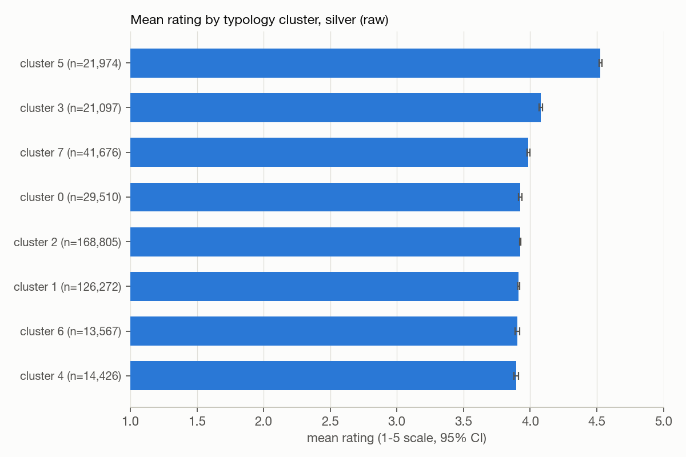

Rating-by-cluster replicates exactly in ranking: the recommendation-forward cluster rates highest in both (gold 4.45, silver 4.53), and the pattern of style-heavy/minimal-plot clusters rating lowest also holds.

### The correction

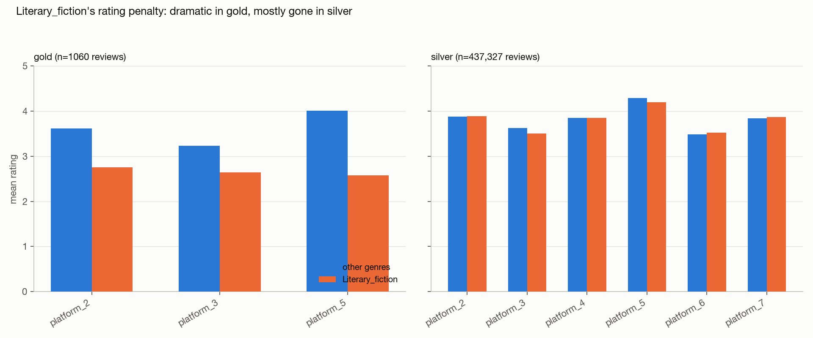

Phase A's single most prominent finding — `Literary_fiction` rating a full point or more lower than other genres, **on every one of gold's 3 dated platforms**, robust to controlling for composition and length in an ordinal regression (coefficient −1.41, the largest of any predictor in that model) — **does not hold up at silver scale**. Raw within-platform gaps: platform_2 (3.88 vs. 3.88, no gap), platform_3 (3.50 vs. 3.62, a small gap in the same direction), platform_4 (3.84 vs. 3.85, no gap), platform_5 (4.19 vs. 4.29, small gap), platform_6 (3.52 vs. 3.48, reversed), platform_7 (3.87 vs. 3.84, reversed). Nothing close to gold's ~1-point gap on any of the 6 platforms with real coverage.

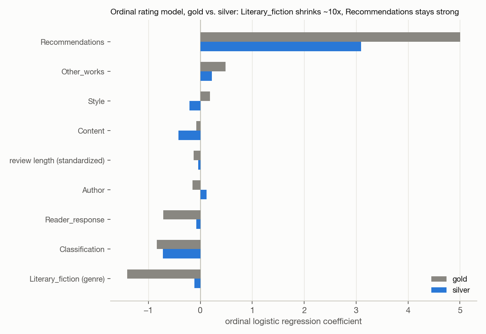

The ordinal regression confirms it directly: `Literary_fiction`'s coefficient **shrinks from −1.41 to −0.115 — roughly a tenfold reduction** — while `Recommendations` stays essentially as strong (5.00 → 3.10, both dominant). Silver's coefficient is still "statistically significant" (p=9.9×10⁻⁹¹), but that reflects n≈437K, not a meaningful effect size; a coefficient of −0.115 on a 5-point ordinal scale is close to negligible next to gold's −1.41. Model fit also drops sharply (pseudo-R² 0.063 → 0.015) — the composition-plus-genre model explains much less of rating variance in the larger, more heterogeneous population.

**The most defensible reading: gold's Literary_fiction finding was a small-sample artifact** (1,152 reviews split across genre × platform leaves thin cells), not a robust population effect — exactly the kind of correction Phase C exists to catch, and a reason to revisit how confidently that finding was stated in the Phase A report. Full tables: [results/10_ratings/silver_rating_correlations.csv](../results/10_ratings/silver_rating_correlations.csv), [results/10_ratings/silver_rating_by_cluster.csv](../results/10_ratings/silver_rating_by_cluster.csv), [results/10_ratings/silver_rating_ordinal_model.csv](../results/10_ratings/silver_rating_ordinal_model.csv), [results/06_genre_platform/silver_litfic_rating_by_platform.csv](../results/06_genre_platform/silver_litfic_rating_by_platform.csv).

## 11. Prolific reviewers: does a person have a signature?

*New in Phase C — no Phase A counterpart.*

New question (chat, 2026-08-19), silver-only — gold's most prolific reviewer (excl. `platform_1`) tops out at 8 reviews, not enough to say anything about an individual's own tendency. Silver has **5,782 reviewers with ≥10 reviews** (256,443 reviews total, one person with 888).

For each, two questions: what fraction of their reviews fall in their single most-common compositional cluster (of the 8 from §5), and separately their most-common sequence cluster (of 2)? "Unusually high" is judged against a null that draws each reviewer's own review count from the real, unevenly-sized corpus-wide cluster distribution (not a uniform one) — a 40% modal share is unremarkable for someone with 10 reviews but a strong signal for someone with 200.

**1,508 of 5,782 reviewers (26%) show a significantly (Benjamini-Hochberg q<0.05, corrected separately within each of the two families of 5,782 tests) high compositional modal share; 910 (16%) show a significantly high sequential one; 136 (2%) show both.** Corrected down from the uncorrected figures (1,797/1,723/31%/30% at raw p<0.05) — expected and not alarming: BH-FDR is supposed to remove some of the marginal cases from a family this large, and the direction and rough shape of the finding are unchanged. A caveat that matters before reading anything into these counts: statistical power tracks review count directly — reviewers flagged on both dimensions average more reviews than those flagged on neither — so "not significant" for a 10-review reviewer doesn't mean "no personal tendency," just "not enough of their own reviews to detect one yet." The *share* itself, not just the q-value, is the number to read as an effect size. (Correction and methodology: `ANALYSIS_PLAN.md` item 4 — BH-FDR chosen over Bonferroni/Holm since this is a screening/exploratory question, not one where controlling the family-wise error rate is the right target; `N_SIM` also raised from 2,000 to 20,000 so the underlying permutation p-values have enough resolution among the most extreme reviewers for BH to rank them correctly rather than tying many of them at the old floor of 0.0005.)

The sequential figures above moved substantially from the mean-position version of this section (was 765/13%/498/9% for sequential/both) — the onset switch (§5) also collapsed silver's own sequence typology from k=7 down to k=2, and "modal share" against only two clusters is a much coarser, more compressed statistic (everyone's modal share now starts at ≥50% by construction) than the 8-way compositional modal share it's being compared to. That coarsening shows up starkly below.

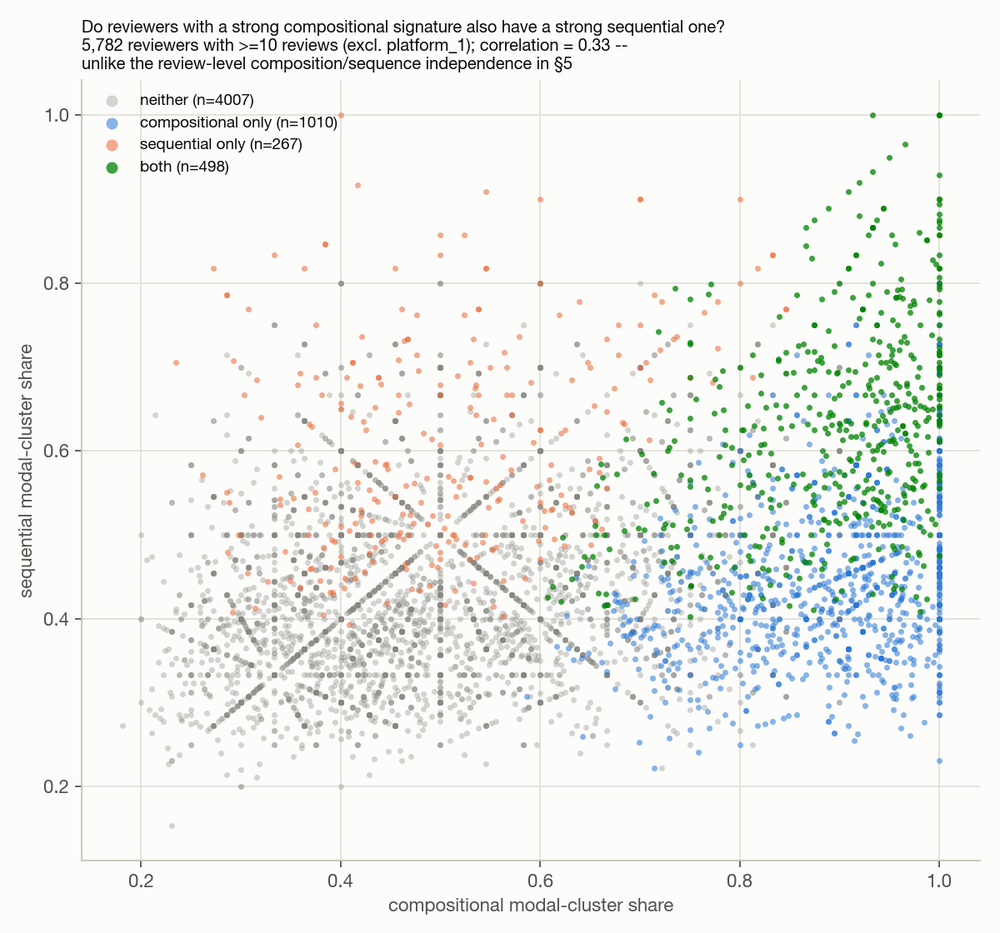

**Compositional and sequential modal share now correlate *negatively* across reviewers (r=−0.49)** — under the mean-position version of this feature they correlated positively (r=+0.33, "reviewers who reliably discuss the same kind of thing also reliably order it the same way"). Taken at face value this reads as a genuine reversal, but Part (b) below — the continuous similarity-ranking version of the identical question, a sharper instrument on the same 5,782 reviewers — finds the *opposite* sign (a standardized consistency correlation of +0.59, if anything stronger than the old mean-position figure). The most defensible reading, given that disagreement: the modal-share correlation is a measurement artifact of sequence typology's collapse to k=2 (previous paragraph), not a real reversal of the underlying finding. With only two sequence clusters, a reviewer's modal share is compressed onto a narrow ≥50–100% range with a hard floor, and which side of that floor a reviewer lands on can flip on a small compositional difference in a way an 8-cluster modal share never has to — degenerating the correlation rather than measuring it. Part (b)'s continuous score doesn't have that floor and is the more trustworthy of the two here. This is a genuinely different result from §5's finding that composition and sequence are largely independent axes *within* the review-level dataset (ARI −0.018) — that finding is about what varies across the whole population of reviews; this one is about whether an individual person's own habits are internally consistent across both axes, and by Part (b)'s more trustworthy measure, they still are. It's also consistent with §7 above: reviewer identity is the single strongest similarity signal of the three tested there, and this section shows part of what that signature is made of — a stable topical *and* structural habit, not just one or the other.

Which clusters attract this kind of personal loyalty is uneven. Among the 1,508 reviewers with a significant (q<0.05) compositional signature, the overwhelming majority (1,433) are locked into cluster 2 (narrative-forward — unsurprising, since it's also the largest cluster corpus-wide, 41%) or cluster 1 (response-forward, 53). But 22 reviewers are significantly locked into cluster 4 specifically — the small (3% corpus-wide), `Other_works`-heavy, `Young_adult`-skewed "comparison-heavy" archetype from §5 — with the single clearest case (`impfic-user-399061`, 18 reviews) landing in it **every single time**. No reviewer shows a significant personal habit toward clusters 0, 3, 5, or 6 (style-minimal, recommendation-forward, mixed, or classification-heavy) — those archetypes look more occasional or book-driven (e.g. historical fiction prompting classification commentary) than personal. Full table: [results/12_prolific_reviewer_tendency/silver_prolific_reviewer_tendency.csv](../results/12_prolific_reviewer_tendency/silver_prolific_reviewer_tendency.csv).

### Part (b): does the same signature show up as raw similarity, not just modal-cluster share?

The modal-share test above collapses each review down to a single discrete cluster label before asking about consistency — a coarser measure than it needs to be. This asks the same question a different way: is a reviewer's *own* set of reviews more similar to each other, on the raw continuous feature vectors themselves (mean pairwise cosine similarity, the same measure §7's book/author/reviewer tests used), than random reviews are — now computed per reviewer rather than only in aggregate? Same 5,782 prolific reviewers, same compositional vectors as §7, plus a new sequence feature vector per review (each main category's onset, i.e. first-occurrence, position, corpus onset-marginal-imputed where absent — the same construction the sequence typology clustering itself was fit on).

Flagging "unusually high" per reviewer via 11,529 individual z-tests (5,747 compositional + 5,782 sequential, after a small drop for reviewers with an all-zero composition vector) against §7's corpus-wide random-pairs baseline is far cheaper than running a real permutation test for each one — but doing it honestly requires knowing how good that shortcut actually is, which is exactly what went wrong on the first attempt and was caught, not shipped: **the natural per-reviewer standard error — std(pairwise similarities)/√n_pairs — treats each reviewer's own pairwise similarities as independent draws, and they aren't** (a review with n reviews appears in n−1 pairs, not one). Spot-checking against a real permutation test at reviewers sitting right on the naive method's q=0.05 line exposed the problem concretely: their *real* permutation p-values were 0.25–0.4, nowhere close to significant. Fixed, not just caveated: the standard error below is a **within-reviewer cluster bootstrap** instead (resample that reviewer's own reviews with replacement 500 times, recompute mean similarity over pairs whose two members are genuinely different original reviews each time) — the same principle §7's aggregate cluster-bootstrap CI already uses, applied per-reviewer here. Re-checking the same borderline cases against real permutation after the fix: p-values of 0.03–0.17 against a nominal q≈0.05 — much closer, not perfect, and read as a reason to treat q-values near the 0.05 line as approximate and lean on the similarity score itself as the effect size, same caveat this project applies to every approximate method it uses. Full validation table: [results/13_reviewer_similarity_ranking/silver_reviewer_similarity_ranking_permutation_check.csv](../results/13_reviewer_similarity_ranking/silver_reviewer_similarity_ranking_permutation_check.csv).

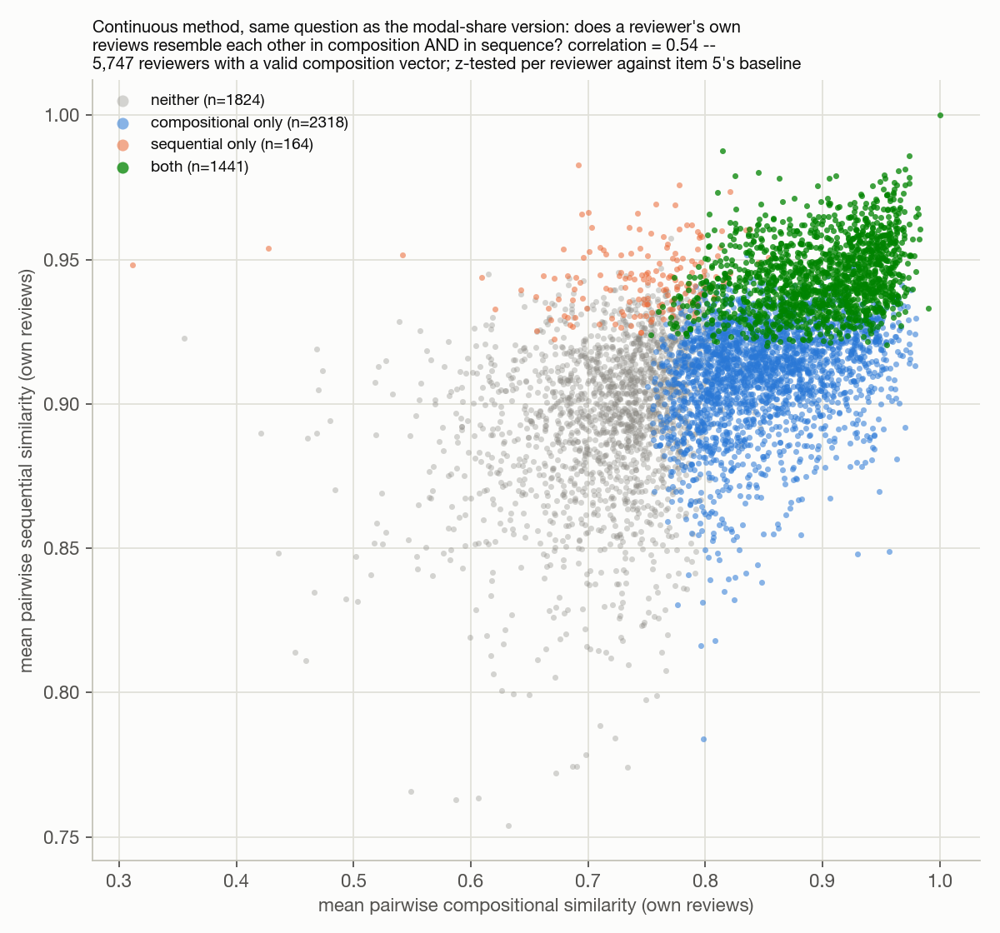

**3,759 of 5,747 reviewers (65%) show significantly (q<0.05) higher-than-baseline compositional similarity; 1,547 (27%) sequential; 1,062 (18%) both** — higher rates than the modal-share version's compositional figure (26%), as expected: raw similarity is a more sensitive, continuous measure that doesn't require landing in the exact same discrete cluster to register as "consistent" (the sequential rate is comparable to modal share's 16% this time, rather than higher — the k=2 floor discussed above inflates modal share's own apparent rate too, in a way that partly masks how much more sensitive the continuous version actually is). The two methods agree on the *direction* of who's consistent — **cross-method triangulation: this item's compositional similarity score correlates r=0.70 with item 3's compositional modal share across reviewers** — while disagreeing on where exactly to draw a significance line, itself informative: a reviewer can write reliably similar reviews without always landing in the identical named cluster. **Compositional and sequential consistency correlate *positively* at r=0.59 under this continuous method** (using the standardized z-scores, not the raw similarity values, as the comparable "consistency" statistic) — if anything a touch stronger than the mean-position version's r=0.54, and the opposite sign from Part (a)'s modal-share correlation above. As argued there, this continuous result is the one to trust: it isn't floored by a 2-cluster modal share, and it reproduces the pre-onset finding's sign and rough size rather than overturning it. Full table: [results/13_reviewer_similarity_ranking/silver_reviewer_similarity_ranking.csv](../results/13_reviewer_similarity_ranking/silver_reviewer_similarity_ranking.csv).

### Part (c): is *contiguity* part of the signature too?

New question (chat, 2026-08-31). Parts (a) and (b) established that **composition** and **order** are personal signatures. Whether a reviewer's *organization* — keeping each category in one block, §3's contiguity — is also a personal trait had never been tested. Silver-only by necessity: gold's most prolific reviewer has just 4 contiguity-eligible reviews, so gold cannot address this at all. Population here is **3,983 reviewers with ≥10 eligible reviews (183,624 reviews)** — note the eligibility filter costs reviewers, since 5,782 prolific reviewers become 3,983 once reviews too short or too single-category to score are dropped.

The natural statistic is the **intraclass correlation**: the share of variance in a per-review measure that sits *between* reviewers rather than within them. A different instrument from parts (a) and (b), and one that answers "is this a trait" directly. `src/24_contiguity_as_trait.py`.

Two things would make a bare ICC meaningless, and both are handled. First, **an ICC of 0.12 means nothing in isolation**, so it is reported against measures already known to be signatures (`Content`/`Reader_response` share) and against review length. Second, and more seriously, **contiguity excess correlates with length (ρ=+0.19, §3) and length turns out to be the strongest personal signature in the data** — so part of any contiguity trait could simply be "this reviewer writes long reviews." Every measure is therefore also reported after residualizing on length, and on length + genre + platform (platform because §12 finds Cramér's V=0.70 between prolificness and platform).

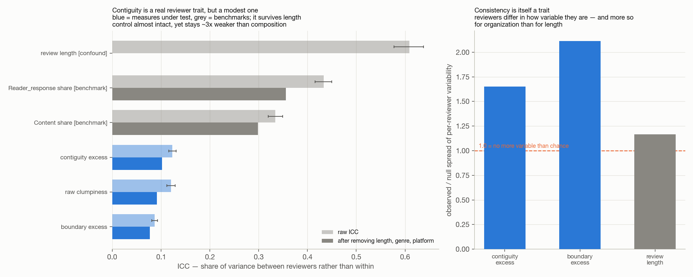

| measure | ICC (raw) | 94% CI | after removing length, genre, platform |
|---|---|---|---|
| review **length** *(confound)* | **0.609** | 0.577–0.638 | — |
| `Reader_response` share *(benchmark)* | 0.433 | 0.416–0.450 | 0.356 |
| `Content` share *(benchmark)* | 0.334 | 0.320–0.349 | 0.298 |
| **contiguity excess** | **0.123** | 0.116–0.131 | **0.102** |
| raw clumpiness | 0.120 | 0.112–0.129 | 0.091 |
| **boundary excess** | **0.087** | 0.081–0.093 | **0.077** |

**Contiguity is a genuine reviewer trait, and the length worry does not materialise — but it is a modest trait.** 91% of contiguity excess's ICC survives removing length, and 83% survives removing length, genre and platform together, landing at 0.102. So a personal organizational style exists independently of how long a reviewer writes or where they publish. But it sits at roughly **a third of composition's strength** (0.30–0.36) and **a sixth of length's** (0.61). The ordering is the finding: *how much* someone writes is the most personal thing about them, *what* they write about is next, and *how they organise it* is real but comparatively weak.

A small internal check worth noting: the excess measure retains 91% of its ICC under length control while raw clumpiness retains only 79%. That is exactly what §3's argument for preferring excess over the raw score predicts, arrived at from a different direction.

**Consistency is itself a trait, and more sharply for organization than for length.** Do some reviewers vary more review-to-review than others? Against a null that shuffles reviews across reviewers while preserving each reviewer's review count, the spread of per-reviewer variability is **1.65× chance for contiguity excess and 2.11× for boundary excess** (both p≈0.002) — versus only **1.17× for length**. So reviewers differ not just in their average organization but in how *reliably* they achieve it, and they differ more on that dimension than they do on consistency of length. Full tables: [results/24_contiguity_as_trait/silver_contiguity_trait_icc.csv](../results/24_contiguity_as_trait/silver_contiguity_trait_icc.csv), [results/24_contiguity_as_trait/silver_contiguity_trait_consistency.csv](../results/24_contiguity_as_trait/silver_contiguity_trait_consistency.csv).

### Part (d): is there a reviewer typology based on organization?

Part (c) established that organization is a personal trait. This asks whether reviewers fall into *kinds* on that dimension. `src/26c_reviewer_organization_typology.py`, same 3,983 reviewers with ≥10 eligible reviews.

Nine per-reviewer features: mean contiguity excess, mean boundary excess, and the mean onset (first-occurrence) position of each of the seven main categories (the reviewer's characteristic ordering; onset rather than mean position as of 2026-09-22, §5). **Every feature is residualized on length + genre + platform at the review level before aggregating**, and that is doing real work rather than being a formality — the positional features are themselves length-dependent, some strongly (measured pre-onset: `Reader_response` position correlated ρ=+0.52 with review length, `Style` +0.25, `Classification` +0.20 — the exact figures predate the onset switch but the qualitative point they motivate, that length must be controlled for, still holds), and §12 finds Cramér's V=0.70 between prolificness and platform. Without the control, this would substantially be a length-and-platform typology under a different name. k is chosen by §5's protocol — silhouette plus bootstrap stability — so the result is comparable to the compositional typology rather than judged by a different standard.

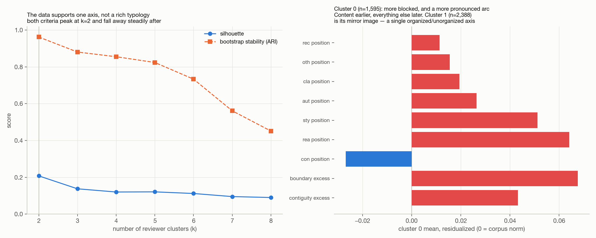

**There is a reviewer typology, but it is a single axis, not a rich set of styles.** Both criteria peak at **k=2** (silhouette 0.219, bootstrap ARI 0.955) and decline steadily thereafter; by k=7 stability has fallen to 0.62. The silhouette is modest, but comparable to §5's compositional typology (0.27) — which this report already describes as soft rather than hard — so the same reading applies: a real tendency along a continuum, not discrete boxes.

The two groups are mirror images on every feature. **Cluster 0 (1,497 reviewers) writes more blocked reviews *and* a more pronounced arc**: above-norm contiguity excess (+0.045) and boundary excess (+0.070), with `Content` positioned *earlier* than the corpus norm (−0.056) while every other category sits *later* (`Reader_response` +0.108, `Style` +0.061, `Author` +0.046). **Cluster 1 (2,486 reviewers) is the inverse — less blocked, with a flatter, more compressed arc.** So the axis is not "which arc a reviewer uses" but "how strongly they enact the corpus-wide arc at all" — and it comes through, if anything, a bit more sharply on the positional features (onset, not mean position, as of 2026-09-22 — §5) than it did before, `Content` and `Reader_response`'s deltas both roughly doubling in size.

**Three checks say this is a real and distinct axis:**

- **Not a platform or genre artifact.** Cramér's V with dominant platform is **0.129** and with dominant genre **0.069** — against the V=0.70 that §12 finds between prolificness and platform. The residualization did its job.
- **Not a length artifact.** Mean review length is 17.8 vs 16.1 sentences across the two clusters — a modest gap, on features already length-residualized.
- **Not a relabelling of the compositional signature.** ARI against each reviewer's modal compositional cluster (part a) is **0.047** — essentially independent. This mirrors §5's review-level finding that composition and sequence are largely independent axes (ARI −0.018), now shown at the reviewer level: *what* a reviewer habitually discusses and *how tidily they organise it* are separate dimensions of personal style.

The honest limit: with contiguity's ICC at 0.10, per-reviewer means are noisy, and k=2 with a 0.22 silhouette is the most this data supports. The finding is that an organized/unorganized axis exists and is independent of composition — not that reviewers sort into well-separated organizational types. Full tables: [results/26_reviewer_organization_typology/silver_reviewer_organization_typology.csv](../results/26_reviewer_organization_typology/silver_reviewer_organization_typology.csv), [results/26_reviewer_organization_typology/silver_reviewer_organization_profile.csv](../results/26_reviewer_organization_typology/silver_reviewer_organization_profile.csv), [results/26_reviewer_organization_typology/silver_reviewer_organization_k_selection.csv](../results/26_reviewer_organization_typology/silver_reviewer_organization_k_selection.csv).

## 12. Prolific vs. occasional reviewers: who are the habitual reviewers?

*New in Phase C — no Phase A counterpart.*

New question (chat, 2026-08-19) — §11 established that prolific reviewers (≥10 reviews) each have an internally consistent personal signature. This asks a different one: does that signature differ *systematically* from how occasional reviewers (1–2 reviews) write, and is it visible from a reviewer's very first review (a trait/selection effect — people who write that way are the ones who keep reviewing) or something that develops over a reviewing career (a within-person habituation effect)? Silver-only — gold has no reviewer with ≥10 reviews. **122,584 occasional reviewers (134,457 reviews) vs. 5,782 prolific reviewers (256,443 reviews)**, excl. `platform_1` throughout. Every comparison pools reviews within each group, not reviewers, and reports effect sizes (Cramér's V, Cohen's d) as the number to read — at this n, p-values are close to guaranteed for any real effect. `src/15c_prolific_vs_occasional.py`.

**Prolific reviewers write substantially longer, somewhat more specific, and more critical reviews.** Length: mean 14.9 vs. 5.4 sentences (Cohen's d=0.76, a large effect). Specificity (§9): 80.0% vs. 76.9% of labeled sentences get sub-category-specific (d=0.15, small). Density doesn't differ meaningfully (d=−0.10). **Rating is the more interesting one: prolific reviewers rate more critically — mean 3.82 vs. occasional's 4.24 (d=−0.42, moderate)** — one-off reviews skew toward enthusiasm; habitual reviewing comes with more measured ratings. Their compositional and sequential typology-cluster membership also differs substantially (Cramér's V=0.39 compositional, 0.19 sequential — comparable in size to length's own association with cluster membership from §9). Full tables: [results/15_prolific_vs_occasional/silver_prolific_vs_occasional_scalar.csv](../results/15_prolific_vs_occasional/silver_prolific_vs_occasional_scalar.csv), [results/15_prolific_vs_occasional/silver_prolific_vs_occasional_composition.csv](../results/15_prolific_vs_occasional/silver_prolific_vs_occasional_composition.csv).

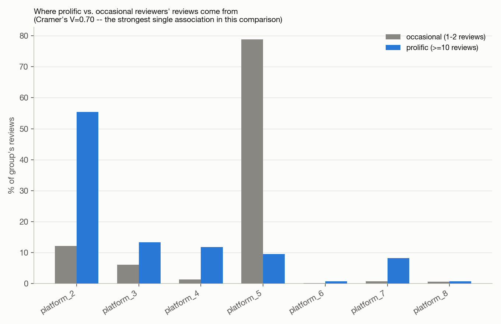

**The single strongest association in this whole comparison is platform, not writing style.** Cramér's V=0.70 — platform_5 supplies 79% of occasional reviewers' reviews but only 9% of prolific reviewers'; platform_2 is the mirror image (55% prolific, 12% occasional). Genre concentration is real but far more modest (V=0.15). This is an important caveat on every comparison above, not a separate finding: "prolific" is heavily confounded with "uses platform_2" (or a platform like it) — some of what looks like a prolific-reviewer writing style may really be a platform-2-reviewer writing style, not disentangled here. Full tables: [results/15_prolific_vs_occasional/silver_prolific_vs_occasional_platform.csv](../results/15_prolific_vs_occasional/silver_prolific_vs_occasional_platform.csv), [results/15_prolific_vs_occasional/silver_prolific_vs_occasional_genre.csv](../results/15_prolific_vs_occasional/silver_prolific_vs_occasional_genre.csv).

### Selection or development?

The sharpest test: split each prolific reviewer's own dated history into their first 3 reviews and their most recent 3 (requires ≥6 dated reviews so the two windows never overlap — 5,735 of 5,782 qualify).

**Selection: prolific reviewers already look different on their very first few reviews, before "becoming prolific" could have caused anything.** Their *early* reviews (pooled) vs. occasional reviewers directly: length d=0.67 (still large, though smaller than the d=0.76 for all their reviews pooled — see below), rating d=−0.33 (already more critical than occasional reviewers), specificity d=0.08 (small but significant, q=0.0001). Density does **not** differ at this stage (p=0.52) — the one measure among these four with no early signal at all. Full table: [results/15_prolific_vs_occasional/silver_prolific_early_vs_occasional_scalar.csv](../results/15_prolific_vs_occasional/silver_prolific_early_vs_occasional_scalar.csv).

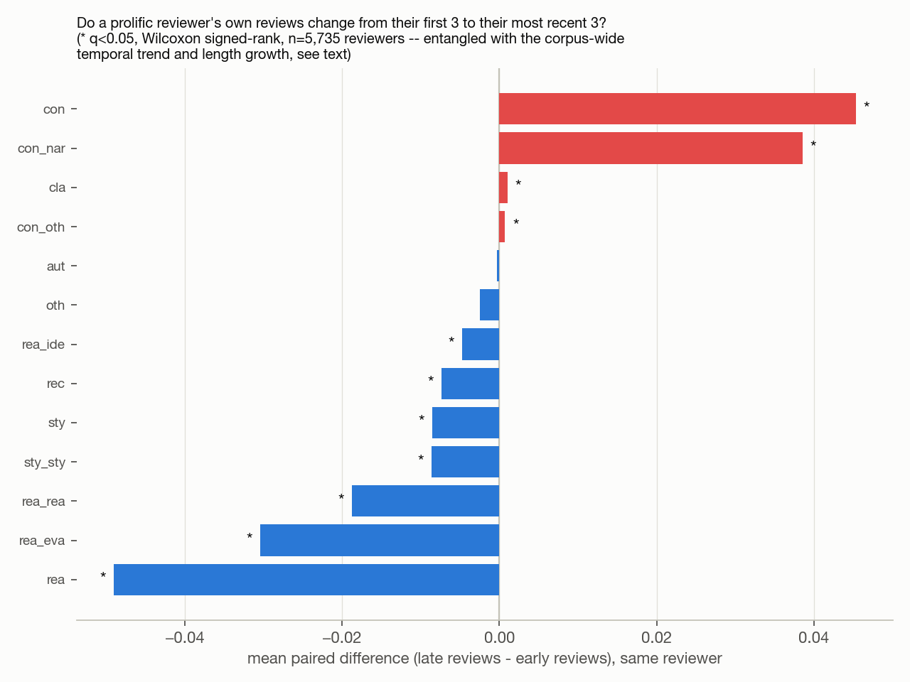

**Development: reviews also keep changing within the same person's own career, not just at the population level.** Paired (Wilcoxon signed-rank on each reviewer's own early→late shift, n=5,735): `Content`/`Content--Narrative` share **rises** (+0.045/+0.039, both q<10⁻³⁷) while `Reader_response`/`Evaluation_of_quality` share **falls** (−0.049/−0.030, both q<10⁻²⁵) — the identical direction as both the corpus-wide temporal trend (§8 above) and the length-composition correlation (§9) — and review length itself grows within-person too (10.7→13.1 sentences, +2.47, q<10⁻¹²⁰).

**That overlap is a real interpretive problem, not a footnote: this within-person shift is entangled with both known confounds, not cleanly separated from them.** The median gap between a reviewer's early and late review windows is 2.8 years (mean 3.3) — long enough for a meaningful slice of the corpus-wide secular drift to fall inside it. Back-of-envelope: §9's platform-adjusted year coefficient for `Content`'s *share* (+0.0091/year) projects to roughly +0.030 over a 3.3-year gap — about two-thirds of the observed +0.045 shift — and the reviewer's own +2.47-sentence length growth, run through §9's length-share slope (+0.0097/sentence), projects to roughly another +0.024, on its own comparable to the rest of the gap (these two projections aren't independent of each other, since length itself trends with calendar time too, so they don't simply add). **The honest reading: a real within-person shift toward narrative content and away from generic reader-response commentary as reviewers gain experience is plausible and consistent with the data, but this analysis cannot cleanly separate "reviewers develop a personal preference for content over time" from "reviewers happen to write more, and later, as their career goes on, and both of those mechanically pull composition the same direction."** A length-and-year-adjusted version of this paired test (regressing each reviewer's per-review composition on review rank/experience with year and length as covariates) would be needed to isolate a residual experience effect — a natural follow-up, not attempted here given the already substantial scope of this item. Specificity shows no within-person change (p=0.23); rating drifts slightly more critical with experience (−0.040, q=0.0002, small). Full tables: [results/15_prolific_vs_occasional/silver_prolific_early_vs_late_paired_composition.csv](../results/15_prolific_vs_occasional/silver_prolific_early_vs_late_paired_composition.csv), [results/15_prolific_vs_occasional/silver_prolific_early_vs_late_paired_scalar.csv](../results/15_prolific_vs_occasional/silver_prolific_early_vs_late_paired_scalar.csv).

## 13. Instance-level correction: does it change the structural findings?

*New in Phase C — no Phase A counterpart.*

Last of the Phase C TODO items, deliberately: §1 is the only section elsewhere in this report that applies the validated Rogan-Gladen correction — everything else (§2–10) is raw, on the reasoning that raw replication had already strongly validated co-occurrence, contiguity, order, and typology against gold, so this is a precision/rigor pass on findings already trusted, not a gap-filling one. It's also the most expensive item: multiple imputation (M draws × permutation-heavy methods) doesn't finish in reasonable time at the full 5.2M-sentence corpus, so this runs on a random 10,000-review subsample instead (~8.7x gold's size, ~2.1% of the fiction-filtered corpus) — `src/14c_imputed_correction.py`, M=20 imputations per `src/correction/imputation.py`'s already-validated conditional-prior design, using the real held-out confusion matrices and the Rogan-Gladen corrected sentence-level prevalence as each label's prior. Every corrected number is reported next to the raw value on the *same* subsample (isolates what correction itself changes) and the raw value already published at full-corpus scale (context on subsampling variance).

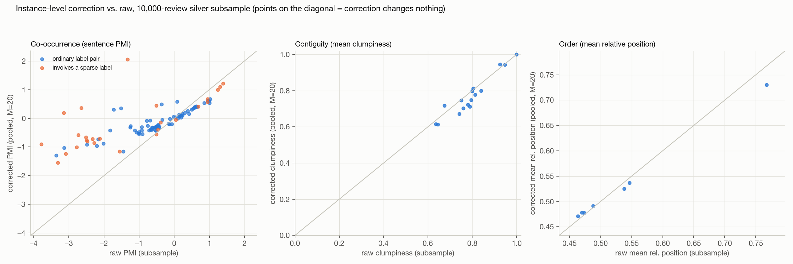

**Contiguity and order barely move.** Mean clumpiness shifts by 0.032 on average across the 16 labels (largest single shift: `Reader_response` −0.078), and the ranking of which labels are most/least contiguous is unchanged — `Content`/`Content--Narrative` stay the most clumped, `Author`/`Reader_response--Evaluation_of_quality` the least. Mean relative position shifts by 0.012 on average — the "arc" (`Content` early, `Recommendations` closing at ~0.73–0.77) is fully intact under correction. Full tables: [results/14_imputed_correction/silver_imputed_contiguity.csv](../results/14_imputed_correction/silver_imputed_contiguity.csv), [results/14_imputed_correction/silver_imputed_order.csv](../results/14_imputed_correction/silver_imputed_order.csv).

**Co-occurrence mostly holds too, with one expected exception.** For the 13 labels that aren't already-known-sparse (`SPARSE_GOLD_LABELS`), corrected PMI correlates ρ=0.84 with raw PMI (72 non-trivial pairs) and agrees in sign for 67/72 (93%) — correction doesn't overturn which pairs attract or repel. The exception is exactly where it should be: pairs involving `Style--Context`, `Content--Quote`, or `Reader_response--Reception` (mean |PMI shift| 1.28 vs. 0.47 for ordinary pairs) — these three already carry a `sparse_gold_flag` because gold has too few positive examples to estimate them reliably, and it shows up directly in their confusion-matrix quality: `Style--Context`'s held-out test set has exactly **one** true positive sentence, making its sensitivity/specificity estimate (a degenerate 1.0/1.0) essentially uninformative rather than a real reliability measure. The correction pipeline doesn't invent precision a 1-example test set doesn't have — this is the sparse-label caveat already flagged everywhere else in this project showing up concretely in a new place, not a new problem. Full table: [results/14_imputed_correction/silver_imputed_cooccurrence.csv](../results/14_imputed_correction/silver_imputed_cooccurrence.csv).

**Typology is the most reassuring result: correction barely reshuffles who lands in which archetype.** Clustering the subsample's raw compositions and its MI-mean corrected compositions separately (k=8, matching the validated raw k) gives an adjusted Rand index of **0.885** between the two cluster assignments — high agreement for a method with no obligation to agree at all. The profiles themselves are close to identical: both versions have a ~42% narrative-forward cluster (raw `Content` 0.674, corrected 0.646), a tiny (<1%) `Classification`-heavy cluster, and the same general archetype shapes throughout. The raw silver typology (§5) isn't an artifact of uncorrected label noise. Full tables: [results/14_imputed_correction/silver_imputed_typology_profile_raw.csv](../results/14_imputed_correction/silver_imputed_typology_profile_raw.csv), [results/14_imputed_correction/silver_imputed_typology_profile_corrected.csv](../results/14_imputed_correction/silver_imputed_typology_profile_corrected.csv), [results/14_imputed_correction/silver_imputed_typology_crosstab.csv](../results/14_imputed_correction/silver_imputed_typology_crosstab.csv).

**Bottom line**: everything §2–5 concluded from raw silver data holds up under instance-level correction, at subsample scale — the one place correction actually moves things is co-occurrence involving labels this project has flagged as unreliable since Phase A, for a documented and expected reason, not a new one. This is what "raw replication is already strongly validated" (this section's own opening claim) predicts, now checked rather than assumed.

## 14. Bayesian hierarchical model: platform, genre, time, and reputation, jointly

*New in Phase C — no Phase A counterpart.*

New question (chat, 2026-08-19), design settled over several rounds of discussion (2026-08-20) before any code was written — do platform, genre, calendar time, and book/author reputation jointly shape what a review covers, estimated with proper partial pooling instead of the marginal, one-factor-at-a-time tests everywhere else in this report? First pass, silver-only, on a 10,000-review subsample (445,531 dated, non-`platform_1` reviews eligible) — one hierarchical Beta regression per main category's `prop__label` (7 parallel models, not a single joint Dirichlet-multinomial: main labels aren't mutually exclusive at the sentence level, so the shares don't sum to 1 the way a true compositional vector would need to). `src/16c_bayesian_coverage_model.py`, PyMC via `bambi`, fit with variational inference (ADVI) for speed.

Each model: `prop__label ~ year_c + length_c + book_fame + author_fame + reviewer_experience + (year_c|source_id) + (1|nur_genre)`. Book fame and author fame are both `log1p(prior review count)` for that work/author, computed only from reviews dated strictly before the current one — the identical lagged construction at both levels, deliberately count-based only for this pass (rating-based fame needs a genre-level cold-start prior that count-based fame doesn't, and is deferred). Reviewer experience reuses §12's lagged logic. Random effects kept deliberately small: platform and genre, not work/author/reviewer identity — fame and experience are the mechanism through which those identities should matter here, not an additional effect on top.

**The collinearity question, answered rather than just flagged:** book fame and author fame correlate at r=0.37 across the sample (expected — author fame is partly built from book fame, and the two are identical at an author's debut book) — but that turns out not to be a practical problem. VIF for both is ~1.2 (far below the usual concern threshold of 5-10), and the posterior correlation between the two coefficients is under 0.05 in absolute value for every one of the 7 labels. The model has no trouble telling them apart.

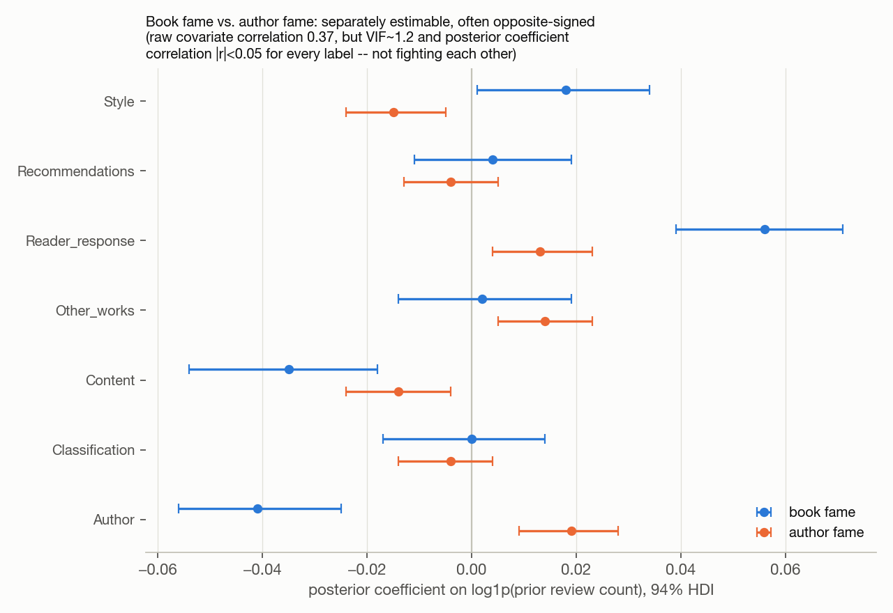

**And telling them apart matters, because they often point in opposite directions.** For `Author`'s own share: book fame −0.041 (well-established books get *less* author discussion — less need to introduce someone already known), author fame +0.019 (well-established authors get *more* — reviewers discuss their career or oeuvre). `Style` shows the same opposite-sign pattern (book fame +0.018, author fame −0.015). `Content` and `Reader_response` — the two largest fame effects in the table — both move with book fame in a coherent way: book fame −0.035 on `Content` and +0.056 on `Reader_response`, the single largest coefficient among any fame effect — well-known books get less synopsis and more personal reaction, consistent with reviewers assuming less need to explain the plot. `Other_works` responds to author fame specifically (+0.014, not book fame) — famous authors' books get compared to their other work more, a book-specific reputation doesn't trigger the same comparison. Full table: [results/16_bayesian_coverage_model/silver_bayesian_coverage_fixed_effects.csv](../results/16_bayesian_coverage_model/silver_bayesian_coverage_fixed_effects.csv), collinearity diagnostics: [results/16_bayesian_coverage_model/silver_bayesian_coverage_collinearity.csv](../results/16_bayesian_coverage_model/silver_bayesian_coverage_collinearity.csv), [results/16_bayesian_coverage_model/silver_bayesian_coverage_vif.csv](../results/16_bayesian_coverage_model/silver_bayesian_coverage_vif.csv).

**Reviewer experience replicates §12's within-person finding, via a completely different construction.** `Content` share rises with reviewer experience (+0.106, the largest single coefficient of any covariate for that label) and `Reader_response` share falls (−0.086) — the identical direction §12's paired early-vs-late test found, this time from a continuous lagged covariate fit jointly with year and length rather than a rank-based first-3-vs-last-3 split. Two independent operationalizations landing on the same answer is a real corroboration, not a coincidence of shared code. `Recommendations` share also falls with experience (−0.025) — a pattern not visible in §12's narrower comparison.

**Sanity check against the existing frequentist year-trend regression**: of the 3 labels with a clearly non-null Bayesian `year_c` effect (94% HDI excluding 0) — `Content` (+0.022), `Reader_response` (−0.017), `Style` (+0.017) — all 3 match the sign of the already-published full-corpus frequentist coefficient. The other 4 labels' Bayesian year effects all have HDIs straddling zero (including `Classification` and `Recommendations`, the two that disagree in sign with the frequentist point estimate) — a sign flip on two near-null effects is expected noise, not a discrepancy to worry about. Full table: [results/16_bayesian_coverage_model/silver_bayesian_coverage_sanity_check.csv](../results/16_bayesian_coverage_model/silver_bayesian_coverage_sanity_check.csv).

**Scope, honestly stated**: this is a first-pass, subsample-scale model fit with a fast approximation (VI), not full-corpus MCMC — a screening tool to check whether the joint structure is worth the fuller investment, not a final result. Rating-based fame remains deferred, per `ANALYSIS_PLAN.md` item 9. And per that plan's own framing: this model answers "does reputation predict coverage, net of the obvious time-ordering confound," not the harder "does reputation cause it" — no causal claim is made here. The fame×genre question below (originally deferred here too) was promoted and answered as item 10, along with two further questions it raised; the optional 4-category joint model was assessed and closed out rather than built — see the end of this section.

### When do book fame and author fame diverge?

New question (chat, 2026-08-20) — book fame and author fame are cleanly separable (above), but that's their *level*. What about the *shape* of an author's fame trajectory — does it matter whether an author's reputation rides on one breakout book or is spread across many? Two new lagged, time-varying covariates (recomputed as of each review, same construction discipline as everything else in this model): **`author_fame_concentration`** (what share of the author's prior reviews, across all their books, belong to their single most-reviewed prior book — mean 0.53 across the subsample) and **`is_current_breakout`** (is *this* book currently the author's most-reviewed one, or is a different book of theirs more famous — true for 46% of reviews). `src/17c_fame_extensions.py`, same 7-model setup as above, extended with these two covariates plus their interactions with book/author fame.

`Author`'s own share falls sharply when the review's own book *is* the author's breakout (`is_current_breakout` −0.124) — when a book is actively making an author's name, reviewers write about the book, not yet about "the author" as a career. `Content` responds strongly to concentration itself (+0.200, the largest main effect in this extension) — reviewing an author whose fame is concentrated in one dominant book comes with more synopsis, not less; `Reader_response` shows the mirror pattern (−0.129). The interactions matter too: `Other_works` comparison is where author-fame concentration bites hardest (`author_fame:author_fame_concentration` +0.122) — a concentrated reputation invites more "compared to their other work" commentary, more than a spread-out one does. `Style` and `Author` both show the book-fame/author-fame interaction terms pulling in opposite directions from their own main effects (e.g. `Author`: `book_fame:concentration` −0.091 vs. `author_fame:concentration` +0.050) — concentration doesn't just add a main effect, it changes how strongly book fame and author fame themselves matter. `Classification` and `Recommendations` show no reliable divergence signal on any of these terms. Full table: [results/17_fame_extensions/silver_fame_divergence_fixed_effects.csv](../results/17_fame_extensions/silver_fame_divergence_fixed_effects.csv).

### Does the fame effect differ by genre?

Promoted from a deferred follow-up (chat, 2026-08-20) once the first-pass fame coefficients looked interesting enough to justify it: specific hypothesis going in was that `Literary_fiction` — where a famous author's similar new book might read as creative staleness — would diverge from "genre fiction," where delivering more of a known, trusted experience is closer to the point. `book_fame`/`author_fame` × genre fixed-effect interactions, same subsample.

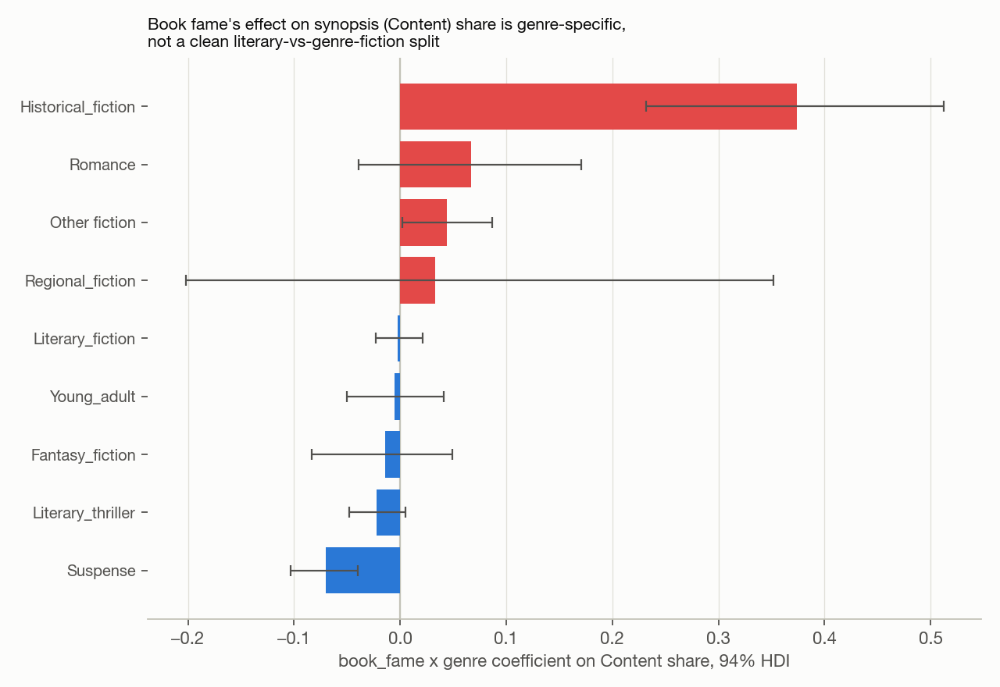

**Genre clearly matters, but not along the hypothesized literary-vs-genre-fiction axis — the pattern is more genre-specific than binary.** Book fame's effect on `Content` (synopsis) share ranges from strongly positive in `Historical_fiction` (+0.374) to strongly negative in `Suspense` (−0.070), with `Literary_fiction` sitting close to zero and non-significant (−0.002) in between — the two most extreme genres are both "genre fiction" by the hypothesis's own framing, not literary fiction vs. everything else. The one place the data does support a version of the original intuition, just not the one specified going in: for `Author`'s own share, author fame's effect is significantly *positive* in `Literary_thriller` (+0.057), `Romance` (+0.082), and `Suspense` (+0.038), but not reliably different from zero in `Literary_fiction` itself (+0.007, HDI crosses 0) — if anything, genre-fiction readerships engage *more* with a famous author's identity, not less, plausibly because genre fandom is often explicitly author-brand-driven ("a new King," "a new Roberts") in a way literary fiction's reception isn't. `Literary_fiction` does show its own real, specific effects: author fame there reduces `Content` (−0.021) and raises `Other_works` (+0.019) and `Reader_response` (+0.018); book fame raises `Style` (+0.030) and `Recommendations` (+0.023) specifically in that genre. Full table: [results/17_fame_extensions/silver_fame_genre_fixed_effects.csv](../results/17_fame_extensions/silver_fame_genre_fixed_effects.csv).

### Why do Historical_fiction and Suspense diverge so sharply?

New question (chat, 2026-08-20), direct follow-on: `Historical_fiction`'s and `Suspense`'s book-fame coefficients on `Content` are the two most extreme in the whole genre table, in opposite directions — worth understanding, not just noting. Three candidate mechanisms were planned, in order of cost (`ANALYSIS_PLAN.md` item 11); the first was cheap enough to try immediately and came back with a clean, decisive answer, so the other two (a genre-split version of the mediation check above, and a series-position confound with no data to test it directly) weren't needed this round.

**Candidate mechanism: spoiler sensitivity.** Suspense readers are famously plot-secretive — a well-known thriller's later reviews might avoid re-summarizing the twist, where a well-known historical novel's setting and events generally aren't "spoilable" the same way. `Content` bundles three sub-categories with very different spoiler-relevance: `Content--Narrative` (plot/synopsis — exactly what a spoiler-averse reviewer would hold back), `Content--Other`, and `Content--Quote`. Rerunning the identical book_fame × genre interaction on each sub separately, instead of pooled `Content`, isolates which one is actually driving the divergence. `src/18c_content_spoiler_check.py`.

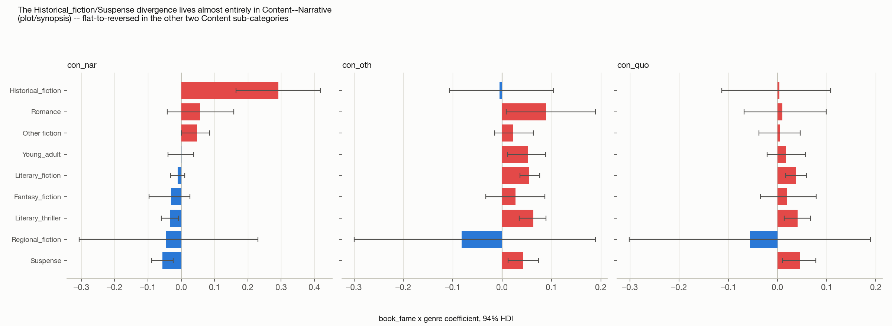

**The divergence lives almost entirely in `Content--Narrative`, exactly where the spoiler-sensitivity hypothesis predicts it should.** `Historical_fiction`: +0.292 (94% HDI 0.165–0.418) — accounts for ~78% of the pooled `Content` effect (+0.374) on its own. `Suspense`: −0.057 (HDI −0.089 to −0.024) — ~81% of the pooled effect (−0.070). The other two subs tell a genuinely different story: `Content--Other` is flat for `Historical_fiction` (−0.005, n.s.) and actually *positive* for `Suspense` (+0.043, significant) — the opposite sign from `Content--Narrative` in the same genre; `Content--Quote` shows the same pattern (`Historical_fiction` +0.004 n.s., `Suspense` +0.046 significant). As famous suspense novels accumulate more reviews, reviewers write measurably *less* plot summary specifically — not less content commentary in general, since the non-narrative subs move the other way — while famous historical fiction gets *more* plot/narrative summary as it accumulates reviews. That's the plot-secrecy story, not a general "less to say about a famous book" effect, which would have suppressed all three subs together rather than splitting them. Full table: [results/18_content_spoiler_check/silver_content_subs_by_fame_genre.csv](../results/18_content_spoiler_check/silver_content_subs_by_fame_genre.csv).

### Why do Romance/Suspense/Literary_thriller show a genre-fiction author-brand effect that Literary_fiction doesn't?

New question (chat, 2026-08-20), direct follow-on from the genre section above: author fame significantly raises `Author`-share in `Literary_thriller`, `Romance`, and `Suspense`, but not reliably in `Literary_fiction` — genre-fiction readerships appear to engage more with a famous author's identity, not less. `Author` has no sub-categories, so §14's `Content` decomposition trick doesn't apply here; two different, both free, checks instead (`ANALYSIS_PLAN.md` item 12), reusing tables already built rather than fitting anything new.

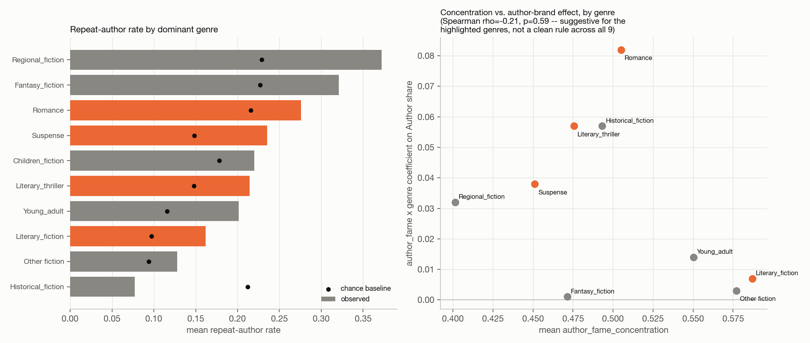

**Both descriptive checks point the same direction for the genres in question.** Reviewers whose dominant genre is `Suspense` repeat authors at a 23.5% rate and `Literary_thriller` readers at 21.4%, both clearly above `Literary_fiction` readers' 16.2% (all three comfortably above their own chance baselines too) — genre-fiction readers really do return to authors they already know more than literary-fiction readers do, a direct behavioral link to discussing "the author" as a through-line across books. Separately, `author_fame_concentration` (§14 above) is structurally lower for `Suspense` (0.451) and `Literary_thriller` (0.476) than for `Literary_fiction`, which has the *highest* concentration of any of the 10 genres (0.587) — literary-fiction authors' reputations more often ride on one breakout book, where suspense and thriller authors' fame is spread across a steadier, more series-like body of work. Both patterns are consistent with the same underlying picture: genre fiction's author-brand relationship is built from repeated encounters with a broader backlist, literary fiction's more often isn't.

**But formally, concentration doesn't predict the author-brand effect cleanly across all 9 genres** — Spearman rho=−0.21 (p=0.59, n=9) between genre-mean concentration and the author_fame×genre coefficient, the right direction but not remotely significant, and `Fantasy_fiction` is a clear counterexample (low concentration like `Suspense`, but a near-zero author-brand coefficient). The honest reading: both descriptive patterns are real and directionally consistent with a repeat-readership/spread-fame story for the *specific* genres this question was originally about, but they don't combine into one clean, general rule that predicts every genre's author-fame coefficient from its concentration alone. Path 3 (extending the model with a genre-restricted interaction) wasn't pursued given that — a stronger model wouldn't rescue a relationship two independent descriptive checks already show is inconsistent at the full-genre level. Full tables: [results/17_fame_extensions/silver_repeat_author_rate_by_genre.csv](../results/17_fame_extensions/silver_repeat_author_rate_by_genre.csv), [results/17_fame_extensions/silver_fame_concentration_by_genre.csv](../results/17_fame_extensions/silver_fame_concentration_by_genre.csv).

### Reviewer prolificness and fame

Two distinct questions (chat, 2026-08-20): do prolific reviewers gravitate toward authors they already know, and does fame's relationship with coverage actually run through *who* reviews rather than *how* any one person writes?

**Prolific reviewers do repeat authors, well above chance.** For 5,739 prolific reviewers, the observed rate of reviewing an author they've already reviewed before (within their own history) is **18.5%, versus an 11.7% chance baseline** (permutation null: n random author draws from the reviewer's own dominant genre's empirical author pool, repeated 2,000 times per unique n/genre). 1,107 of 5,739 (19%) are individually significant at q<0.05 — the aggregate gap is clear even though, as with every other per-reviewer test in this project, individual significance tracks review count. Full table: [results/17_fame_extensions/silver_repeat_author_rate.csv](../results/17_fame_extensions/silver_repeat_author_rate.csv).

**Fame does predict reviewer experience — but not in the differentiated way hypothesized.** A quick check (`reviewer_experience ~ book_fame + author_fame`) finds *both* book fame (−0.084) and author fame (−0.046) significantly *reduce* reviewer experience — more famous books and more famous authors both draw somewhat *less* experienced reviewers, not "famous books draw occasional reviewers while famous authors draw prolific ones" as originally framed. The mediator exists; the specific differentiated story doesn't hold as stated.

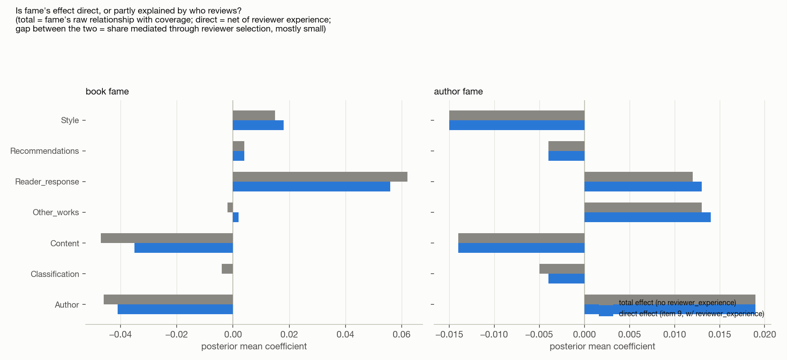

**And the mediated share, where it's measurable at all, is modest — most of fame's effect on coverage is direct, not explained by who reviews.** Refitting the 7 models *without* `reviewer_experience` (the "total" effect) and comparing to the original coefficients (the "direct" effect, already net of reviewer experience) gives a mediated share for each fame/label pair. The clearest case: `Content`/book fame is 25.5% mediated — book fame reduces reviewer experience (above), and less-experienced reviewers write proportionally more `Content` (§14 above), so part of the reason famous books get less synopsis is that they draw reviewers who'd naturally write more synopsis anyway; removing that pathway still leaves the majority (74.5%) of the effect as direct. `Reader_response`/book fame shows a smaller version of the same mechanism (9.7% mediated, opposite sign, consistent with reviewer experience *reducing* `Reader_response`). Most other label/fame combinations show near-zero or numerically unstable mediated shares (dividing two small, sometimes near-null coefficients produces large-looking percentages that aren't meaningful — e.g. `Other_works`/book fame's "200%" is two numbers indistinguishable from zero, not a real effect). Full table: [results/17_fame_extensions/silver_fame_predicts_experience.csv](../results/17_fame_extensions/silver_fame_predicts_experience.csv), [results/17_fame_extensions/silver_fame_total_vs_direct_effect.csv](../results/17_fame_extensions/silver_fame_total_vs_direct_effect.csv).

### Closing this arc: the joint model isn't worth pursuing

Decision (chat, 2026-08-20), not just a deferral: the optional 4-category joint model (`Reader_response`/`Content`/`Style`/`Author`, flagged above as deferred) turns out not to be worth building. Its whole purpose was to formally capture "when `Content` rises, does `Reader_response` tend to fall" as an estimated covariance rather than an assumption — and items 9–12 already demonstrated exactly that trade-off, *indirectly but repeatedly*: `Content` and `Reader_response` move in opposite directions across every covariate fit across this entire arc — length, time, reviewer experience, book fame, author-fame concentration, all of it. That's about as strong an informal case for a real compositional trade-off as there is without ever fitting the joint model. What it would add on top is narrower than it first looks: a *formal residual correlation* between the two, net of those shared covariates — a genuine but marginal question at this point, not a new discovery waiting to be unlocked.

There's a technical cost specific to this project's own tooling, too, not just an effort cost: the mean-field variational inference (ADVI) used throughout items 9–12 assumes independent posterior components by construction — a poor fit for a model whose entire point is estimating a correlation. Doing this properly would mean switching to full NUTS, exactly the heavier inference item 9's own scope explicitly excluded ("not full-corpus MCMC"), and a materially bigger step up than anything items 10–12 needed, all of which reused the same fast, already-validated univariate machinery. **The Bayesian-modeling arc (items 9–12) is complete as of this pass** — the joint model stays a documented option in `ANALYSIS_PLAN.md` item 9, to revisit only if a future question specifically needs the formal residual-correlation number and can't be answered by the cheaper indirect route already run four times over.

## 15. Synthesis

*↔ [Phase A: §11. Synthesis](report.md#synthesis-an-emerging-review-arc)*

Four conclusions, and they're all about *how much to trust Phase A*, which is what this whole exercise was for:

1. **The structural findings replicate remarkably well.** Co-occurrence, contiguity, order, and — most tellingly — the full 8-cluster typology (not just its count, its actual composition) all reappear at 400x scale with the same rankings, same signs, similar relative magnitudes. The "review arc" (synopsis → response → verdict), the "reviews are written in topic blocks" contiguity finding, and the eight review archetypes are not artifacts of a 1,152-review sample. The temporal shift toward narrative-forward reviews is real and, if anything, stronger with more data.
2. **One specific, prominently-reported finding was not robust, and scale caught it.** The Literary_fiction rating penalty — gold's strongest single predictor in its ratings model — collapses by ~10x at silver scale. This is the concrete payoff of doing Phase C at all: a finding that looked clean, well-controlled, and consistent across all 3 gold platforms turned out not to generalize, and the only way to know that was to check against a much larger sample.
3. **Scale went the other way too: one prominent gold null didn't hold up either.** §7 found gold's "no author consistency once you hold book constant" result reverses at silver scale (z=−1.39, n.s. → z=21.8, p=1.0×10⁻¹⁰⁵) — the most defensible reading is that gold's 122 authors and 6,933 eligible pairs were simply underpowered to detect a real effect, not that the effect doesn't exist. Point 2 and this point are the same lesson pointing in opposite directions: scale is needed to know whether a gold finding — positive or null — actually generalizes.
4. **Scale also caught a measurement artifact hiding inside the method, not just a finding that didn't generalize.** §8's review-level "≥1 sentence" temporal trends looked like a clean, platform-adjusted result — until checked against the sentence level, which revealed that 5 of 13 categories had their trend running in the *opposite* direction once review-length growth (not platform) was accounted for. Gold's much smaller sentence counts made the same check far less conclusive (mostly "not significant" rather than "significantly reversed"). This is a different kind of payoff than points 2–3 — not "this specific claim was wrong or underpowered," but "this whole family of review-level trend claims needed a structurally different check, which only became decisive at scale."

The practical implication for anyone citing this project's gold-only findings: co-occurrence/contiguity/order/typology results can be cited with real confidence; any single-genre rating comparison should be treated as provisional until checked against silver, the way this section just did for Literary_fiction; a gold *null* result on a similarity/consistency question should also be treated as provisional rather than conclusive, the way §7 revised the author-consistency finding; and any review-level ("≥1 sentence") temporal trend should be read at the sentence level before being taken as a real shift in emphasis rather than a length artifact.

## 16. Scope and caveats

*↔ [Phase A: §12. Scope and caveats](report.md#scope-and-caveats)*

- **Most of this report is raw (uncorrected); §1 and §13 are the exceptions, and only at subsample scale for §13.** §1 applies the aggregate Rogan-Gladen correction at full corpus scale. §13 checks §2–5's structural findings (co-occurrence, contiguity, order, typology) against instance-level (multiple-imputation) correction, but only on a 10,000-review subsample — the full 5.2M-sentence corpus doesn't finish M=20 imputations × permutation-heavy methods in reasonable time. §6–12 (genre/platform, book/author/reviewer similarity, temporality, length, ratings, prolific-reviewer signature and prolific-vs-occasional) remain entirely raw; extending correction to those is real remaining work, not attempted here. The correction module itself (`src/correction/imputation.py`) uses a conditional-prior hierarchy design (main labels imputed first, subs conditioned on their main's draw) that validates well for most labels — two labels (`Content--Narrative`, `Reader_response--Evaluation_of_quality`) still carry a documented residual bias at the *instance* level specifically; the aggregate Rogan-Gladen correction has ~0 validated bias for every label including those two. See that file's docstring for the full validation history.
- **§7's comparative PERMANOVA (variance-partitioning across reviewer/book/author/platform/genre) is not repeated here**, only the three pairwise similarity tests. `oneway_permanova` has the same dense-matrix problem the pairwise test had and needs its own scalable redesign (sum-of-squares via sampling) — scoped out as follow-up, not attempted this pass. Gold's version of that test (§7 of the Phase A report) found reviewer > book > author > platform > genre; whether that ranking holds at silver scale, and whether the author row's genre confound persists, is open.
- **§11's prolific-reviewer test is confounded with review count itself**, not just underpowered for low-n reviewers (already flagged in §11) — a reviewer who happens to write a lot for one book series, one platform's house style, or one genre will show a strong "signature" that's really about what/where they were reviewing, not an independent personal habit layered on top. Disentangling that (e.g. controlling for genre/platform mix, or requiring the signature to hold across genres) is a natural refinement, not attempted here. (The multiple-comparisons problem this test has running 5,782 times per dimension is now corrected — BH-FDR applied separately within each family, `ANALYSIS_PLAN.md` item 4 — the 26%/13%/9% figures in §11 are already q<0.05, not raw p-values.)
- **§6's contiguity-by-genre/platform analysis reports near-null effects, which are a weaker kind of claim than they look.** Partial η² under 0.01 means "genre and platform explain almost none of the variance in organization *as measured here*" — it does not mean no genre or platform differences exist. The measures are coarse (one number per review), the length control is linear, and a genre effect concentrated in a subpopulation (say, only long reviews) would be diluted in a pooled η². The length-quartile breakdown in `silver_contiguity_by_length_quartile_group.csv` is the check on that; it is reported but not analyzed in detail here.
- **§6's "the arc is universal" result rests on direction-stability, a deliberately coarse criterion.** A pair counts as stable if P(A before B) falls on the same side of 0.5 in every group — that is robust but insensitive: a pair could shift from P=0.55 to P=0.85 across genres and still count as stable. The reported spread columns (`range_p`, `sd_p`) are the check on magnitude, and some genuinely ordered pairs do move a fair amount (`Content`/`Style` ranges 0.21 across platforms). The claim supported is "no genre or platform reverses an ordering", not "the strength of every ordering is constant".
- **§11's part (d) typology is a k=2 split on noisy per-reviewer means, and should not be read as a discovered set of reviewer types.** Silhouette 0.208 is soft (comparable to §5's compositional typology, which this report already qualifies), the underlying trait has ICC 0.10, and a reviewer's feature vector averages as few as 10 reviews. The supported claim is "an organized/unorganized axis exists, is not a platform/genre/length artifact, and is independent of the compositional signature" — not that reviewers partition into two well-separated kinds. k selection used silhouette as primary; bootstrap stability is monotonically decreasing in k here, so it discriminates less between candidate k values than it does in §5.
- **§11's part (c) ICC rests on a reviewer population reshaped by the eligibility filter, and reports one ICC variant.** The 5,782 prolific reviewers become 3,983 once reviews too short or too single-category to score are dropped, and those retained skew toward longer, more multi-category reviewers — so the trait is established for reviewers whose reviews are substantial enough to *have* measurable organization, not for prolific reviewers generally. ICC(1) (one-way, reviewers as random effect) is used throughout; ICC(2)/ICC(3) would give slightly different values, and the residualized figures come from a linear model, so a non-linear length relationship would leave residual length signal behind. The comparison *between* measures — all computed identically — is more robust than any single absolute value.
- **§11's part (b) per-reviewer similarity z-test is a validated approximation, not an exact test.** The bootstrap standard error fixed a real problem (the naive version overstated significance badly — real permutation p-values of 0.25–0.4 for reviewers the naive z-test called borderline-significant at q≈0.05) but isn't perfectly calibrated even after the fix (spot-checked borderline cases land at real permutation p-values of 0.03–0.17 against a nominal q≈0.05, closer but not exact) — treat q-values near 0.05 in that table as approximate, and the similarity score itself as the more trustworthy number, same caveat as everywhere else significance is reported at this scale.
- **Statistical significance is close to uninformative at this n.** Repeated throughout: with hundreds of thousands to millions of observations, p-values near 0 are the default outcome for almost any real (or trivially small) effect. Effect sizes (PMI, clumpiness, Cramér's V, regression coefficients, cluster profile proportions) are what carry information in this report; p-values are reported for completeness and consistency with the gold-set methodology, not because they discriminate between "real" and "noise" here.
- **Genre/platform/temporal associations are raw comparisons, not corrected ones** — same caveat as everywhere else in this document, but worth restating for §6 and §8 specifically since those are exactly the kind of "which group differs" question a correction bug could distort if it existed (none is known to at the raw-comparison level used here, since no correction formula was applied to these particular numbers).
- **§8's length confound is now fixed, not just flagged** (2026-08-19) — every category trend is fit at both the review level (original) and the sentence level (immune to length by construction), reported side by side. 5 of the 13 review-level trends flip sign at the sentence level; only 8 hold up in the same direction at both. See §8's note on what "artifact" does and doesn't mean here — length itself is plausibly meaningful, not noise; what's inflated is specifically the review-level presence *measure*, and the sentence-level replacement has its own simplification (a length-weighted corpus rate, not a length-neutral per-review share); see §9 for length treated as a substantive dimension rather than a covariate. What's still not controlled for, in either version: genre composition, reviewer turnover, and other slower shifts could still be latent confounds behind a surviving trend — §8 has ruled out platform and length-as-measurement-inflation specifically, not every possible confound.
- **§9's length-quartile-by-cluster test isn't corrected for the two families run (composition, sequence)**, and its main finding (cluster 2 capturing 85% of the longest quartile) is stated as an association, not a causal claim about which drives which — same caveat as gold's §9.
- **§9's density and specificity measures use silver's 16-label set** (`WEAK_MODEL_LABELS` excluded) vs. gold's 20 — absolute values aren't directly comparable gold-to-silver, only within-source correlations, rankings, and directions are.
- **§12's early-vs-late "development" finding is entangled with §8's temporal trend and §9's length-composition correlation, and says so in the text rather than only here** — the back-of-envelope decomposition there is a sanity check, not a formal decomposition; a length-and-year-adjusted version of that paired test is flagged as a natural follow-up, not attempted. §12's platform confound (Cramér's V=0.70 between prolific/occasional status and platform) also isn't controlled for in any of that section's comparisons — some of what reads as a "prolific reviewer" effect may be a platform-2-reviewer effect.
- **§13's instance-level correction check is a subsample validation, not a full-corpus corrected result.** 10,000 reviews is enough to check whether correction *changes the conclusions* (it mostly doesn't), not to publish as "the corrected co-occurrence/contiguity/order/typology numbers" for the full 467K-review corpus — those would need the same method run at full scale, the remaining work the bullet above flags. Co-occurrence PMI's per-imputation uncertainty is reported as the SD across the M draws rather than a full Rubin's-rules CI (no clean analytic per-imputation variance for PMI the way a simple mean has) — a scoping simplification, not an oversight. Typology's ARI=0.885 compares two independently-fit clusterings, not a pooled statistical test with its own p-value — a high ARI is reassuring but isn't itself a formal significance claim.
- **§14's Bayesian model, and its fame-divergence/genre/reviewer-mix extensions, are a first-pass screening tool, not a finished result.** Fit via variational inference (a fast approximation) on the same 10,000-review subsample throughout, not full-corpus MCMC — treat it as evidence the joint approach is worth the fuller investment, not as final coefficients. `arviz` couldn't compute its usual multi-chain diagnostics (r_hat, ESS) for a single VI approximation, which is expected for this inference method, not a fit-quality warning to chase. Rating-based fame and the optional 4-category joint model remain deliberately deferred — see `ANALYSIS_PLAN.md` item 9.
- **The fame×genre interaction (§14) is 9 genres × 2 fame types × 7 labels = 126 coefficients, reported without a multiple-comparisons correction.** Read the pattern (which genres and labels show the clearest, largest effects) rather than treating every individual HDI-excludes-zero cell as an independently confirmed finding — same caveat this project applies to every large uncorrected-test family. The genre-specific story (no clean literary-vs-genre-fiction split, but real and substantial genre heterogeneity) is the robust takeaway; individual genre×label cells near the threshold should be read with more caution.
- **The `Content` sub-category spoiler-sensitivity check (§14) is well-powered for the genres it's decisive about, less so for the smallest ones.** `Historical_fiction` (n=61 in the subsample) and `Regional_fiction` (n=32) carry correspondingly wide HDIs — the `Historical_fiction`/`Content--Narrative` estimate (+0.292, HDI 0.165–0.418) is still clearly non-zero despite the small n, but should be read as a real, if imprecisely bounded, effect rather than a tightly pinned-down number. `Suspense` (n=1,480) is comparatively well-powered. `ANALYSIS_PLAN.md` item 11's other two candidate mechanisms (a genre-split version of the mediation check, and a series-position confound with no data currently available to test it) weren't pursued once the spoiler-sensitivity check came back this clean — worth revisiting only if a future finding doesn't fit that story.
- **The genre-fiction author-brand check (§14, item 12) is descriptive, not a formal mechanism test, and doesn't generalize cleanly.** Repeat-author rate and fame concentration both move the expected direction for `Suspense`/`Literary_thriller`/`Romance` vs. `Literary_fiction`, but the genre-level Spearman correlation between concentration and the author-brand coefficient is weak and non-significant (rho=−0.21, p=0.59, n=9), and `Fantasy_fiction` is a clear counterexample (low concentration, near-zero author-brand effect). Read this as two suggestive, real patterns for the specific genres the question was about, not a general predictive rule across all 10 genres — some smaller genres (`Romance` n=125 in the subsample, `Regional_fiction`/`Historical_fiction` n<70 for the repeat-author check) are thin enough that their individual estimates should be read cautiously.
- **The book/author-fame mediation analysis (§14) only tests one candidate mediator (reviewer experience) and one direction of the causal arrow.** It doesn't rule out other pathways (e.g. fame changing which *genres* or *platforms* a book's reviews come from, not just which reviewers), and "does fame predict reviewer experience" is itself a correlational check, not a causal one — consistent with this whole model's stated scope (predicts coverage net of confounds, doesn't establish that fame *causes* it).
- **This report supersedes two Phase A claims specifically** — if citing this project's findings going forward, cite §7 above (not §7 of the Phase A report) for the author-consistency question, since silver reverses gold's null there; and cite §10 of this report (not §10 of the Phase A report) for ratings, since silver corrects gold's Literary_fiction claim.
